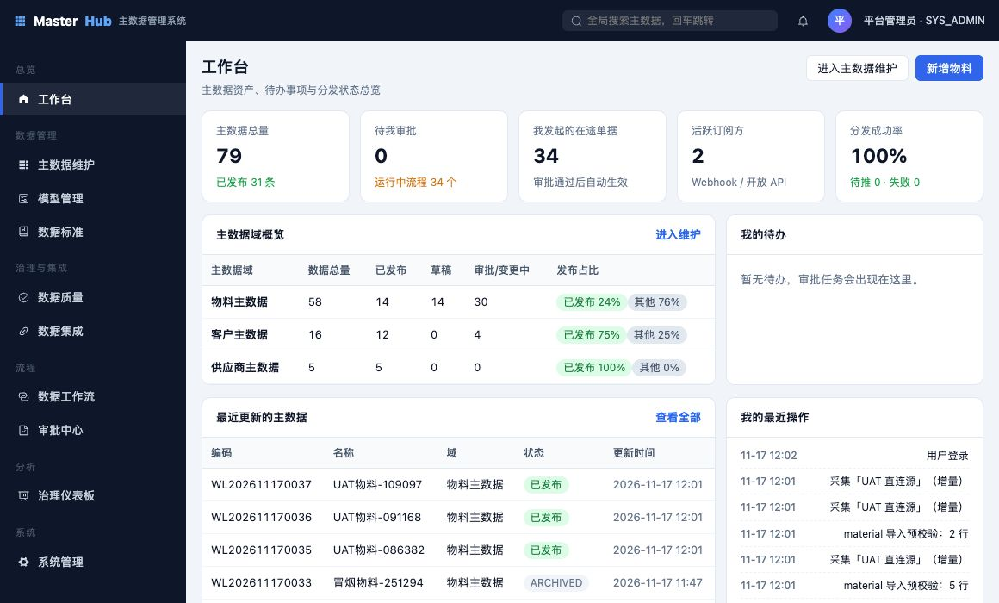
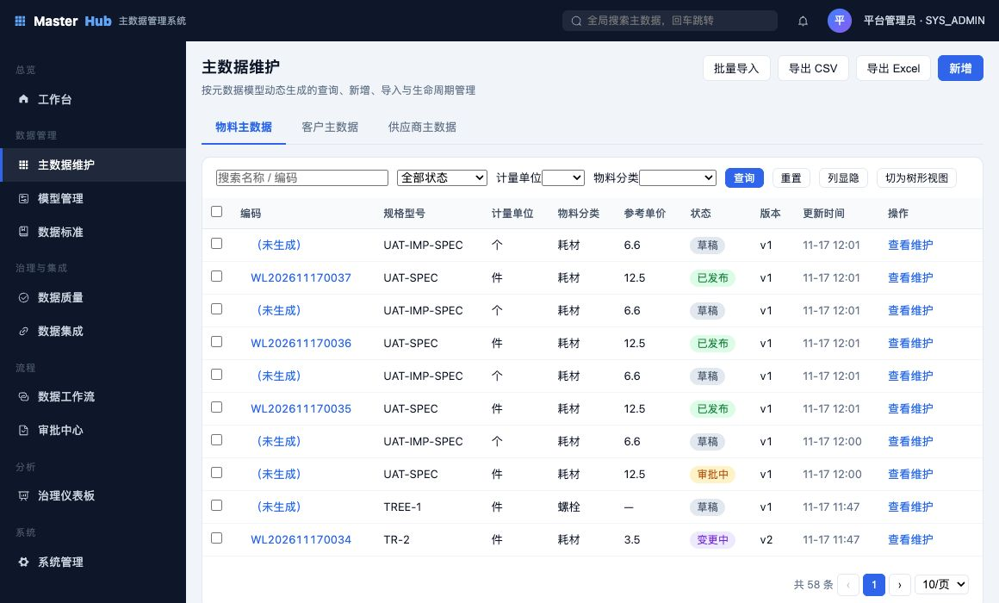
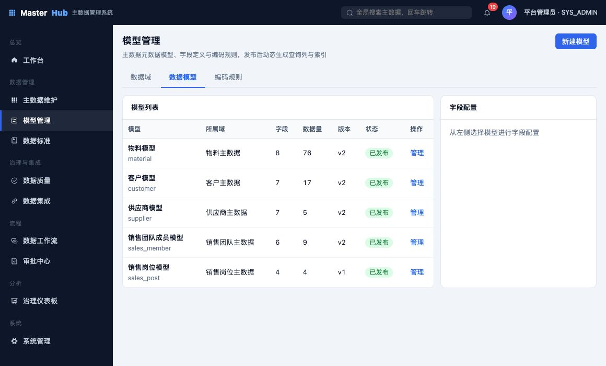

# MasterHub 主数据管理系统

MasterHub 是一套可完整运行的主数据管理（MDM）系统，覆盖「建模 → 录入 → 审批 → 发布 → 分发 → 治理」全链路。系统内置 5 个演示数据域（物料、客户、供应商、销售岗位、销售团队），开箱即可体验从元数据配置到外部系统消费的完整流程。



## 核心能力

| 模块 | 主要能力 |
| --- | --- |
| 工作台 | 主数据总量、待我审批、在途单据、订阅方与分发成功率总览；域概览、我的待办、最近更新、最近操作 |
| 数据标准 | 统一维护码表与码值，支持树形层级码表（如销售职级），供枚举字段引用 |
| 模型管理 | 新建数据域、定义模型与字段、配置层级字段与编码规则、模型发布与版本管理 |
| 主数据维护 | 列表检索、分页、动态列显隐、树形视图、新增/维护、提交审批、冻结/解冻/归档、版本历史与回滚、查重与合并、CSV/Excel 导出、模板导入与预校验 |
| 审批中心 | 待我审批、抄送我的、审批实例、流程定义；支持通过、驳回、转办、加签与会签/或签节点 |
| 数据集成 | 订阅方管理、Outbox 事件分发（签名 + 重试 + 死信）、分发日志、源系统采集（API / 数据库直连 / 文件，支持时间戳增量） |
| 数据质量 | 五维质量评估、5 类校验规则、定期巡检任务、问题清单与整改闭环、巡检记录 |
| 数据工作流 | 13 类处理节点可视化编排（读取、筛选、公式、去重、聚合、关联、码值转换、输出等），支持草稿/发布/运行 |
| 治理仪表板 | 主数据规模、质量评分、审批耗时、分发与工作流成功率，含新增趋势与质量五维雷达图 |
| 系统管理 | 用户、角色权限、任务调度、参数配置、审计日志 |




## 技术架构

| 层次 | 技术选型 |
| --- | --- |
| 前端 | Vue 3 + Vite 6 + TypeScript + Element Plus + Pinia + Vue Router |
| 后端 | NestJS 11 + TypeScript，13 个业务模块 |
| 存储 | SQLite（better-sqlite3，WAL 模式），单文件 `server/data/masterhub.db` |
| 鉴权 | JWT + RBAC，权限 key 控制菜单、按钮与数据域可见范围 |
| 集成 | 开放 REST API 增量拉取 + Outbox Webhook 事件推送（HMAC-SHA256 签名） |
| 测试 | Node ESM 编写的 UAT 接口与 UI 自动化脚本 |

请求链路：`Vue 页面 → /api/v1/* → NestJS 控制器 → 业务服务 → SQLite`；对外供数走 `GET /open/v1/master/:domain` 或多订阅方 Webhook 推送。

## 目录结构

```
MASTERHUB/
├─ server/                 NestJS 服务端
│  ├─ src/modules/         业务模块（auth/metadata/master/approval/integration/
│  │                       collect/import/quality/workflow/stats/schedule/system…）
│  └─ data/                SQLite 数据库文件
├─ web/                    Vue3 前端
│  └─ src/views/           15 个页面（工作台、主数据、模型、审批、集成、质量…）
├─ docs/
│  ├─ FAQ/                 操作教程与外部接入 FAQ（含截图）
│  └─ images/guide/        README 与用户手册配图
├─ TEST/UAT/               UAT 用例、自动化脚本、结果与测试报告
├─ 主数据管理系统功能设计.md
└─ 主数据管理系统技术方案.md
```

## 快速开始

环境要求：Node.js ≥ 18、npm。

```bash
# 1. 启动后端（默认 http://localhost:3000）
cd server
npm install
npm run build
npm start

# 2. 另开终端启动前端（默认 http://localhost:5173）
cd web
npm install
npm run dev
```

浏览器打开 <http://localhost:5173>，使用下方账号登录。

首次启动会自动建表并写入演示数据（5 个数据域、5 个模型、码表、审批流程定义与 4 个账号）。如需重置环境，停止服务后删除 `server/data/masterhub.db` 再启动即可。

### 演示账号

| 账号 | 密码 | 姓名 | 角色 | 典型用途 |
| --- | --- | --- | --- | --- |
| admin | admin123 | 平台管理员 | 系统管理员 | 建模、码表、权限、全部功能 |
| steward | steward123 | 林治理 | 数据治理岗 | 审批复审、质量巡检、集成配置 |
| leader | leader123 | 周主管 | 部门主管 | 审批初审 |
| buyer | buyer123 | 陈采购 | 业务专员 | 主数据录入与提交 |

## 内置数据域

| 域编码 | 名称 | 说明 |
| --- | --- | --- |
| material | 物料主数据 | 物料名称、规格、计量单位、分类、价格 |
| customer | 客户主数据 | 客户基础信息与等级 |
| supplier | 供应商主数据 | 供应商信息与准入状态 |
| sales_post | 销售岗位主数据 | 岗位序列、编制人数、岗位职责 |
| sales_team | 销售团队主数据 | 层级模型，`parentMember` 指向直属上级，`post` 引用岗位编码 |

销售岗位与销售团队的完整维护流程（岗位先行、人员后录、调整汇报线）见 [销售团队数据维护教程](docs/FAQ/销售团队数据维护教程.md)。

## 开放接口

增量拉取（免登录，仅返回已发布数据，每页最多 50 条）：

```
GET /open/v1/master/{domain}?cursor={lastId}
```

```json
{
  "code": 0,
  "msg": "ok",
  "data": {
    "domain": "sales_team",
    "list": [
      { "id": 94, "masterCode": "XS0001", "name": "张万峰", "version": 2,
        "updatedAt": "2026-11-17T21:30:33",
        "data": { "memberName": "张万峰", "region": "EAST", "parentMember": null,
                  "post": "POST001", "entryDate": "2020-03-16", "active": true } }
    ],
    "nextCursor": "94"
  },
  "traceId": "9a31c0f4-2ab"
}
```

事件推送：在「数据集成 → 订阅方」配置回调地址，主数据发布/变更/冻结/解冻/归档时由后台分发，请求头携带 `X-MH-EVENT` 与 `X-MH-SIGNATURE`（`HMAC-SHA256(secret, body)`），失败自动退避重试并进入死信可人工重试。四种接入方式的对比与操作步骤详见 [外部系统如何获取数据](docs/FAQ/外部系统如何获取数据.md)。

## API 调用示例

所有业务接口以 `/api/v1` 开头，响应统一包装为 `{ code, msg, data, traceId }`，`code = 0` 表示成功；除登录与 `/open/v1` 外均需携带 `Authorization: Bearer <token>`。以下示例以 `sales_team`（销售团队）域演示。

### 1. 登录获取 Token

```bash
curl -s -X POST http://localhost:3000/api/v1/auth/login \
  -H 'Content-Type: application/json' \
  -d '{"username":"admin","password":"admin123"}'
```

```json
{
  "code": 0,
  "msg": "ok",
  "data": {
    "token": "eyJhbGciOiJIUzI1NiIsInR5cCI6IkpXVCJ9...",
    "user": {
      "id": 1, "username": "admin", "displayName": "平台管理员",
      "dept": "信息中心", "roles": ["SYS_ADMIN"], "roleNames": ["系统管理员"],
      "perms": ["master.view", "master.create", "..."], "domains": ["material", "..."],
      "fieldMasks": {}
    }
  },
  "traceId": "b2f1c8a0-9d1"
}
```

令牌有效期由全局参数 `session.timeoutHours` 控制（默认 8 小时），过期后可调用 `POST /api/v1/auth/refresh`（body 为 `{"token":"<旧 token>"}`）换新。

### 2. 查询主数据列表

```bash
TOKEN='粘贴登录接口返回的 data.token'
curl -s "http://localhost:3000/api/v1/master-data/sales_team?page=1&size=10&status=PUBLISHED" \
  -H "Authorization: Bearer $TOKEN"
```

支持 `keyword`（名称/编码模糊）、`status`、`page`、`size` 以及模型上标记为「可查询」的字段名（如 `region=EAST`）。响应中的 `data` 结构：

```json
{
  "list": [
    {
      "id": 96, "domain_code": "sales_team", "master_code": "XS0003",
      "name": "王丽华", "status": "PUBLISHED", "status_label": "已发布",
      "version": 3, "data": { "memberName": "王丽华", "region": "SOUTH", "post": "POST002" },
      "created_at": "2026-11-17T21:30:33", "updated_at": "2026-11-17T22:19:37"
    }
  ],
  "total": 9, "page": 1, "size": 10,
  "model": { "id": 5, "name": "销售团队成员模型", "nameKey": "memberName", "parentField": "parentMember" },
  "fields": [{ "key": "memberName", "label": "姓名", "type": "TEXT", "required": true }],
  "statusCounts": { "PUBLISHED": 9 }
}
```

### 3. 新增并提交审批

`submit: true` 表示保存后立即提交；不传则仅保存草稿。引用字段（`post`、`parentMember`）填被引用记录的主数据编码。

```bash
curl -s -X POST http://localhost:3000/api/v1/master-data/sales_team \
  -H "Authorization: Bearer $TOKEN" \
  -H 'Content-Type: application/json' \
  -d '{
    "data": {
      "memberName": "赵新",
      "region": "EAST",
      "parentMember": "XS0005",
      "post": "POST004",
      "entryDate": "2026-11-17",
      "active": true
    },
    "submit": true
  }'
```

保存成功返回记录详情，`data.status` 为 `PENDING`（审批中），编码在审批通过后生成。

### 4. 处理审批

```bash
# LEADER_TOKEN / STEWARD_TOKEN 分别为 leader、steward 账号登录后得到的 token
LEADER_TOKEN='粘贴 leader 账号的 data.token'

# 查看当前用户的待办
curl -s http://localhost:3000/api/v1/approvals/todo \
  -H "Authorization: Bearer $LEADER_TOKEN"

# 按待办里的 instance_id 审批通过（驳回用 /reject）
curl -s -X POST http://localhost:3000/api/v1/approvals/123/pass \
  -H "Authorization: Bearer $LEADER_TOKEN" \
  -H 'Content-Type: application/json' \
  -d '{"comment":"资料齐全，同意"}'
```

审批权限为 `approval.handle`。两级流程需依次由部门主管、数据治理岗处理；全部通过后主数据状态变为 `PUBLISHED` 并触发分发事件。

### 5. 开放接口分页拉取（Node.js）

`/open/v1` 免鉴权，仅返回已发布数据。空页时 `nextCursor` 不再前进，可作为终止条件：

```js
const BASE = 'http://localhost:3000';

async function* pullAll(domain) {
  let cursor = '0';
  for (;;) {
    const res = await fetch(`${BASE}/open/v1/master/${domain}?cursor=${cursor}`);
    const body = await res.json();
    if (body.code !== 0) throw new Error(`${body.code}: ${body.msg}`);

    const { list, nextCursor } = body.data;
    if (!list.length) return;          // 空页 = 拉取结束
    yield* list;
    cursor = nextCursor;
  }
}

const posts = new Map();
for await (const post of pullAll('sales_post')) posts.set(post.masterCode, post);

for await (const member of pullAll('sales_team')) {
  const post = posts.get(member.data.post);   // 用编码 join 岗位
  console.log(member.masterCode, member.name, post?.name, post?.data.postSeq);
}
```

### 6. Webhook 验签（Node.js / Express）

```js
import express from 'express';
import { createHmac, timingSafeEqual } from 'node:crypto';

const app = express();
const SECRET = process.env.MH_SECRET;   // 与订阅方配置的 secret 一致

// 必须用原始请求体计算签名，不能先用 express.json() 解析后重新序列化
app.post('/hooks/masterhub', express.raw({ type: 'application/json' }), (req, res) => {
  const expected = createHmac('sha256', SECRET).update(req.body).digest('hex');
  const actual = String(req.headers['x-mh-signature'] || '');
  const ok = expected.length === actual.length &&
    timingSafeEqual(Buffer.from(expected), Buffer.from(actual));
  if (!ok) return res.status(401).send('invalid signature');

  const event = JSON.parse(req.body.toString('utf8'));
  // event: { eventNo, eventType, domain, masterCode, occurredAt, data }
  console.log(req.headers['x-mh-event'], event.eventType, event.domain, event.masterCode, event.data.version);
  res.json({ received: true, eventNo: event.eventNo });
});

app.listen(4000);
```

本地联调时可将订阅方地址指向内置模拟器 `POST /api/v1/integration/mock-webhook`，再用 `POST /api/v1/integration/dispatch` 手动触发分发，无需自建回调服务。

### 7. 常用接口速查

| 方法 | 路径 | 说明 | 权限 |
| --- | --- | --- | --- |
| POST | `/api/v1/auth/login` | 登录获取 token | 公开 |
| POST | `/api/v1/auth/refresh` | 刷新 token | 公开 |
| GET | `/api/v1/domains` | 当前用户可见的数据域 | 登录 |
| GET | `/api/v1/models` | 模型与字段定义 | `model.view` |
| GET | `/api/v1/master-data/{domain}` | 主数据列表（分页/筛选） | `master.view` |
| POST | `/api/v1/master-data/{domain}` | 新增（可带 `submit`） | `master.create` |
| GET | `/api/v1/master-data/{domain}/{key}` | 详情（key 为编码或 id） | `master.view` |
| PUT | `/api/v1/master-data/{domain}/{key}` | 维护（走变更审批） | `master.edit` |
| POST | `/api/v1/master-data/{domain}/{key}/submit` | 提交审批 | `master.submit` |
| GET | `/api/v1/master-data/{domain}/{key}/versions` | 版本历史 | `master.view` |
| POST | `/api/v1/master-data/{domain}/batch-lifecycle` | 批量冻结/解冻/归档 | `master.lifecycle` |
| GET | `/api/v1/approvals/todo` | 我的审批待办 | `approval.view` |
| POST | `/api/v1/approvals/{id}/pass` | 审批通过 | `approval.handle` |
| GET | `/api/v1/integration/push-events` | 分发事件列表 | `integration.view` |
| POST | `/api/v1/integration/subscribers` | 新增/编辑订阅方 | `integration.manage` |
| POST | `/api/v1/integration/dispatch` | 手动触发分发 | `integration.manage` |
| GET | `/open/v1/master/{domain}?cursor=0` | 开放接口增量拉取 | 公开 |

## 测试与验收

`TEST/UAT/` 包含完整的验收资产：

- [uat-testcases.md](TEST/UAT/uat-testcases.md)：51 条测试用例（认证、元数据、主数据、导入导出、审批、集成、采集、质量、工作流、系统）
- `scripts/`：接口自动化、UI 自动化与造数脚本（如 `node TEST/UAT/scripts/uat-api.mjs`）
- `results/`、[uat-report.md](TEST/UAT/uat-report.md)：执行结果与测试报告（含关键步骤截图）
- `screenshots/`：验收截图

## 文档索引

- [USERGUIDE.md](USERGUIDE.md)：面向业务用户的操作手册
- [销售团队数据维护教程](docs/FAQ/销售团队数据维护教程.md)：岗位与人员分层维护的完整实操
- [外部系统如何获取数据](docs/FAQ/外部系统如何获取数据.md)：拉取、推送、导出、直连四种接入方式
- [主数据管理系统功能设计.md](主数据管理系统功能设计.md)：功能范围与业务规则
- [主数据管理系统技术方案.md](主数据管理系统技术方案.md)：架构、数据模型与模块设计

## 说明

- 前端基于 `createWebHistory`，开发环境由 Vite 代理后端接口；部署到 Nginx 时需配置 history 回退与 `/api`、`/open` 反向代理。
- 当前存储层为 SQLite，适合单机部署与演示；面向高并发生产场景时，替换为 MySQL/PostgreSQL 并调整数据访问层即可，业务层接口无需变化。
- 开放接口当前为最小实现（免鉴权、未限流），生产接入建议在网关层增加 API Key、白名单与限流。
