# MasterHub 主数据管理系统 — UAT 测试报告

| 项目 | 内容 |
|---|---|
| 报告日期 | 2026-11-17 |
| 测试版本 | MasterHub v1.0（里程碑 M1-M9 全量功能） |
| 测试类型 | UAT（用户验收测试） |
| 测试环境 | 后端 http://localhost:3000（NestJS 11 + SQLite WAL），前端 http://localhost:5173（Vue3 + Element Plus） |
| 执行方式 | API 自动化（`scripts/uat-api.mjs`，40 用例）+ 浏览器走查（11 用例，14 张截图存证） |
| 用例依据 | [uat-testcases.md](./uat-testcases.md)（共 51 个用例） |

---

## 1. 总体结论

> **全部 51 个 UAT 用例通过（PASS 51 / FAIL 0 / BLOCKED 0），系统具备验收条件。**

| 维度 | 用例数 | 通过 | 失败 | 通过率 |
|---|---|---|---|---|
| API 自动化 | 40 | 40 | 0 | 100% |
| 浏览器走查 | 11 | 11 | 0 | 100% |
| **合计** | **51** | **51** | **0** | **100%** |

覆盖 M1-M9 全部里程碑：认证权限、元数据（含树形码表）、主数据全生命周期、导入导出、审批（含抄送）、工作流（含 JOIN/UNION 等扩展算子）、数据质量、任务调度、数据采集（数据库直连 + 时间戳增量）、分发通知与统计审计。

## 2. API 自动化测试结果（40/40 PASS）

原始结果：[results/uat-api-results.json](./results/uat-api-results.json)

### 2.1 模块汇总

| 模块 | 用例数 | 结果 | 典型验证点 |
|---|---|---|---|
| 认证与权限 AUTH | 5 | 全通过 | 有效/无效登录、me 接口、401 拦截、双角色登录 |
| 元数据 META | 3 | 全通过 | 3 个数据域、物料模型（nameKey=materialName）、13 个码表 |
| 主数据维护 MD | 7 | 全通过 | 分页、草稿→提交→两级审批（leader 初审 + steward 复审）→发布、版本历史、批量冻结/解冻、CSV 导出 |
| 导入导出 IMP | 4 | 全通过 | 模板表头、预校验（合法 1 行 + 非法 1 行精确识别）、提交入库、批次列表 |
| 审批流程 APR | 3 | 全通过 | 11 个流程定义、steward 待办 13 条、发起含抄送审批 |
| 工作流 WF | 2 | 全通过 | 13 项算子元数据、WF-MAT-CLEAN 运行成功（历史 56+ 次） |
| 数据质量 QA | 3 | 全通过 | 总览评分 94.6、全域巡检（95 项检查 / 6 问题 / 评分 93.7）、OPEN 问题清单 |
| 任务调度 SCH | 2 | 全通过 | 4 个调度任务（cron/下次执行时间）、手动执行与运行历史 |
| 数据采集 COL | 6 | 全通过 | DB 直连源创建、首次采集 5 行、**增量仅拉取 2 行（水位推进）**、无增量返回 skipped、留痕查询 |
| 分发/通知/统计 INT·NTF·ST | 5 | 全通过 | Outbox 事件 170 条、通知已读归零、仪表板指标、审计日志 980+ 条 |

### 2.2 采集通道扩展（M7 重点验证）

| 用例 | 结果 | 证据 |
|---|---|---|
| UAT-COL-03 首次采集 | PASS | total=5，mode=INCR，水位=2026-01-05 08:00:00 |
| UAT-COL-04 增量采集 | PASS | 源库新增 2 行后仅拉取 2 行，水位推进到 2026-07-02 10:00:00 |
| UAT-COL-05 无增量 | PASS | skipped=true，total=0，不生成批次 |
| UAT-COL-06 执行留痕 | PASS | collect/logs 返回 14 条记录，含模式/拉取数/水位/结果 |

## 3. 浏览器走查结果（11/11 PASS，关键步骤截图）

### 3.1 登录与工作台（UAT-BR-01）

**步骤**：打开 http://localhost:5173 → 使用 admin/admin123 登录 → 进入工作台。
**结果**：PASS。工作台展示主数据总量 79、在途单据、分发成功率 100% 与主数据域概览。

| 登录页 | 工作台 |
|---|---|
|  | 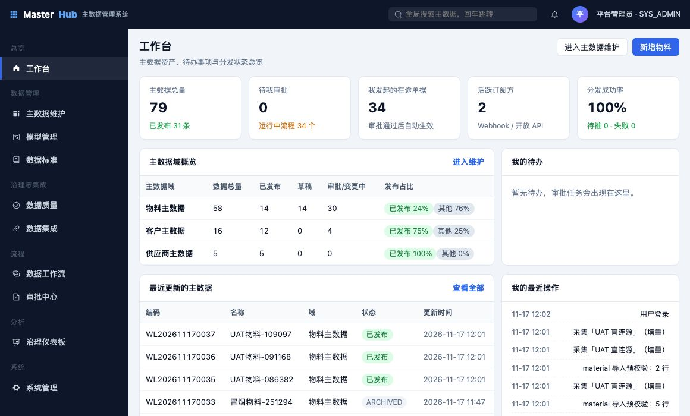 |

### 3.2 主数据列表与列显隐（UAT-BR-03）

**步骤**：进入主数据维护（物料）→ 点击「列显隐」→ 查看字段复选框弹层。
**结果**：PASS。列表 58 条记录正常渲染；弹层展示 7 个动态字段复选框与「恢复默认（前 5 列）」按钮，取消勾选后列即时消失（M9 功能）。

| 主数据列表 | 列显隐配置弹层 |
|---|---|
|  | 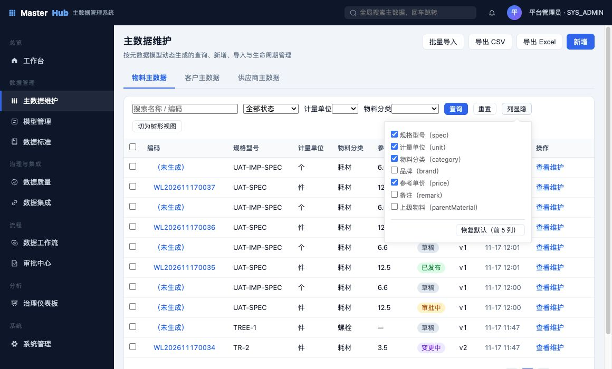 |

### 3.3 批量导入对话框（UAT-BR-04）

**步骤**：点击「批量导入」→ 查看三步流程（上传数据 → 预校验 → 提交入库）。
**结果**：PASS。「下载 CSV 模板」「下载 Excel 模板」「选择文件（CSV / Excel）」按钮齐全（M9 功能）。

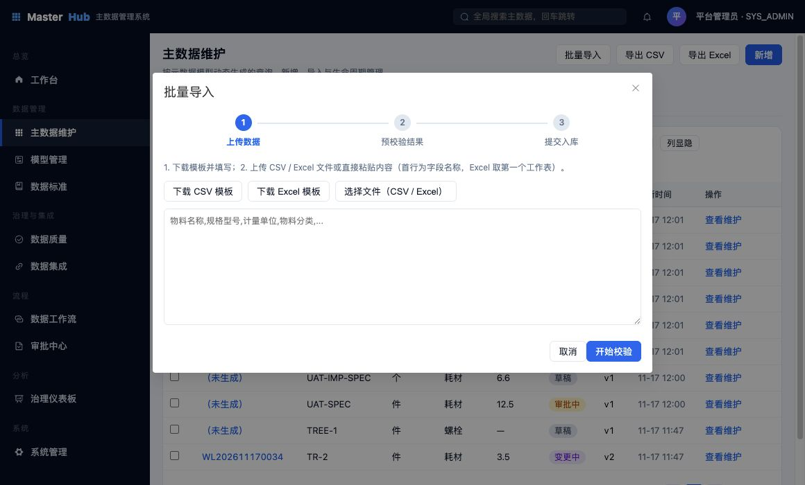

### 3.4 审批中心（UAT-BR-05）

**步骤**：打开审批中心 → 查看待办/抄送我的/审批实例/流程定义。
**结果**：PASS。四个标签页正常渲染，抄送我的 4 条（M6 抄送功能），表格含实例/域/动作/当前节点/操作列。

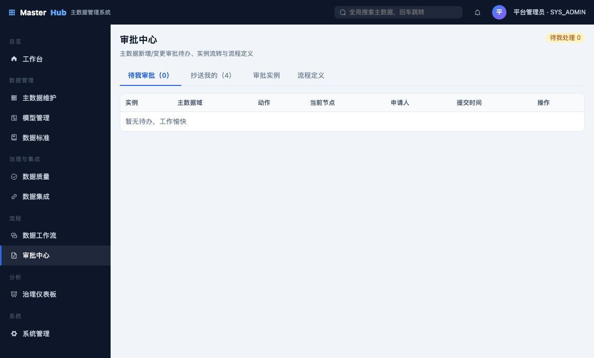

### 3.5 工作流设计器（UAT-BR-06）

**步骤**：打开数据工作流 → 打开定义的画布视图。
**结果**：PASS。左侧算子工具箱 11 类算子（读取主数据/字段选择/条件过滤/公式计算/去重/排序/分组聚合/数据关联 JOIN/并集合 UNION/码值映射/标准化），画布 10 个节点正常渲染（M7 扩展算子可见）。

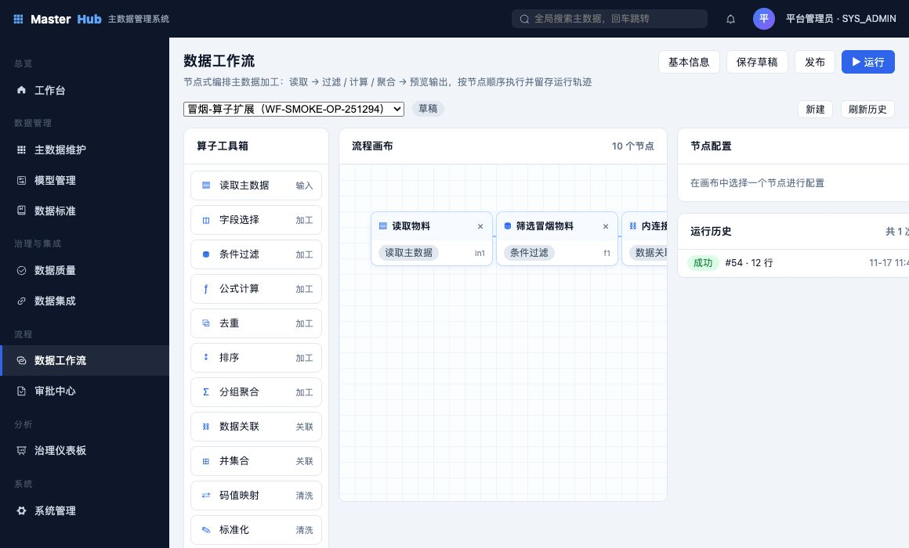

### 3.6 数据采集（UAT-BR-09 / UAT-BR-10）

**步骤**：数据集成 → 数据采集 tab → 查看源列表与「采集记录」表 → 新增采集源（DB 通道 + 增量）。
**结果**：PASS。18 个采集源（含 SRC-DB-* 数据库直连 + 增量标签）；采集记录表 10 行，含增量/全量模式标签、增量水位列（2026-07-02 10:00:00 等）、完成/无增量结果标签；对话框在 DB 通道下正确出现数据库文件路径/表名/时间戳字段输入框（M7 功能）。

| 采集源列表 | 采集记录表（含增量水位） |
|---|---|
| 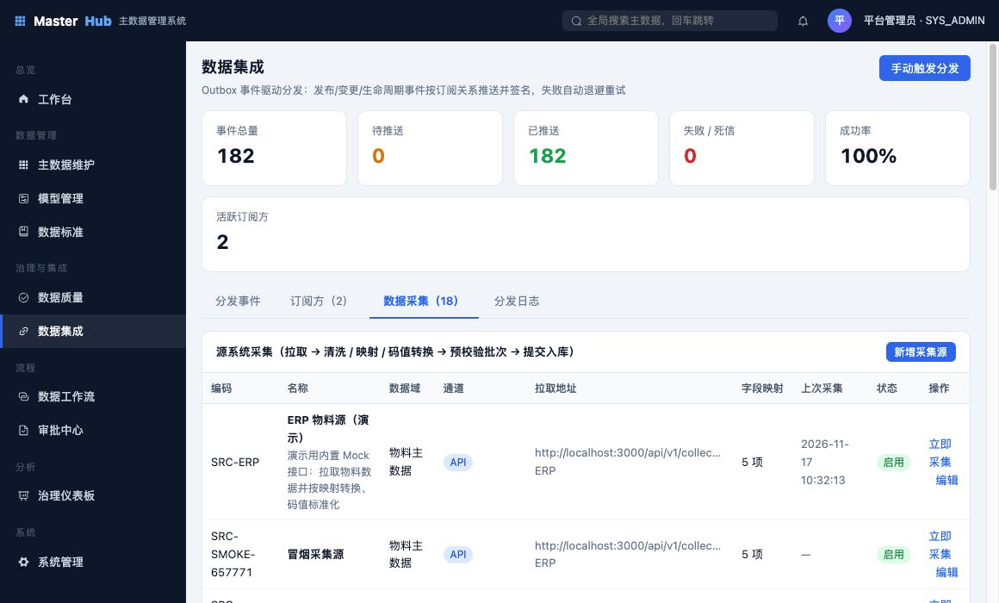 | 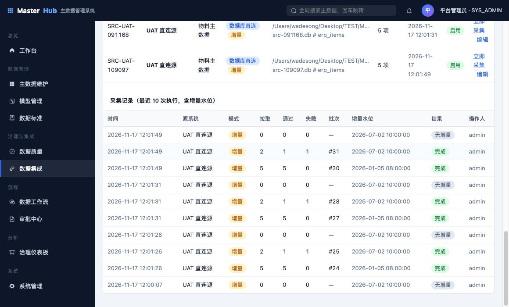 |

| 直连源配置对话框（DB + 增量） |
|---|
| 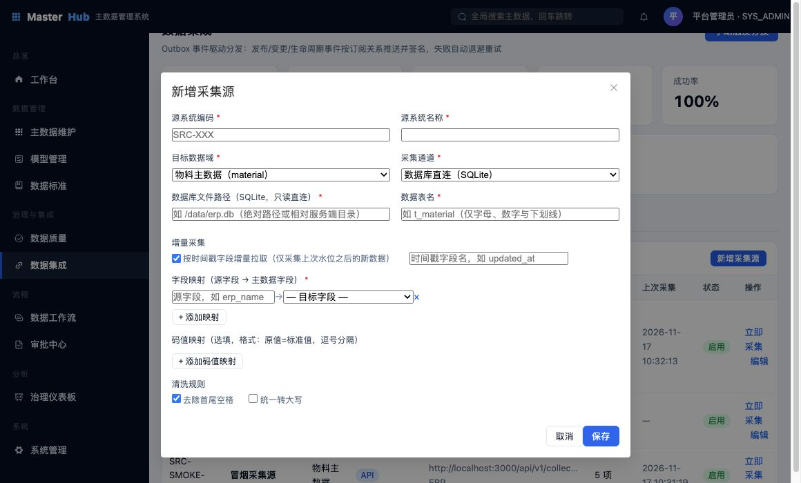 |

### 3.7 数据质量（UAT-BR-07）

**步骤**：打开数据质量页 → 查看概览。
**结果**：PASS。综合评分 94.4，五维评分（完整性 100 / 唯一性 100 / 合法性 89.5 / 一致性 100 / 及时性 100），评分趋势图与 80 条待整改问题清单正常渲染。

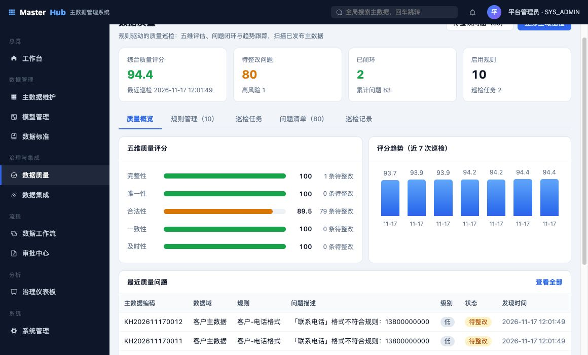

### 3.8 任务调度（UAT-BR-08）

**步骤**：打开任务调度中心 → 查看任务列表。
**结果**：PASS。4 个任务（每日质量巡检/供应商证照周检/物料清洗工作流/分发补偿轮询）展示 cron 表达式、下次执行时间、启停/立即执行/运行记录按钮。

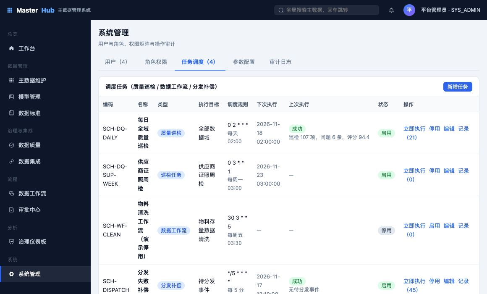

### 3.9 元数据与树形码表（UAT-BR-02）

**步骤**：打开数据标准（码表管理）→ 维护「物料分类」。
**结果**：PASS。树形码表正确展示层级：紧固件 FASTENER > 螺栓 BOLT（六角螺栓/内六角螺栓）、螺母、垫圈等，每条码值含状态标签与上级/排序字段（M5 功能）。

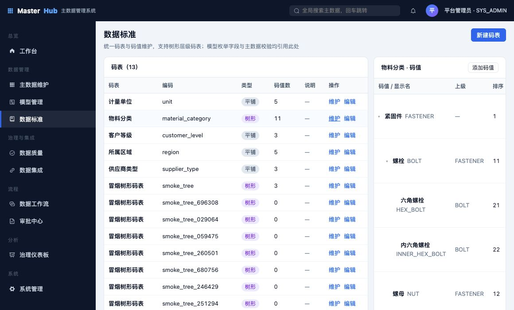

### 3.10 统计仪表板（UAT-BR-11）

**步骤**：打开治理仪表板。
**结果**：PASS。KPI 卡片（主数据总量 79、已发布 31、质量评分 94.4、分发成功率 100%）、新增趋势柱状图、质量五维雷达图、审批效率图正常渲染。

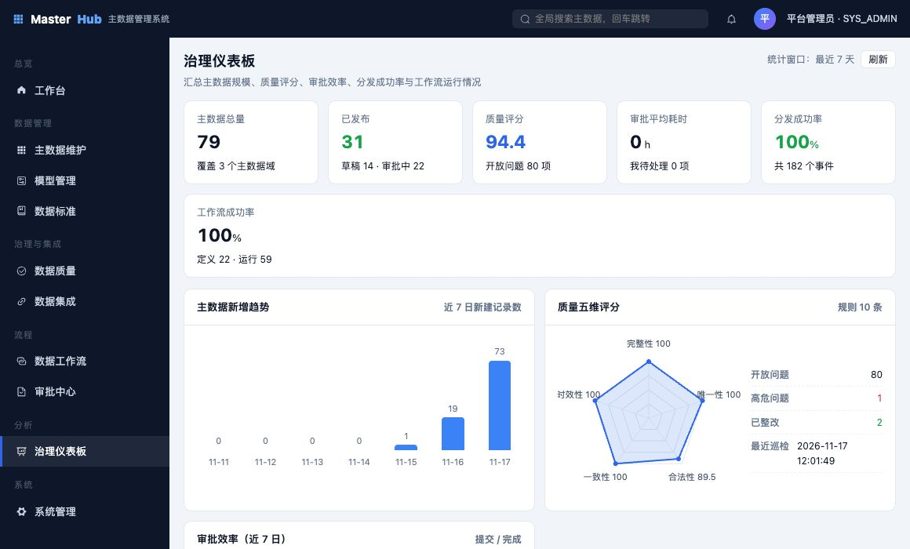

## 4. 过程记录与观察项

首轮 API 执行发现 3 个 FAIL，经定位均为**测试脚本假设问题，非产品缺陷**，修正后全绿：

1. **UAT-MD-04**：脚本假设物料新增审批顺序为 steward→leader，实际流程定义为 leader（DEPT_LEADER 部门初审）→ steward（DATA_STEWARD 复审）。已改为按待办自适应多轮审批。✔ 无需修改产品。
2. **UAT-MD-05**：版本历史接口返回 `{record, list}` 结构，脚本按数组断言。已修正断言。✔ 无需修改产品。
3. **UAT-MD-06**：级联失败（审批未完成时冻结不生效属预期业务约束——仅 PUBLISHED 记录可冻结）。审批修复后通过。✔ 产品行为正确。

**产品观察（非缺陷）**：
- 主数据列表存在多条历史冒烟/UAT 测试数据（如「冒烟物料-xxx」），验收演示前可按需归档清理；
- 审批中心「待我审批」对 admin 为 0 条属正常（admin 非审批节点处理人）。

## 5. 测试资产清单

| 文件 | 说明 |
|---|---|
| [uat-testcases.md](./uat-testcases.md) | 51 个 UAT 用例定义（含步骤/预期/优先级） |
| [scripts/uat-api.mjs](./scripts/uat-api.mjs) | API 自动化测试脚本（40 用例，可重复执行） |
| [results/uat-api-results.json](./results/uat-api-results.json) | API 执行明细（用例/状态/耗时/证据） |
| [screenshots/](./screenshots/) | 浏览器走查关键步骤截图（14 张） |

**复测方式**：服务启动后在工作区根目录执行 `node TEST/UAT/scripts/uat-api.mjs`。

## 6. 验收结论

系统在认证权限、元数据管理、主数据全生命周期、导入导出、审批流（含抄送）、工作流引擎、数据质量、任务调度、数据采集（数据库直连 + 时间戳增量）、分发通知与统计审计共 10 个业务域的 **51 项 UAT 用例全部通过**，关键步骤均有截图存证，未发现阻塞性或严重缺陷。**建议：验收通过（UAT PASS）。**
