# MasterHub 用户手册

本手册面向业务用户与管理员，按「登录 → 看板 → 建模 → 录入 → 审批 → 分发 → 治理」的顺序介绍系统各模块的操作。文中截图均来自系统实际运行界面。

- 环境地址：前端 <http://localhost:5173>，后端接口 <http://localhost:3000>
- 登录账号由系统管理员开通；不同角色看到的菜单与按钮不同

---

## 1. 登录

打开系统进入登录页，输入账号密码后登录。登录态由 JWT 维护，令牌过期或失效会自动跳回登录页。


| 账号 | 角色 |
| --- | --- |
| admin | 系统管理员 |
| steward | 数据治理岗 |
| leader | 部门主管 |
| buyer | 业务专员 |

> 初始密码由系统管理员在部署时设置，如需演示账号请联系管理员获取，请勿在文档或代码中留存密码。

## 2. 界面导航

左侧菜单按权限过滤，共 6 组：

| 分组 | 菜单 | 权限 key |
| --- | --- | --- |
| 总览 | 工作台 | `workbench.view` |
| 数据管理 | 主数据维护 / 模型管理 / 数据标准 | `master.view` / `model.view` / `dict.view` |
| 治理与集成 | 数据质量 / 数据集成 | `quality.view` / `integration.view` |
| 流程 | 数据工作流 / 审批中心 | `workflow.view` / `approval.view` |
| 分析 | 治理仪表板 | `dashboard.view` |
| 系统 | 系统管理 | `system.view` |

没有对应权限的菜单不会显示；页面内的新增、导入、导出、生命周期等按钮同样按权限控制（如 `master.create`、`master.import`、`master.export`、`master.lifecycle`、`integration.manage`、`model.manage`）。

## 3. 工作台

登录后的首页，用于快速掌握资产与待办：

- 顶部指标：主数据总量、待我审批、在途单据、活跃订阅方、分发成功率、失败/待推送数量。
- 主数据域概览：每个域的记录数与发布情况。
- 我的待办：直接进入审批处理。
- 最近更新的主数据与最近操作记录：便于追溯谁在什么时候改了什么。

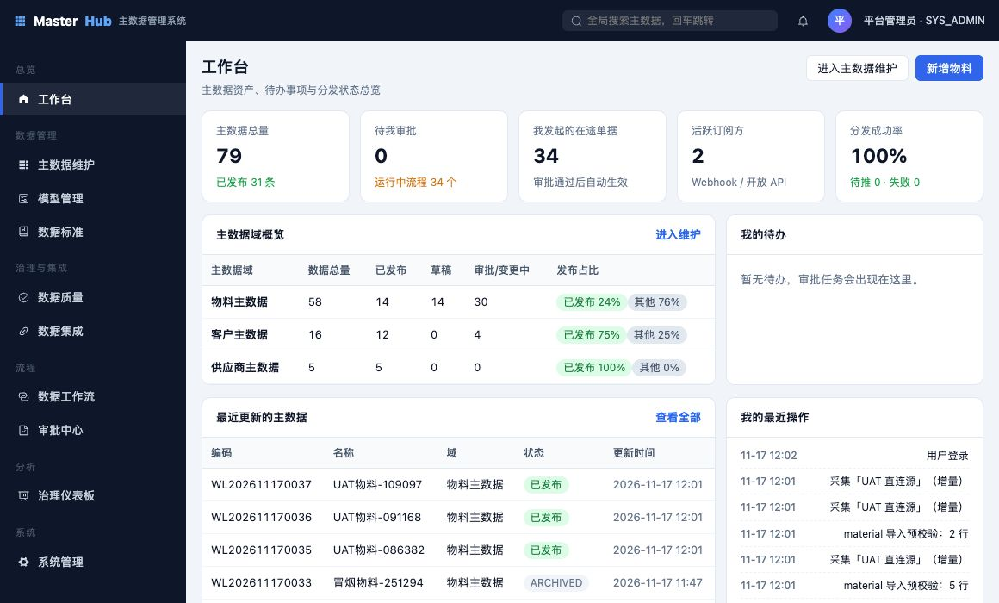

## 4. 数据标准（码表）

「数据标准」统一维护码表与码值，供模型中的枚举字段引用。左侧为码表列表，右侧为选中码表的码值。

- **新建码表**：填写码表编码（如 `unit`）、名称、说明，并选择是否为树形码表。
- **添加码值**：填写码值、显示名、上级码值（树形码表用）、排序与状态；停用的码值不再出现在录入下拉框中。
- **树形码表**：码值按层级缩进展示，可展开/折叠，适合职级、行政区划等分级标准。

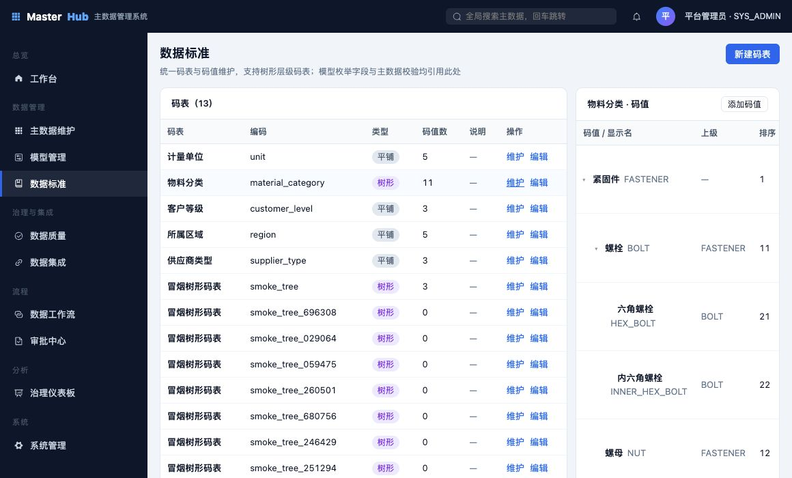

## 5. 模型管理

模型管理是系统的元数据入口，分三个页签：**数据域、数据模型、编码规则**。

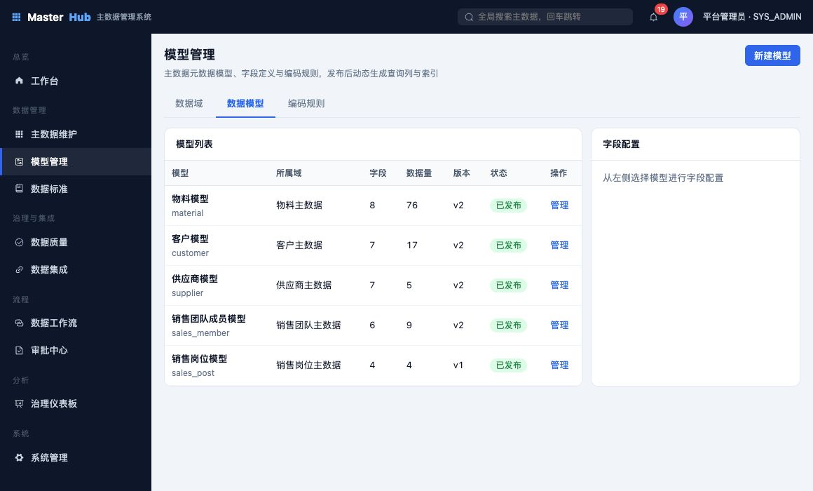

### 5.1 数据域

数据域是主数据的分类边界（一域一模型）。

1. 点击「新建数据域」，填写编码、名称、说明与负责人。
2. 编码规则：小写字母开头，只含小写字母、数字、下划线，2–31 位（如 `sales_post`）。
3. 新建后系统自动为「系统管理员」「数据治理岗」授予该域的数据权限，其他角色需在「系统管理 → 角色权限」中单独授权。

### 5.2 数据模型

1. 点击「新建模型」，选择所属数据域，填写模型编码、名称、名称字段（作为记录显示名）与说明。
2. 在右侧「字段配置」中逐个添加字段：

| 字段类型 | 适用场景 | 额外配置 |
| --- | --- | --- |
| 文本 TEXT | 名称、描述、编码类文本 | — |
| 数值 NUMBER | 人数、金额、库存 | — |
| 日期 DATE | 入职日期、生效日期 | — |
| 枚举 ENUM | 大区、分类、单位 | 必须绑定码表 |
| 引用 REF | 岗位、上级、供应商 | 必须选择被引用的数据域，值存对方主数据编码 |
| 布尔 BOOL | 是否在职、是否启用 | — |

3. 字段可设置「必填」「唯一」「排序」；唯一性由系统在保存与导入时校验。
4. **层级模型**：为模型指定一个层级字段（REF 类型，指向本域），即可获得树形视图与环检测保护。例如销售团队模型的层级字段为 `parentMember`。
5. **发布模型**：点击「发布」后系统校验字段与存量数据的兼容性、创建索引并递增模型版本。未发布的模型变更不会影响录入。

### 5.3 编码规则

主数据编码由编码引擎统一生成，规则由「段」拼装：

| 段类型 | 说明 | 示例 |
| --- | --- | --- |
| FIX 固定值 | 固定前缀 | `XS` |
| DATE 日期 | 按格式取日期 | `yyyyMMdd` |
| JOIN 连接符 | 段间分隔符 | `-` |
| SEQ 流水号 | 指定位数与重置周期（按日/按月/永久） | `XS0001` |

每个数据域必须有一条启用状态的编码规则，否则新增数据时会提示「未配置编码规则」。编码一经生成永久累加、不复用。

## 6. 主数据维护

顶部为数据域页签，切换即切换维护对象。列表支持搜索名称/编码、按状态筛选（草稿、审批中、变更中、已发布、已冻结、已归档）与分页。


### 6.1 列表操作

- **新增**：进入表单填写，可「保存草稿」，也可「保存并提交」直接进入审批。
- **列显隐**：字段较多时勾选需要展示的列，配置按数据域分别记忆，可一键恢复默认前 5 列。
- **批量操作**：勾选记录后批量冻结、解冻或归档。
- **导出**：按当前筛选条件导出 CSV 或 Excel。
- **批量导入**：见 6.4。

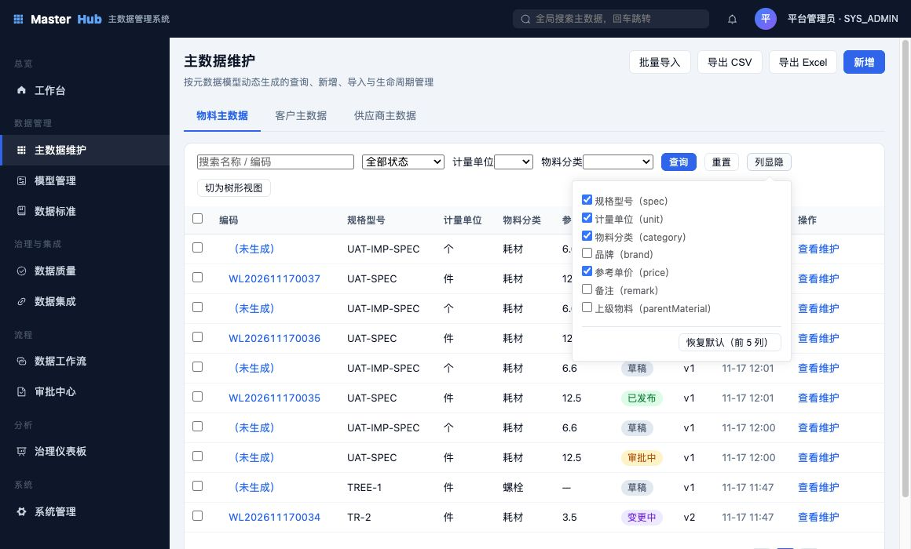

### 6.2 详情页

详情页包含「基本信息」「版本历史」「查重与合并」三个页签：

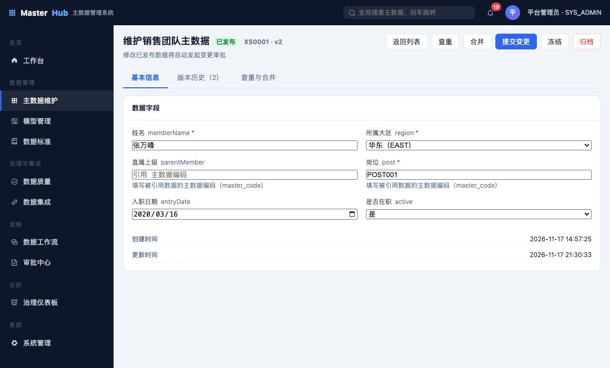

- **基本信息**：按模型字段渲染表单；引用字段填写被引用对象的主数据编码（如岗位填 `POST001`，直属上级填 `XS0001`），保存时校验被引用数据是否存在、层级是否成环。
- **生命周期**：已发布数据可冻结（不可编辑）、解冻、归档；归档后编码不再复用。
- **版本历史**：每次变更审批通过后版本 +1，可查看每个版本的字段差异并回滚。
- **查重与合并**：按唯一字段查找疑似重复记录，合并后重复记录归档，保留记录继承其引用关系。

### 6.3 数据状态

| 状态 | 含义 | 可执行操作 |
| --- | --- | --- |
| DRAFT 草稿 | 尚未提交 | 编辑、删除、提交审批 |
| PENDING 审批中 | 新增审批流转中 | 只读，等待审批 |
| CHANGING 变更中 | 变更审批流转中 | 只读，等待审批 |
| PUBLISHED 已发布 | 对外可用 | 维护（走变更审批）、冻结、归档 |
| FROZEN 已冻结 | 暂停使用 | 解冻、归档 |
| ARCHIVED 已归档 | 生命周期结束 | 只读，可在版本历史追溯 |

只有**已发布**的数据会出现在开放接口与事件推送中。

### 6.4 树形视图

层级模型（如销售团队）可切换到树形视图，按汇报关系展开/折叠，用于核对上下级是否正确。

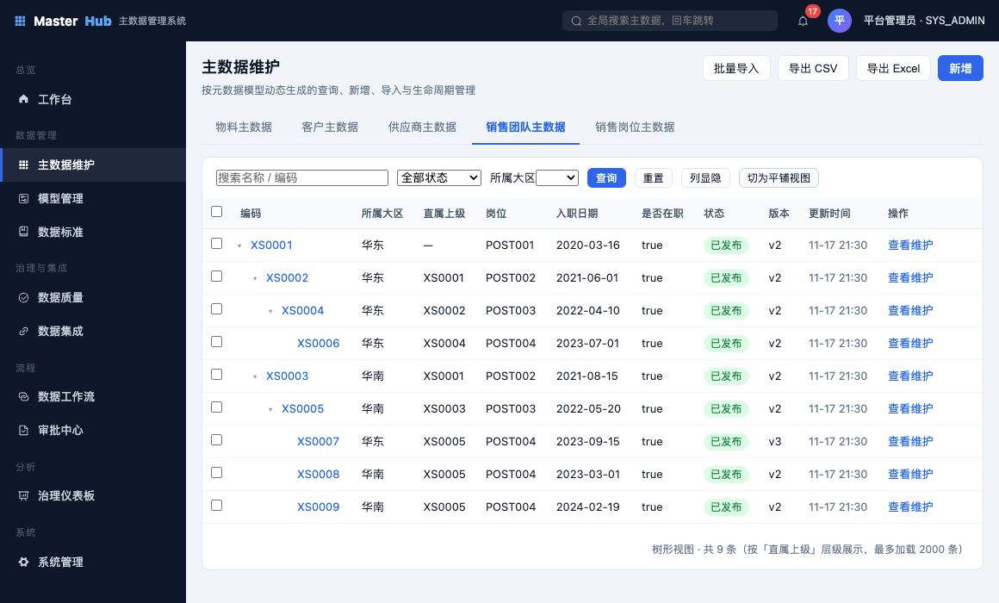

### 6.5 批量导入

1. 点击「批量导入」，先下载 CSV 或 Excel 模板。
2. 按模板填写数据（表头不可改），粘贴或上传后点「开始校验」。
3. 预校验会给出合法行数、非法行数及每行错误原因；修正后重新校验。
4. 校验通过后「提交入库」，导入批次与结果可在导入记录中查询。

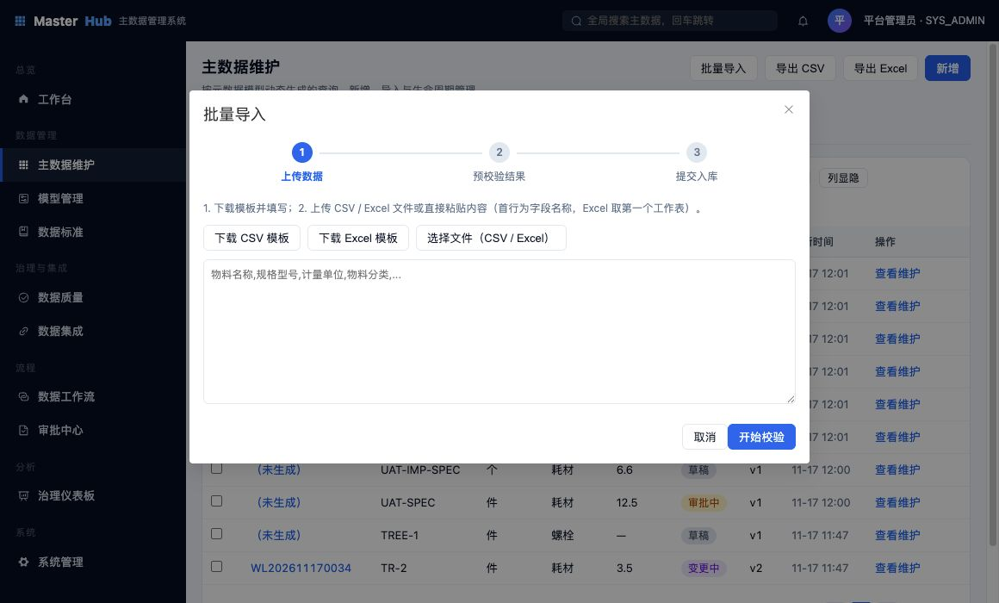

## 7. 审批中心

审批中心包含四个页签：

- **待我审批**：当前轮到我处理的单据，可打开处理弹窗执行「通过」「驳回」，或「转办」给他人、「加签」增加审批人。
- **抄送我的**：抄送给我的审批实例，可查看进度与详情。
- **审批实例**：按状态、申请人筛选历史实例，查看流程节点、审批意见与数据变更对照。
- **流程定义**：新增或编辑流程，配置适用数据域、动作（新增/变更）与审批节点（会签 AND / 或签 OR）、审批人。

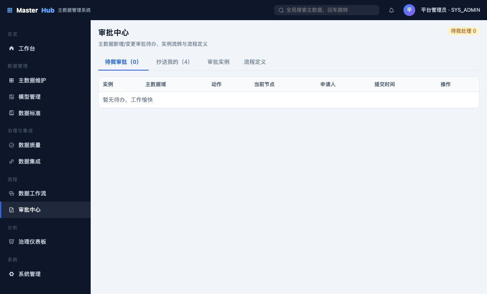

未配置专属流程的数据域会自动匹配通用流程（新增：部门主管初审 → 数据治理岗复审；变更：数据治理岗审批）。审批通过后主数据自动发布或使变更生效，版本 +1。

## 8. 数据集成

数据集成负责「主数据出去」和「外部数据进来」。

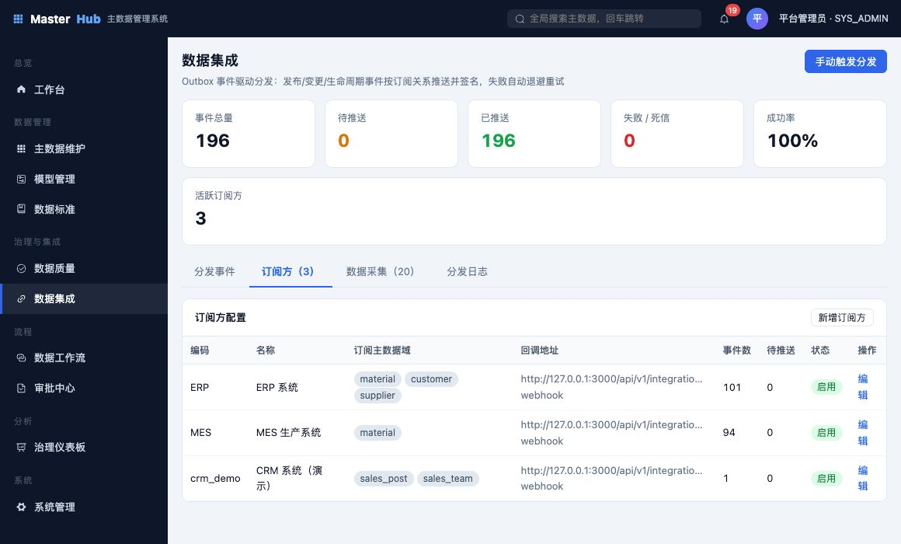

### 8.1 订阅方

配置接收变更事件的外部系统：

- 编码、名称、订阅的数据域（可多选）、回调地址（http/https）、签名密钥、启停状态。
- 密钥用于生成请求签名，务必妥善保管且不要与回调地址一同明文传输。

### 8.2 分发事件

主数据发布/变更/冻结/解冻/归档会生成事件，后台定时分发：

- 按事件号或主数据编码、状态、数据域筛选。
- 列表显示事件类型、订阅方、重试次数与状态（待推送 / 已推送 / 失败 / 死信）。
- 点「详情」查看完整 payload、订阅方与推送日志；失败事件可手动「重试」。
- 具备权限时可点「手动触发分发」，立即处理待推送事件。

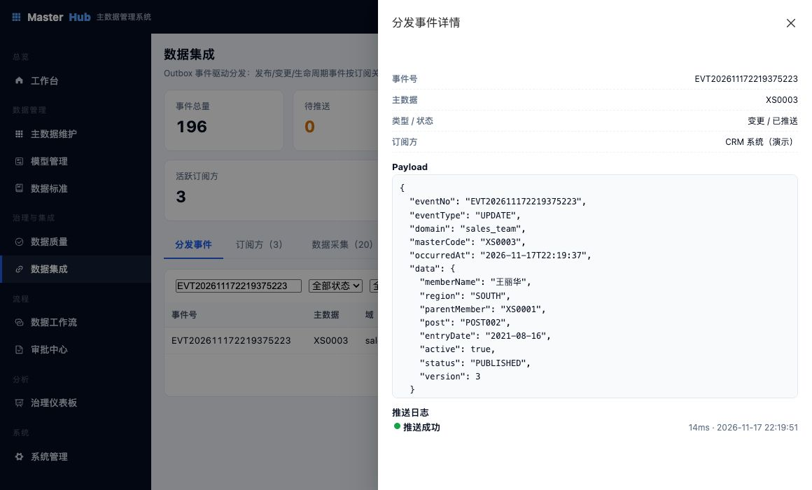

推送请求为 `POST`，请求头包含 `X-MH-EVENT`（事件号）与 `X-MH-SIGNATURE`（`HMAC-SHA256(secret, 请求体)` 的小写十六进制），下游验签后再入库。回调需保证幂等：同一事件可能被重复投递。

### 8.3 数据采集

从源系统把数据拉进 MasterHub：

- **通道**：API、数据库直连、文件。
- **字段映射**：源字段 → 目标字段；支持码值转换与清洗规则（去空格等）。
- **增量采集**：数据库直连可指定时间戳字段，系统记录水位，仅拉取新增/变更数据。
- **立即采集**：手动触发一次采集；采集结果先进预校验批次，再提交入库。

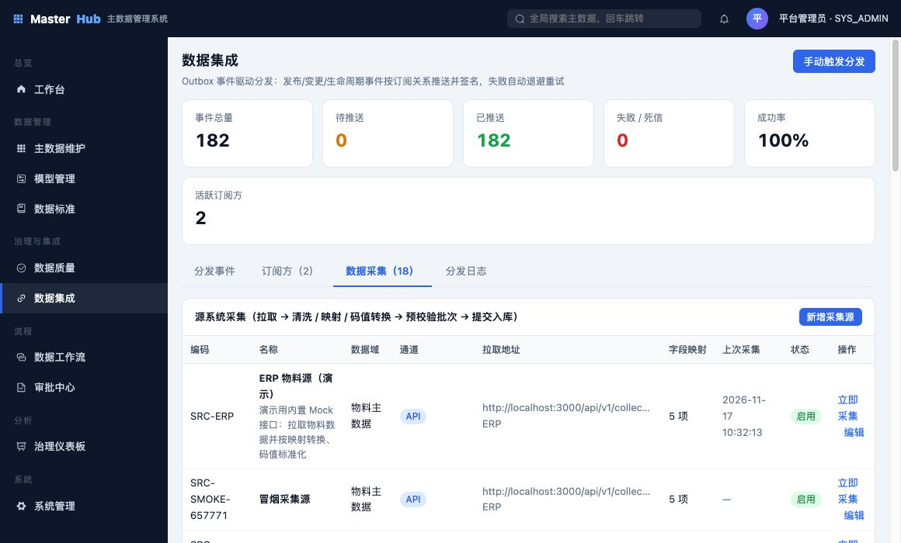
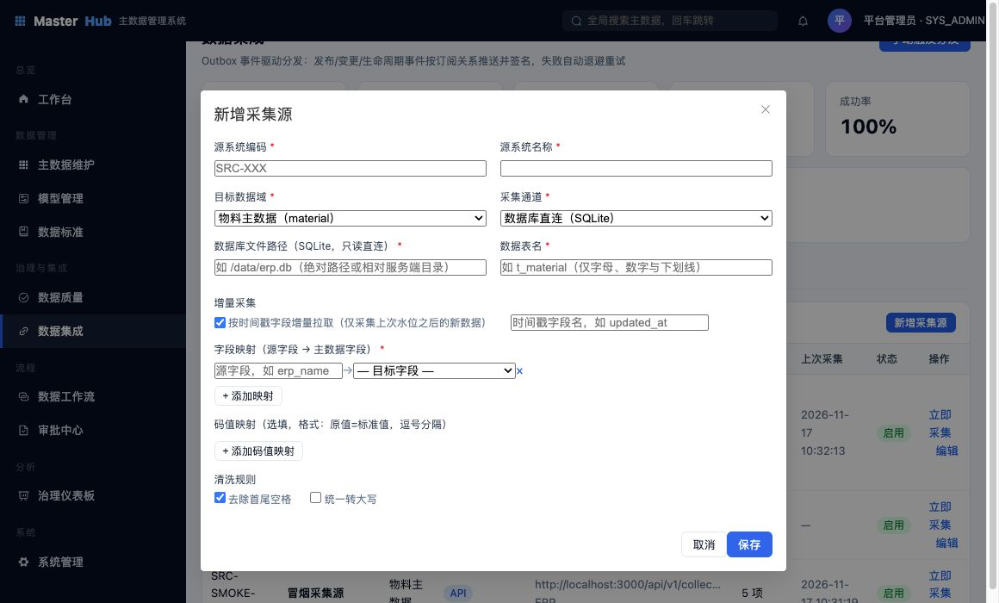

### 8.4 分发日志

记录每次分发的目标地址、HTTP 状态码、耗时与响应摘要，用于排障与对账。

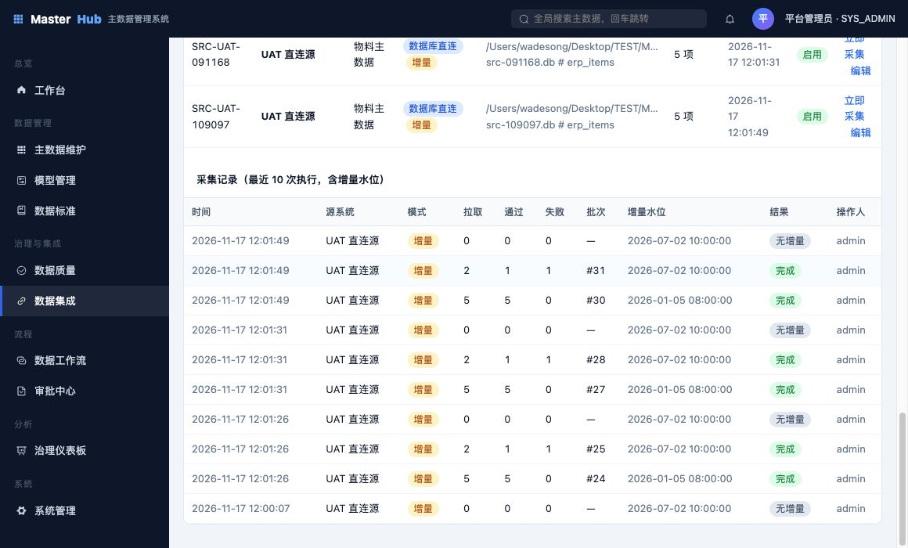

## 9. 数据质量

质量模块以规则驱动巡检，分五个页签：

- **质量概览**：五维质量评分、问题分布与趋势，可一键「立即全域巡检」。
- **规则管理**：为字段配置校验规则，支持非空、唯一、正则、数值/日期范围、码表引用五类，设置严重级别（高/中/低）。
- **巡检任务**：按数据域或全域配置定期巡检任务。
- **问题清单**：按状态（待整改/已修复/已忽略）、域、维度、级别筛选，可指派整改人、标记修复或忽略。
- **巡检记录**：每次巡检的范围、规则数、问题数与耗时。

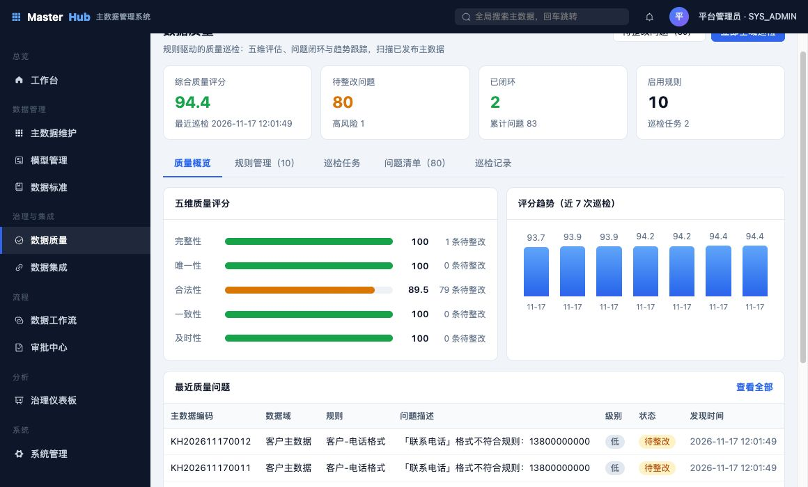

## 10. 数据工作流

工作流用于批量加工主数据，例如筛选后统一补全字段、按码表转换值、关联其他域后输出。

- 左侧为工作流列表，右侧为画布；支持新建、保存草稿、发布、运行。
- 可用节点：读取主数据、字段选择、条件筛选、公式计算、去重、排序、聚合、关联、合并、码值转换、标准化、空值填充、输出。
- 选中节点后在右侧配置参数，画布按连接顺序执行；运行记录可查看每条工作流的执行结果。

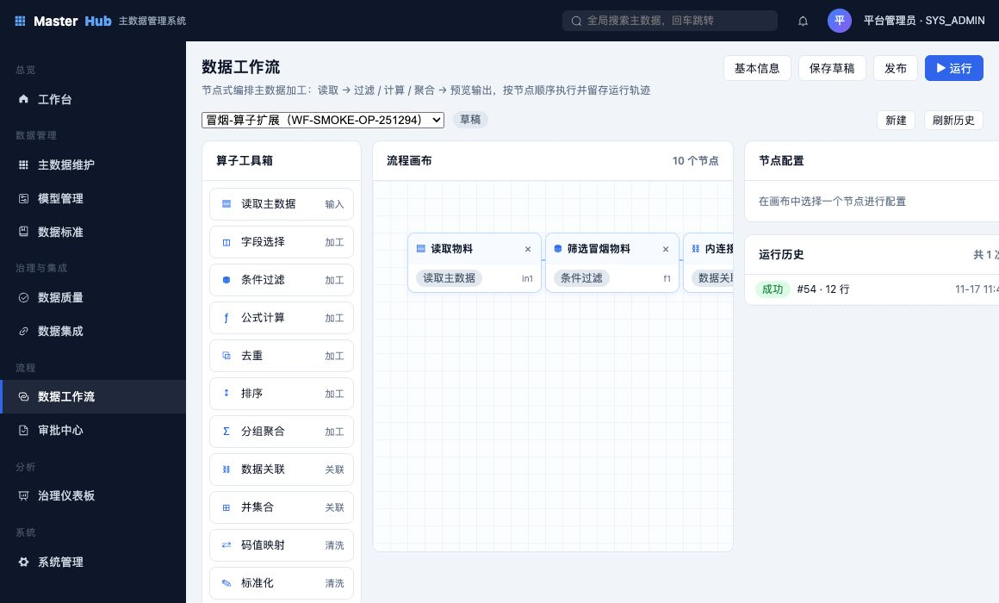

## 11. 治理仪表板

面向管理者的汇总视图：主数据总量与发布量、质量评分、审批平均耗时、分发成功率、工作流成功率，以及主数据新增趋势和质量五维雷达图。

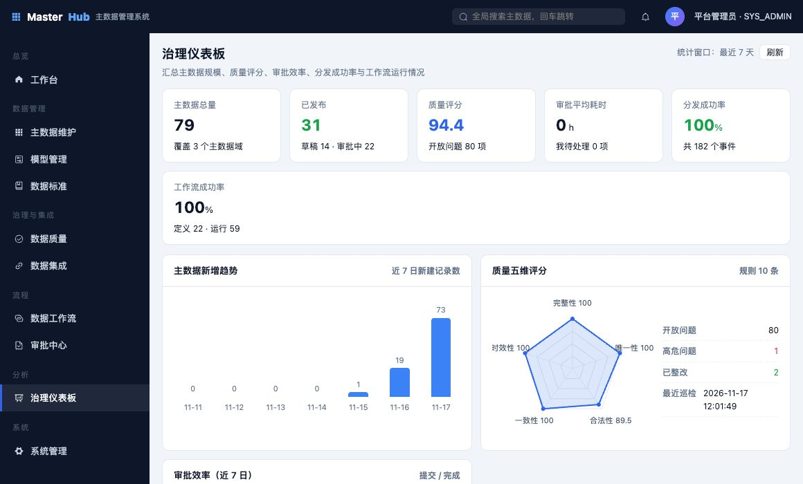

## 12. 系统管理

系统管理包含五个页签：**用户、角色权限、任务调度、参数配置、审计日志**。

- **用户**：新增/编辑用户，分配角色与启停状态。
- **角色权限**：系统内置系统管理员、数据治理岗、部门主管、业务专员四种角色；为角色勾选功能权限，并按数据域授予可见/可维护范围（`sys_data_perm`）。系统管理员默认拥有全部权限。
- **任务调度**：管理质量巡检、数据工作流、分发补偿等定时任务，配置 cron 规则、启停、立即执行，并可按任务与状态查看运行历史（触发方式、结果、耗时、执行人）。
- **参数配置**：维护全局参数键值，保存后即时生效，包括列表默认分页、单次导入最大行数、密码最小长度、登录会话时长与分发最大重试次数。
- **审计日志**：记录登录、建模、数据变更、审批、集成等关键操作，可按时间与关键字检索。

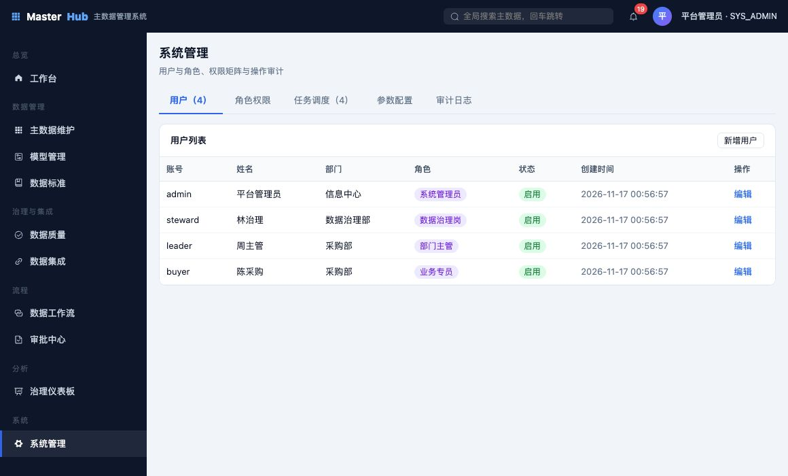
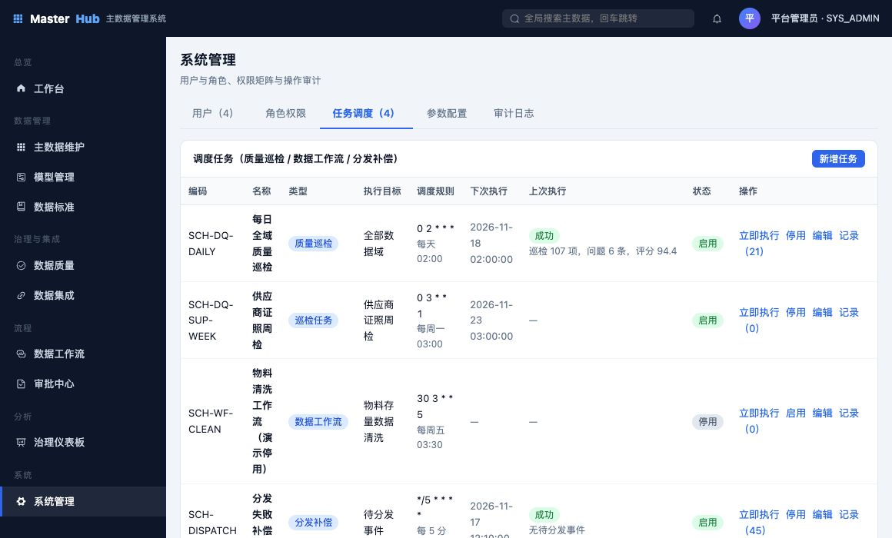

### 12.1 角色与权限建议

| 角色 | 建议权限 |
| --- | --- |
| 系统管理员 | 全部；负责建模、码表、流程、权限与参数 |
| 数据治理岗 | 审批复审、质量巡检、集成配置、数据域维护 |
| 部门主管 | 所辖部门的新增初审、本域数据查看 |
| 业务专员 | 所负责数据域的录入、提交、导出（不含生命周期与建模） |

## 13. API 调用示例

界面上的操作都能通过接口完成，便于批量处理和系统集成。以下示例基于 `http://localhost:3000`，响应统一为 `{ code, msg, data, traceId }`（`code = 0` 成功）；除 `/open/v1` 外均需 `Authorization: Bearer <token>`。更完整的开发者示例（新增、审批、Webhook、Node.js 分页）见 [README 的 API 调用示例](README.md#api-调用示例)。

### 13.1 获取 Token

```bash
curl -s -X POST http://localhost:3000/api/v1/auth/login \
  -H 'Content-Type: application/json' \
  -d '{"username":"admin","password":"<你的密码>"}'
```

返回的 `data.token` 用于后续请求头；有效期为 `session.timeoutHours`（默认 8 小时）。

### 13.2 查询与筛选主数据（curl）

```bash
TOKEN='粘贴登录接口返回的 data.token'

# 已发布的销售成员
curl -s "http://localhost:3000/api/v1/master-data/sales_team?status=PUBLISHED&size=20" \
  -H "Authorization: Bearer $TOKEN"

# 按姓名或编码模糊搜索
curl -s "http://localhost:3000/api/v1/master-data/sales_team?keyword=XS0001" \
  -H "Authorization: Bearer $TOKEN"
```

### 13.3 外部系统同步岗位与人员（Python）

场景：CRM 需要一份「人员 + 岗位 + 直属上级」的完整花名册。开放接口按编码返回数据，需要下游自行 join：

```python
import requests

BASE = "http://localhost:3000"

def pull_all(domain: str) -> list[dict]:
    """按游标拉取某域全部已发布数据"""
    cursor, rows = "0", []
    while True:
        resp = requests.get(f"{BASE}/open/v1/master/{domain}",
                            params={"cursor": cursor}, timeout=10)
        body = resp.json()
        if body.get("code") != 0:
            raise RuntimeError(f"{body.get('code')}: {body.get('msg')}")
        data = body["data"]
        if not data["list"]:          # 空页即结束
            return rows
        rows.extend(data["list"])
        cursor = data["nextCursor"]

posts = {p["masterCode"]: p for p in pull_all("sales_post")}
members = {m["masterCode"]: m for m in pull_all("sales_team")}

for code, member in members.items():
    post = posts.get(member["data"]["post"], {})
    parent_code = member["data"]["parentMember"]
    parent = members.get(parent_code) if parent_code else None
    print(code, member["name"],
          "| 岗位:", post.get("name"),
          "| 职级:", post.get("data", {}).get("postSeq"),
          "| 上级:", parent["name"] if parent else "—")
```

运行前安装依赖：`pip install requests`。

### 13.4 接收变更推送并验签（Python / Flask）

在「数据集成 → 订阅方」把回调地址指向你的服务，并用订阅时填写的 `secret` 验签：

```python
import hashlib
import hmac

from flask import Flask, abort, request

app = Flask(__name__)
SECRET = "crm-secret-2026"          # 与订阅方配置一致


@app.post("/hooks/masterhub")
def masterhub_hook():
    raw = request.get_data()        # 原始字节，验签前不要重新序列化
    expected = hmac.new(SECRET.encode(), raw, hashlib.sha256).hexdigest()
    if not hmac.compare_digest(expected, request.headers.get("X-MH-Signature", "")):
        abort(401)

    event = request.get_json()
    # eventType: CREATE / UPDATE / FREEZE / UNFREEZE / ARCHIVE
    print(event["eventNo"], event["eventType"], event["domain"],
          event["masterCode"], event["data"]["version"])
    return {"received": True, "eventNo": event["eventNo"]}
```

回调实现需幂等：同一事件可能重复投递，建议按 `eventNo` 或 `masterCode + version` 去重。

### 13.5 业务接口速查

| 场景 | 方法与路径 | 权限 |
| --- | --- | --- |
| 登录 | `POST /api/v1/auth/login` | 公开 |
| 主数据列表 | `GET /api/v1/master-data/{domain}` | `master.view` |
| 主数据详情 | `GET /api/v1/master-data/{domain}/{编码}` | `master.view` |
| 新增并提交 | `POST /api/v1/master-data/{domain}`（body 带 `"submit": true`） | `master.create` |
| 修改（走变更审批） | `PUT /api/v1/master-data/{domain}/{编码}` | `master.edit` |
| 版本历史 | `GET /api/v1/master-data/{domain}/{编码}/versions` | `master.view` |
| 我的审批待办 | `GET /api/v1/approvals/todo` | `approval.view` |
| 审批通过 / 驳回 | `POST /api/v1/approvals/{id}/pass`、`/reject` | `approval.handle` |
| 分发事件 | `GET /api/v1/integration/push-events` | `integration.view` |
| 开放接口拉取 | `GET /open/v1/master/{domain}?cursor=0` | 公开 |

## 14. 常见问题

**Q：为什么新增后看不到数据？**
新增提交后处于「审批中」，审批通过才变为「已发布」。用列表状态筛选「审批中」可查看在途单据。

**Q：为什么保存提示「引用的数据不存在」？**
引用字段（岗位、直属上级、供应商等）要求填写**对方的主数据编码**，且对方必须已发布。先确认编码抄写正确、被引用数据已发布。

**Q：为什么某条记录不能编辑？**
审批中、变更中、已冻结、已归档状态均为只读。需等待审批结束，或先解冻。

**Q：外部系统如何读取岗位与人员数据？**
两种方式：`GET /open/v1/master/{domain}` 增量拉取，或在「数据集成 → 订阅方」配置 Webhook 接收事件推送。完整说明见 [外部系统如何获取数据](docs/FAQ/外部系统如何获取数据.md)，销售岗位/人员的字段与拼装方式见 [销售团队数据维护教程 第 15 步](docs/FAQ/销售团队数据维护教程.md)。

**Q：导入校验有非法行怎么办？**
按提示逐行修正后重新校验；非法行不会入库，合法行可在全部修正后一并提交。

---

延伸阅读：

- [README](README.md)：系统能力、架构与启动方式
- [销售团队数据维护教程](docs/FAQ/销售团队数据维护教程.md)：岗位与人员分层维护的完整实操（含逐步骤截图）
- [外部系统如何获取数据](docs/FAQ/外部系统如何获取数据.md)：拉取、推送、导出、直连四种接入方式
