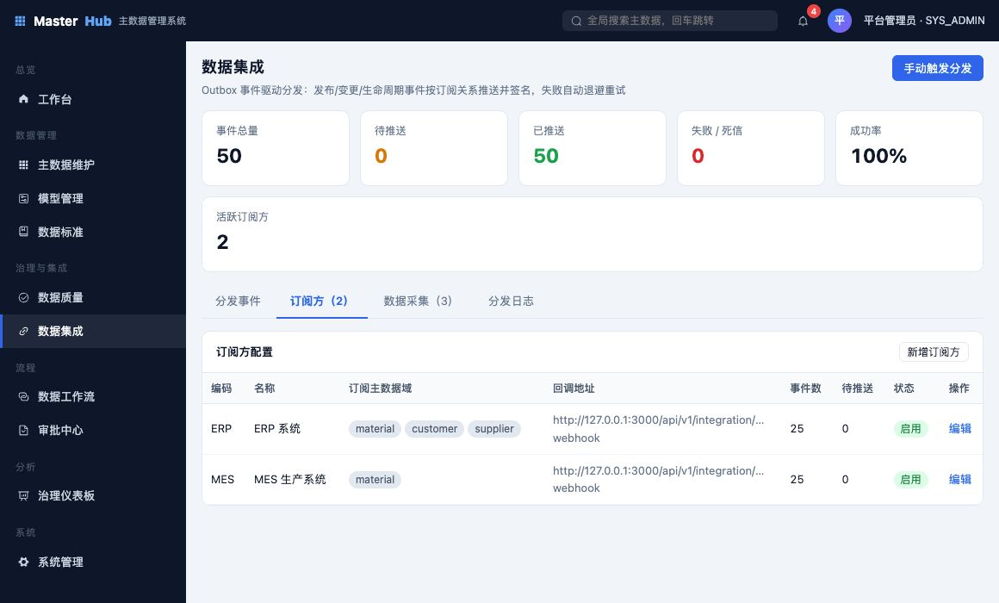
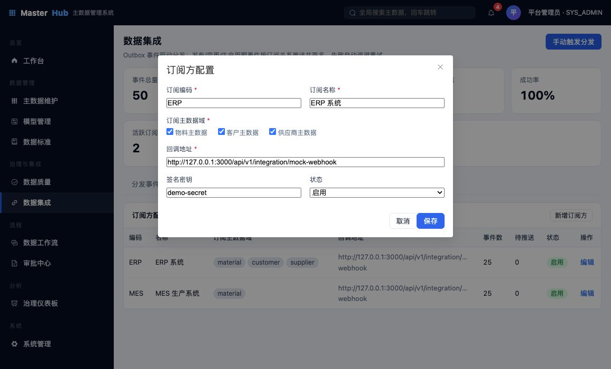
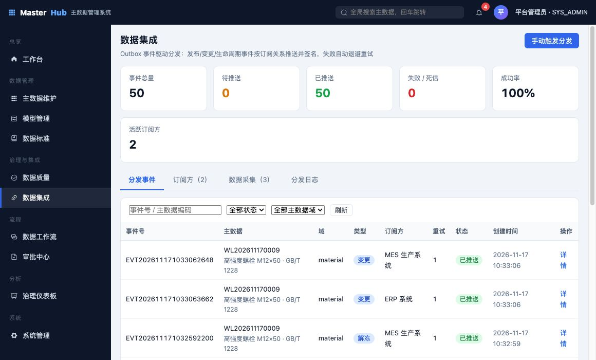
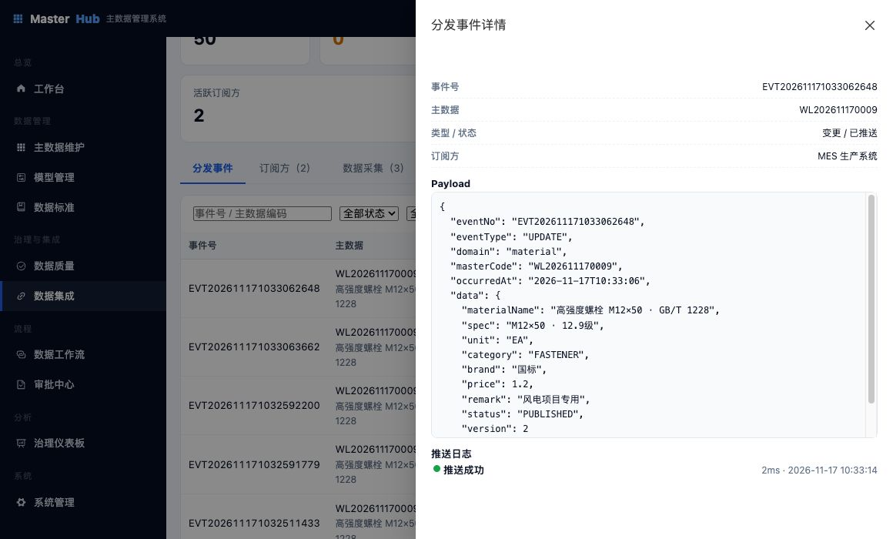
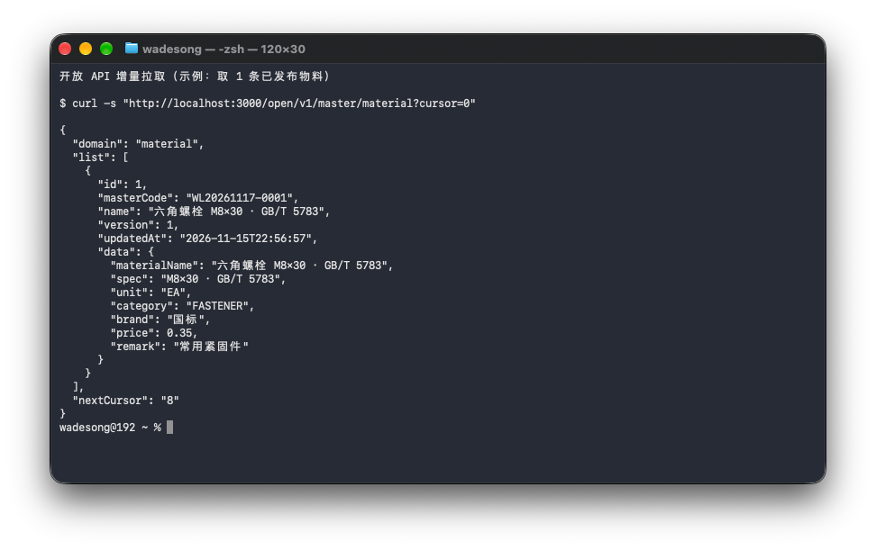
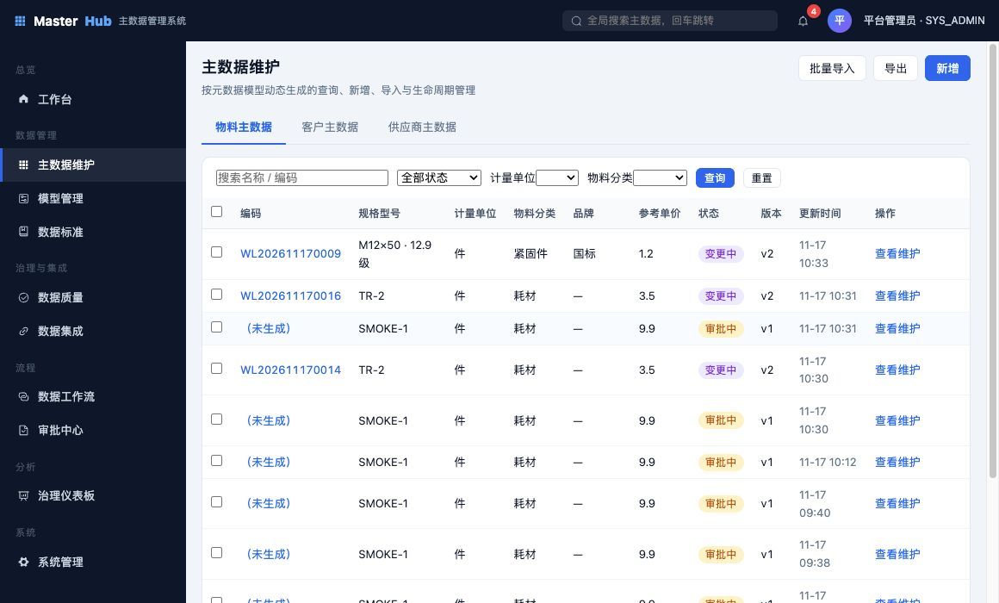
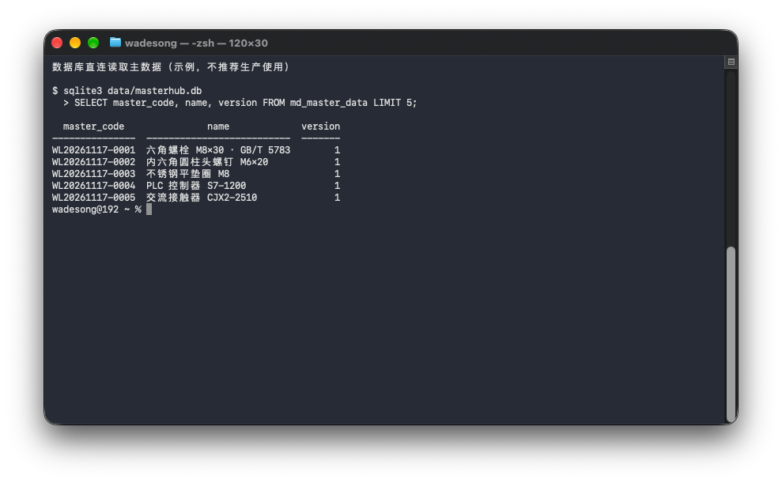

# MasterHub 主数据管理系统 · 外部接入 FAQ

> 本文说明「外部系统如何接入 MasterHub 的主数据」，共 4 种方式（3 种正式方式 + 1 种不推荐方式）。
> 文中截图均来自本系统实际运行界面/接口。

---

## Q1：外部系统如何接入这个主数据系统的数据？有几种方法？

对外提供数据目前有 **4 种方式**，它们共用同一份「已发布主数据」，区别在于时效、集成成本和适用场景。

| 方式 | 数据方向 | 时效 | 外部系统需要做什么 | 适用场景 |
|---|---|---|---|---|
| ① Outbox 事件推送（Webhook） | MasterHub → 外部（主动推） | 准实时（后台默认每 20 秒分发一次） | 提供一个 HTTP 回调地址 + 约定签名密钥 | ERP / MES / BI 需要及时感知主数据新增、变更与生命周期事件 |
| ② 开放 API 增量拉取 | 外部 → MasterHub（主动拉） | 定时（分钟级） | 定时调用接口并按 `cursor` 翻页 | 定时批量同步、离线补数、初始化全量 |
| ③ CSV 文件导出 | MasterHub → 外部（文件） | 手工 / 低频 | 接收 CSV 并自行解析入库 | 一次性交付、对账、给小系统供数 |
| ④ 数据库直连 | 外部 → 数据库（直连） | 实时 | 直接读取 SQLite 数据文件 | **不推荐**：绕过状态机、字段脱敏与分发审计 |

选型建议：**需要实时联动选 ①，需要定时批量选 ②，一次性交换选 ③，④ 仅限离线排障。**

---

## 方式①：Outbox 事件推送（Webhook）

**原理**：主数据发生「新增 / 变更 / 冻结 / 解冻 / 归档」时，系统把事件写入 Outbox 事件表；后台任务每 20 秒扫描待推送事件，按订阅关系 POST 给外部系统；失败自动退避重试，超过最大重试次数进入死信，可人工重试。

### 操作步骤

1. 进入「数据集成 → 订阅方」，点击「新增订阅方」，填写：
   - **订阅编码 / 名称**
   - **订阅主数据域**（可多选，例如物料、客户、供应商）
   - **回调地址**（必须是 `http(s)://` 开头的、外部系统可被访问的接口）
   - **签名密钥**（用于生成 HMAC 签名，外部系统需保存同样密钥验签）





2. 保存后，主数据发布/变更时系统自动生成分发事件。可在「分发事件」页查看事件号、主数据编码、事件类型、订阅方、重试次数与状态。



3. 点击「详情」可查看推送给外部系统的 Payload 原文（含 `eventNo`、`eventType`、`domain`、`masterCode`、`version`、`data` 等字段）。



### 外部系统接收约定

- 请求方式：`POST`，`Content-Type: application/json`
- 请求头：
  - `X-MH-Event`：事件号，例如 `EVT202611171033062648`
  - `X-MH-Signature`：`HMAC-SHA256(secret, 请求体原文)` 的十六进制字符串，用于验签
- 返回 2xx 视为推送成功；非 2xx 或超时视为失败，系统按退避策略重试
- 最大重试次数由参数配置 `dispatch.maxRetry` 控制（默认 5），超过后进入「死信」，可在分发事件页手动重试

> 提示：系统自带一个模拟接收端 `POST /api/v1/integration/mock-webhook`，可在无外部系统时验证推送闭环。

---

## 方式②：开放 API 增量拉取

**原理**：外部系统按自增 `cursor` 分页拉取「已发布且未删除」的主数据，每次 50 条，返回下一页游标。

### 接口

```
GET /open/v1/master/{domain}?cursor={上次返回的 nextCursor}
```

返回示例（实际调用结果）：

```json
{
  "domain": "material",
  "list": [
    {
      "id": 1,
      "masterCode": "WL20261117-0001",
      "name": "六角螺栓 M8×30 · GB/T 5783",
      "version": 1,
      "updatedAt": "2026-11-15T22:56:57",
      "data": {
        "materialName": "六角螺栓 M8×30 · GB/T 5783",
        "spec": "M8×30 · GB/T 5783",
        "unit": "EA",
        "category": "FASTENER",
        "brand": "国标",
        "price": 0.35,
        "remark": "常用紧固件"
      }
    }
  ],
  "nextCursor": "8"
}
```



### 使用方式

1. 首次调用 `cursor=0`（或不传 cursor）获取第一页；
2. 记录返回的 `nextCursor`，下次调用时传入；
3. 循环直到 `list` 为空（或 `nextCursor` 不再前进），即完成一次增量同步；
4. 外部系统按 `masterCode` 做主键更新本地副本；`version` 可用于判断先后。

> 注意：该接口当前是公开接口（未做 API Key / 限流），仅建议在受信内网使用；生产对外暴露前需补充鉴权。
> 如需「变更时间」维度的增量，请使用方式①的事件推送，或按 `updatedAt` 做二次过滤。

---

## 方式③：CSV 文件导出

**原理**：按当前筛选条件导出主数据为 CSV，字典值自动转换为中文标签，适合离线交付与对账。

### 操作步骤

1. 进入「主数据维护」，选择主数据域并设置筛选条件（关键字、状态、扩展字段等）；
2. 点击右上角「导出」，浏览器下载 CSV 文件。



### 说明

- 接口：`GET /api/v1/master-data/{domain}/export`，需要 `master.export` 权限；
- 单次最多导出 **5000 行**，超出请先缩小筛选范围或分批导出；
- 列结构：主数据编码、名称、状态、各业务字段（按模型字段标签）、版本、更新时间；
- 文件为 CSV，可直接用 Excel 打开（UTF-8）。

---

## 方式④：数据库直连（不推荐）

**原理**：MasterHub 单机部署时使用 SQLite 单文件数据库（默认 `server/data/masterhub.db`），外部系统理论上可直接读取该文件或通过 SQLite 驱动查询。



### 为什么不推荐

- 绕过主数据状态机：可能读到草稿、审批中、已归档等非对外数据；
- 绕过字段脱敏与权限控制；
- 绕过分发审计，无法追踪「谁在何时取走了哪些数据」；
- 表结构与版本演进不承诺兼容，升级后可能直接破坏外部系统。

如确需只读排障，请务必：
1. 只读方式打开（`file:...?mode=ro`），并停写或复制副本；
2. 固定筛选 `status = 'PUBLISHED' AND deleted = 0`；
3. 记录访问日志，禁止用于生产集成。

---

## Q2：推送的数据包含哪些内容？能只订阅某个域吗？

- 可以。订阅方创建时通过「订阅主数据域」多选限定范围，只有命中域的发布/变更/生命周期事件才会生成推送。
- Payload 包含事件号、事件类型（`CREATE` / `UPDATE` / `FREEZE` / `UNFREEZE` / `ARCHIVE`）、主数据域、主数据编码、版本号、完整 `data` 与发生时间。

## Q3：推送失败会怎样？

- 系统记录失败原因与重试次数，按退避策略自动重试；
- 超过参数 `dispatch.maxRetry`（默认 5）后事件进入「死信」状态；
- 在「数据集成 → 分发事件」中可按状态筛选「死信」，点击「重试」重新推送；
- 定时任务执行失败也会通过站内通知提醒系统管理员与数据治理岗。

## Q4：外部系统能通过接口直接写入主数据吗？

- 当前**不开放直接写入接口**。外部数据进入 MasterHub 的正规路径是「数据采集 / 批量导入」：
  1. 在「数据集成 → 数据采集」注册源系统，配置字段映射、码值转换与清洗规则；
  2. 执行采集，系统拉取数据并按导入规则逐行校验，生成导入批次；
  3. 校验通过的数据提交入库为草稿，再走提交、审批、发布流程。
- 这样可保证字段标准化、查重、审批留痕与变更审计不被绕过。

## Q5：接口与分发会不会影响主数据状态？

- 不会。推送与拉取均为**只读**行为，只使用 `PUBLISHED` 状态数据；主数据的状态流转仍由提交、审批、冻结、归档等受控操作驱动。
