# 销售团队层级数据维护教程

> **适用场景**：在 MasterHub 中维护一支销售团队——**岗位**（销售总监/大区经理/二线经理/一线销售）与**销售人员**四级汇报线档案，支持岗位独立治理、人员按汇报线树形浏览、逐级引用、批量导入与变更审批。
>
> **演示账号**：`admin / admin123`（系统管理员，本教程以此身份操作）。业务专员录入、主管审批的分工方式见各步骤说明。

## 设计原则：岗位与人员分开建模

**岗位是人员的一个维度，不是人员的一部分。** 岗位有自身属性（职级序列、编制人数、岗位职责）、独立生命周期（撤岗不等于人走）和独立治理归口（人力资源部），因此单独建域建模；人员模型通过 **REF 引用字段** 挂接岗位编码。每个数据域只能挂一个模型，两个域各自维护、互不干扰：

- 若把岗位做成人员模型里的一个枚举字段，岗位将无法携带编制、职责等属性，也无法被绩效、薪酬等其他系统独立引用；
- 岗位信息若冗余到每条人员记录，改岗位职责就要改所有人，且"人离职岗位仍在"无法表达。

## 整体思路

| 步骤 | 做什么 | 为什么 |
| --- | --- | --- |
| 1 | 建码表：销售职级（树形）+ 销售大区 | 职级是**岗位**的分类维度，大区是**人员**的属性 |
| 2 | 新建岗位数据域 `sales_post` | 岗位独立建模、归口人力资源部 |
| 3 | 建岗位模型并发布 | 字段是岗位录入表单的来源 |
| 4 | 配置岗位编码规则（POST + 3 位流水） | 人员要引用岗位编码，编码必须先存在 |
| 5 | 录入 4 个岗位 | 四级职级各设一岗，走审批发布 |
| 6 | 新建人员数据域 `sales_team` | 人员与岗位分域，一域一模型 |
| 7 | 建人员模型并发布（岗位用 REF 引用 `sales_post`） | 人员表单由字段生成，岗位/直属上级均为引用 |
| 8 | 配置人员编码规则（XS + 4 位流水） | 下级要引用上级的编码 |
| 9 | 自顶向下逐级录入 9 名成员 | 直属上级与岗位编码都要求被引用对象先发布 |
| 10+ | 树形视图核对、批量导入、变更调整 | 日常维护 |
| 11 | 开放 API 增量拉取 + 订阅事件推送 | 岗位与人员数据交付给 CRM/BI 等下游系统 |

---

## 第 1 步：建「销售职级」树形码表

职级是链式的：销售总监 → 大区经理 → 二线经理 → 一线销售，因此建**树形码表**，让每个码值带「上级码值」。

1. 进入 **码表维护**，点击 **新建码表**：编码 `sales_rank`、名称「销售职级」、勾选 **树形码表**。

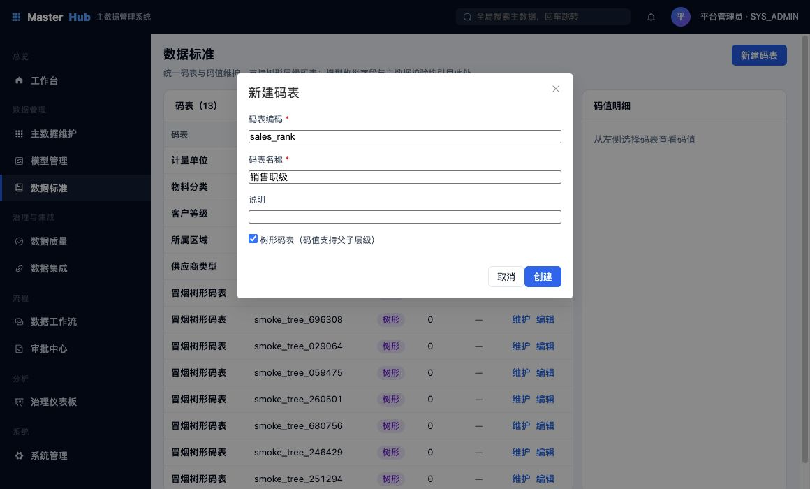

2. 保存后逐个 **新增码值**（4 条），每条在「上级码值」里选择它的上一级：

| 码值 | 名称 | 上级码值 |
| --- | --- | --- |
| `DIRECTOR` | 销售总监 | —（顶级，留空） |
| `REGION_MANAGER` | 大区经理 | `DIRECTOR` |
| `MANAGER` | 二线经理 | `REGION_MANAGER` |
| `SALES` | 一线销售 | `MANAGER` |

3. 保存完毕后，码值列表按层级缩进展示，形成完整的职级链：

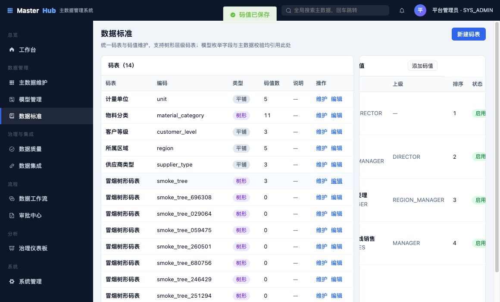

## 第 2 步：建「销售大区」码表

大区之间没有层级，建**平铺码表**：编码 `sales_region`、名称「销售大区」，不勾选树形。添加 3 个码值：`EAST` 华东、`SOUTH` 华南、`WEST` 西部。

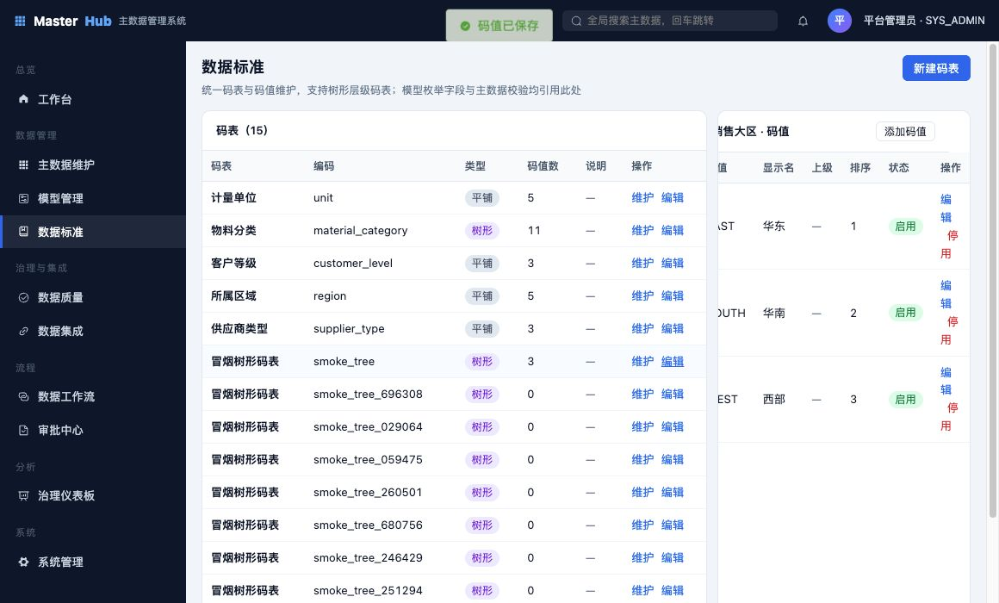

## 第 3 步：新建岗位数据域

1. 进入 **模型管理 → 数据域** 页签，点击 **新建数据域**，按下表填写：

| 项 | 值 |
| --- | --- |
| 数据域编码 | `sales_post`（小写字母开头，仅小写字母/数字/下划线） |
| 数据域名称 | 销售岗位主数据 |
| 归口部门 | 人力资源部 |
| 说明 | 销售岗位序列与编制（供销售人员引用） |

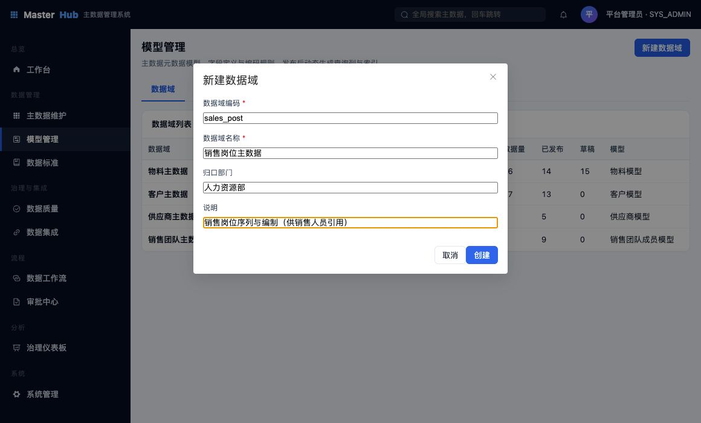

2. 点击 **创建**。新域立即出现在列表中，模型列显示「未建模」，同时系统自动为管理员、数据治理岗授予该域的可见权限。

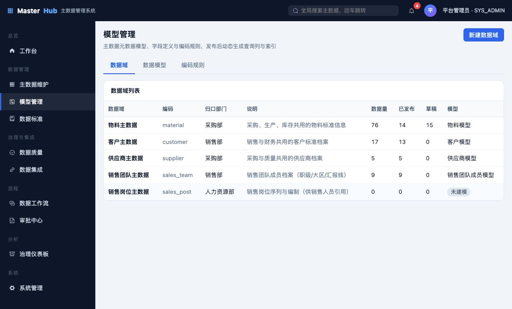

## 第 4 步：新建岗位模型并发布

1. 切换到 **数据模型** 页签，点击 **新建模型**：

| 项 | 值 |
| --- | --- |
| 模型编码 | `sales_post` |
| 模型名称 | 销售岗位模型 |
| 所属主数据域 | 销售岗位主数据 |
| 名称字段标识 | `postName`（该字段将作为岗位记录的显示名） |

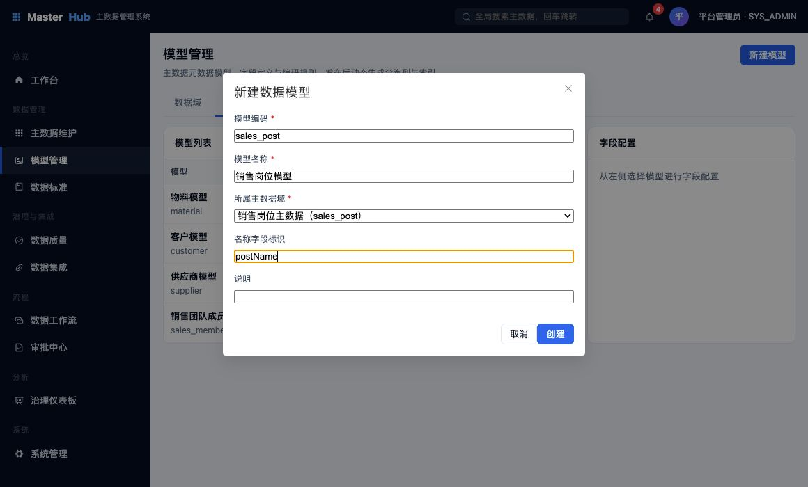

2. 创建后点击该模型的 **管理**，逐个 **添加字段**（共 4 个）：

| 字段标识 | 字段名称 | 类型 | 绑定 | 属性 |
| --- | --- | --- | --- | --- |
| `postName` | 岗位名称 | 文本 | — | 必填、唯一、可查询 |
| `postSeq` | 岗位序列 | 枚举（码表） | `sales_rank` 销售职级 | 必填、可查询 |
| `headcount` | 编制人数 | 数值 | — | — |
| `postDuty` | 岗位职责 | 文本 | — | — |

其中「岗位序列」绑定第 1 步的职级码表——岗位自带职级维度：

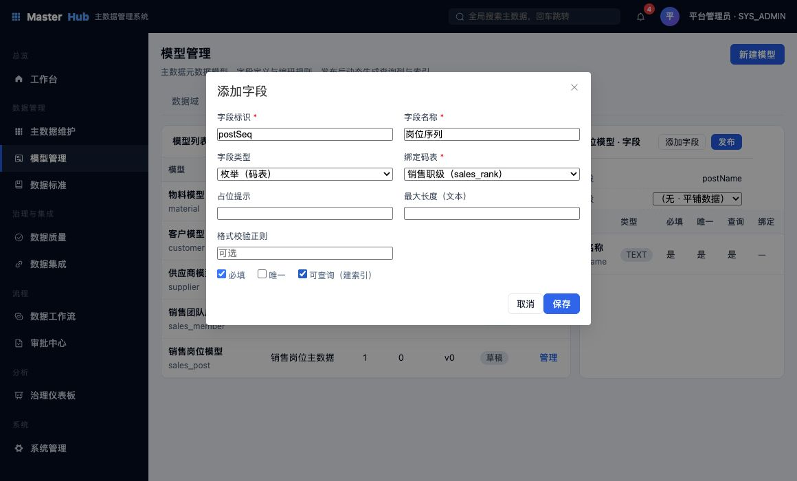

3. 全部字段添加完成后的字段列表：

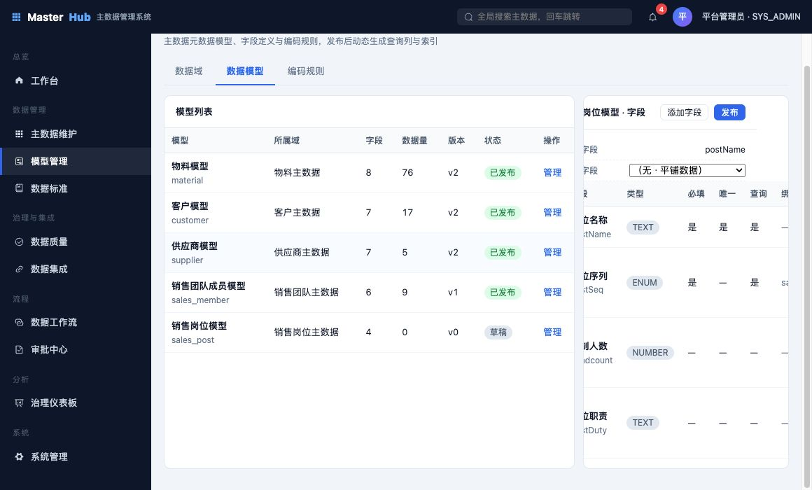

4. 点击 **发布**，确认后模型状态变为 **已发布**，字段与索引随即生效：

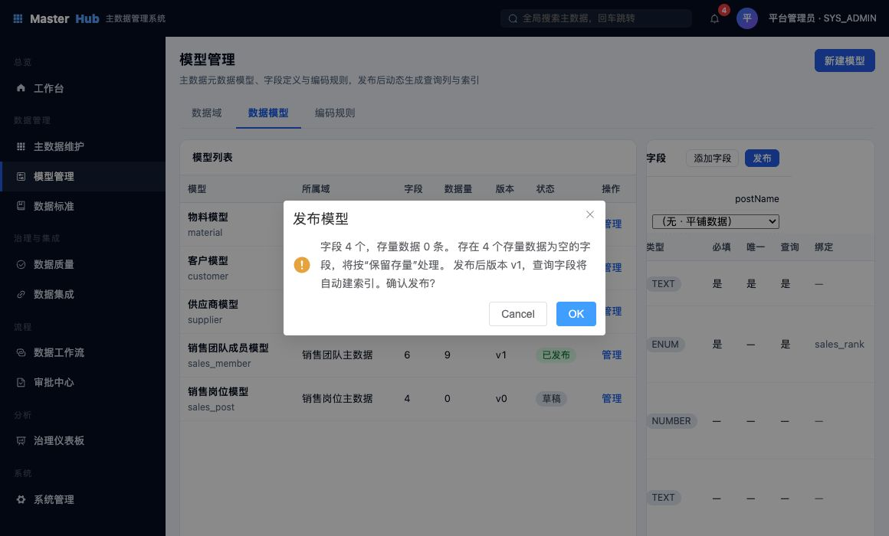

## 第 5 步：配置岗位编码规则

人员要引用岗位的编码，编码必须由系统按规则自动生成。进入 **模型管理 → 编码规则**，点击 **新增编码规则**：主数据域=销售岗位主数据，规则名称=销售岗位编码规则；规则段 2 个——固定值 `POST` + 流水号（位数 3，永久累加）。保存后可预览首条编码 `POST001`。

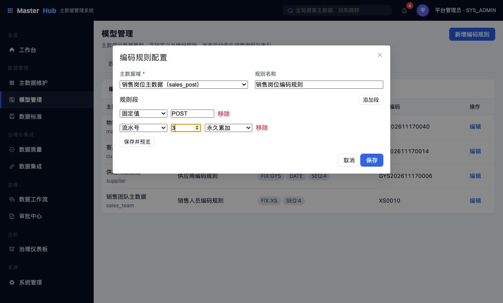

## 第 6 步：录入岗位数据

1. 进入 **主数据维护**，点击「销售岗位主数据」页签，点击 **新增**，填写岗位名称、岗位序列、编制人数、岗位职责：

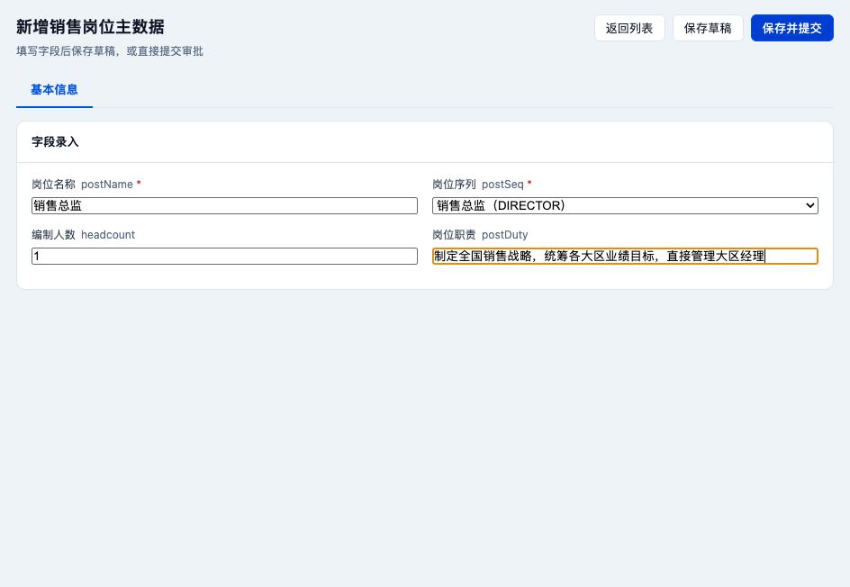

2. 点击 **保存并提交**。与新域未配置专属流程时一致，提交会匹配到通用流程「主数据新增通用审批」——由 **周主管**（部门初审）和 **林治理**（数据治理岗复审）依次在 **审批中心** 审批，通过后自动发布并按规则发号。

3. 按同样方法录入其余岗位。四个岗位全部发布后：

| 编码 | 岗位名称 | 岗位序列 | 编制人数 |
| --- | --- | --- | --- |
| POST001 | 销售总监 | 销售总监（DIRECTOR） | 1 |
| POST002 | 大区经理 | 大区经理（REGION_MANAGER） | 2 |
| POST003 | 二线经理 | 二线经理（MANAGER） | 2 |
| POST004 | 一线销售 | 一线销售（SALES） | 4 |

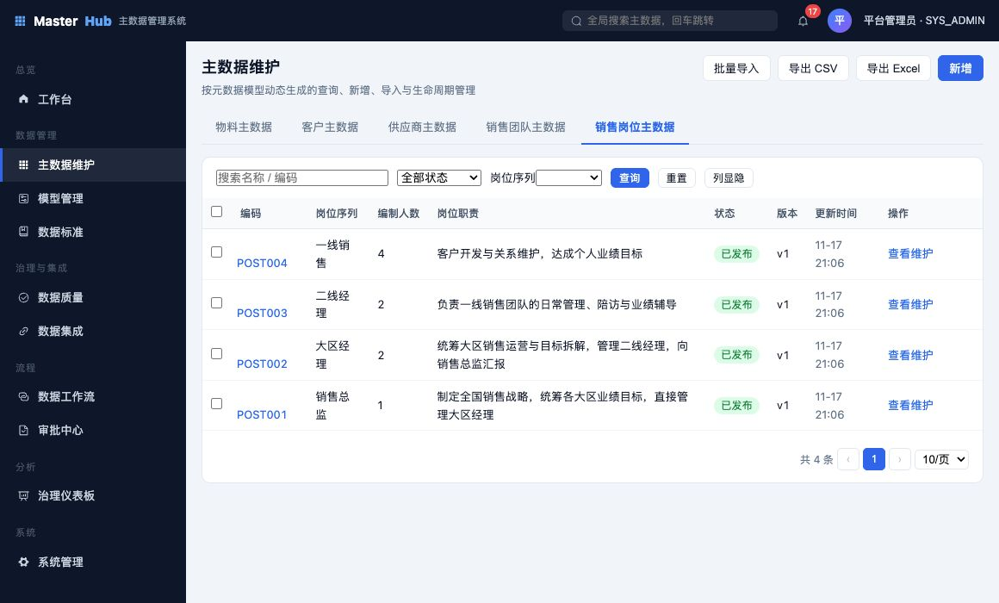

> **岗位是人员的前提**：人员表单里的「岗位」是必填引用，岗位编码（POST001…）必须在岗位发布后才存在。

## 第 7 步：新建人员数据域

岗位就绪后，再为销售人员建独立的数据域。**新建数据域**：编码 `sales_team`、名称「销售团队主数据」、归口部门「销售部」、说明「销售团队成员档案（大区/岗位/汇报线）」。

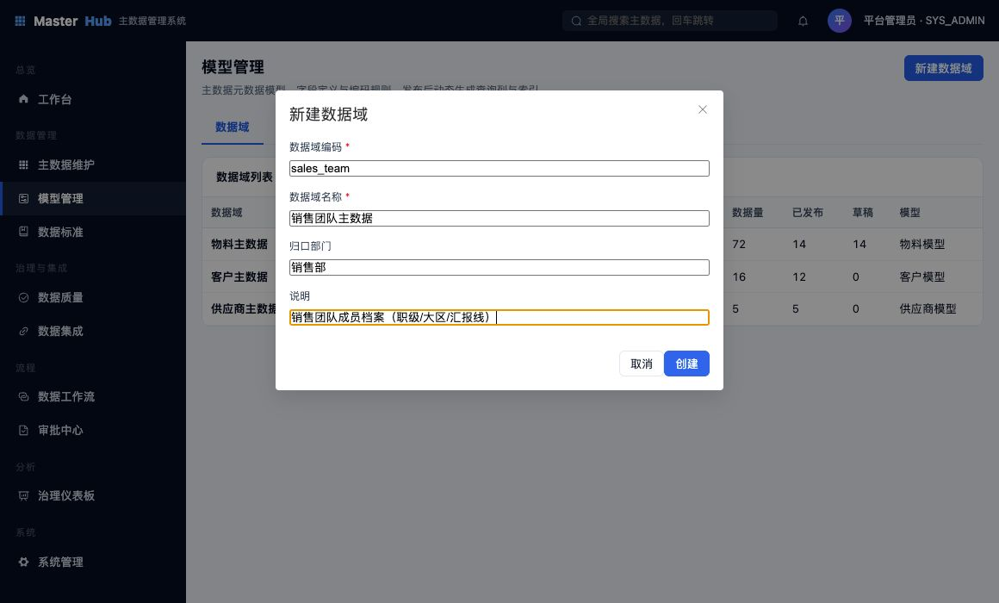

创建后，数据域列表中两个域各挂一个模型，互不干扰：

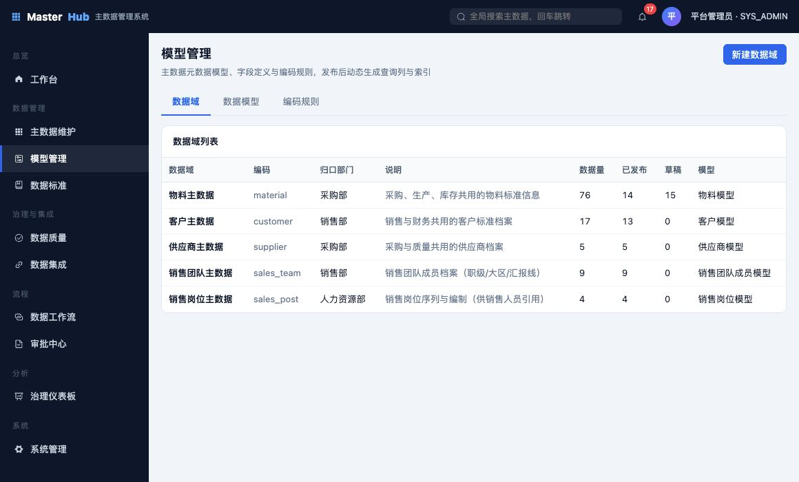

## 第 8 步：新建人员模型并发布

1. **新建模型**：编码 `sales_member`、名称「销售团队成员模型」、所属域「销售团队主数据」、名称字段标识 `memberName`。

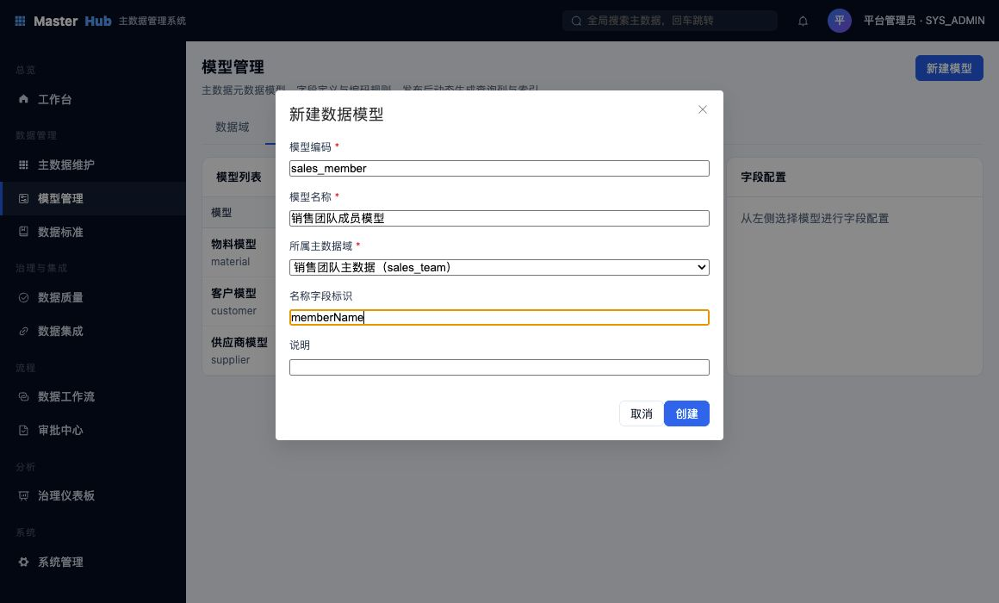

2. 逐个 **添加字段**（共 6 个）：

| 字段标识 | 字段名称 | 类型 | 绑定 | 属性 |
| --- | --- | --- | --- | --- |
| `memberName` | 姓名 | 文本 | — | 必填、唯一、可查询 |
| `region` | 所属大区 | 枚举（码表） | `sales_region` 销售大区 | 必填、可查询 |
| `post` | 岗位 | 引用主数据 | `sales_post` 销售岗位主数据 | 必填 |
| `parentMember` | 直属上级 | 引用主数据 | `sales_team` 销售团队主数据（自引用） | — |
| `entryDate` | 入职日期 | 日期 | — | — |
| `active` | 是否在职 | 布尔 | — | — |

两个引用字段是本教程的关键：**岗位**引用岗位域的编码（POST001…），**直属上级**引用本域上级成员的编码（XS0001…）。人员不再直接存职级——职级通过岗位（岗位序列）间接获得。


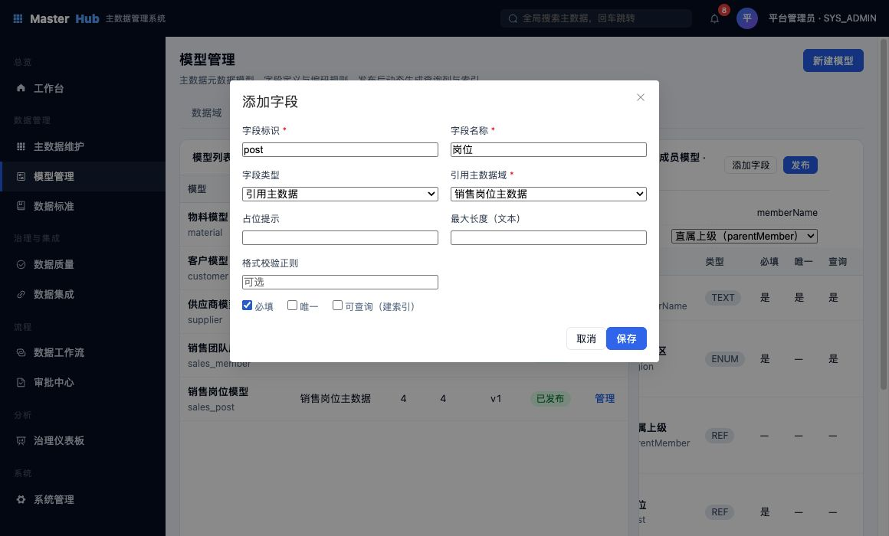

3. 全部字段添加完成后的字段列表：

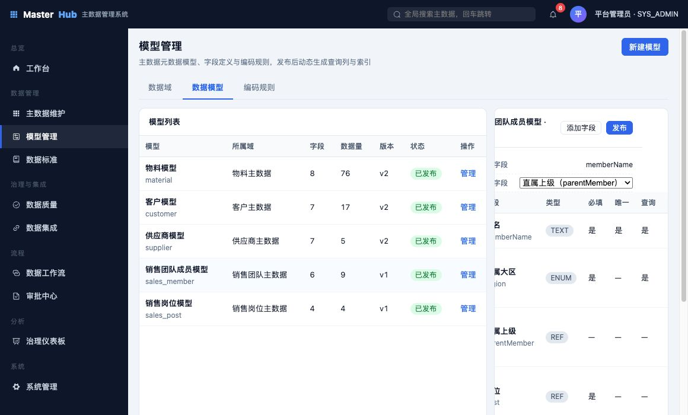

4. 把 **层级字段** 设为 **直属上级（parentMember）** 并确认。设置后列表页出现「切为树形视图」按钮，且保存时自动校验「上级必须存在、不允许形成汇报环」。

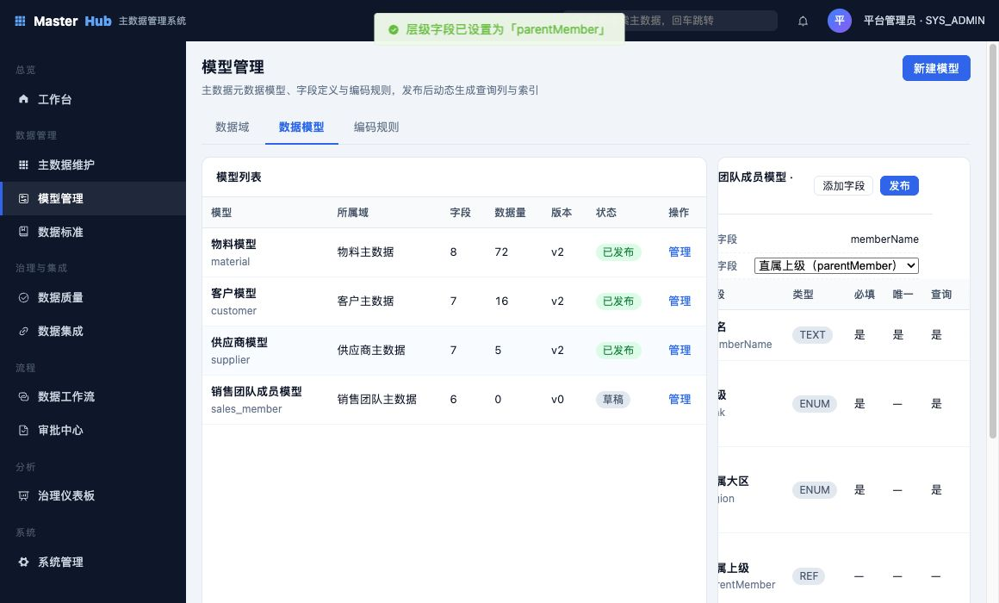

5. 点击 **发布**，确认后模型发布为 v1：

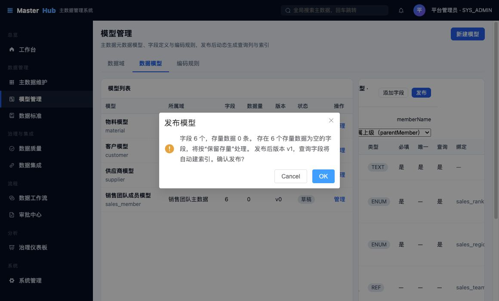

> **模型演进提示**：模型发布后仍可调整字段——新增/删除字段后再次发布即可，系统会检查存量数据并按「保留存量」兼容处理。例如后续把「职级」枚举字段改为「岗位」引用字段后重新发布，系统会提示存量数据的处理方式：
>
> 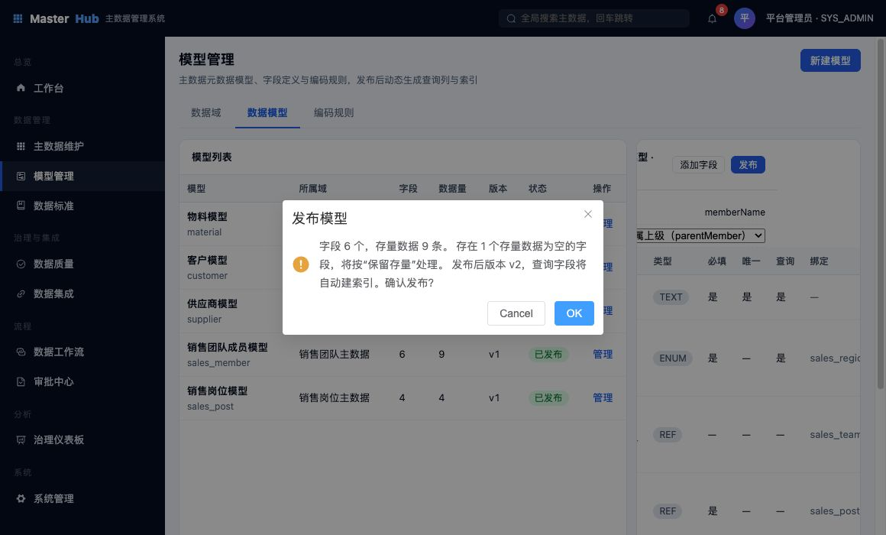

## 第 9 步：配置人员编码规则

进入 **编码规则** 页签，为「销售团队主数据」新增规则：规则名称=销售人员编码规则；规则段——固定值 `XS` + 流水号（位数 4，永久累加）。保存后预览首条编码 `XS0001`。


## 第 10 步：自顶向下逐级录入成员

**核心规则：直属上级填上级成员的编码（如 XS0001），岗位填岗位编码（如 POST001）——两者都要求被引用对象已发布，所以必须先录总监、再录大区经理、然后二线经理、最后一线销售。**

1. **第 1 级 · 销售总监**：新增「张万峰」，所属大区「华东」，**岗位填 `POST001`**，**直属上级留空**（总监是顶级），入职日期、是否在职=是。保存并提交，走两级审批（周主管→林治理），通过后自动发布为 `XS0001`：

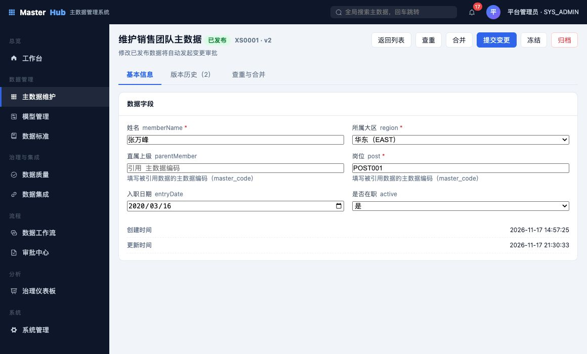

2. **第 2 级 · 大区经理**：新增「李成钢」，**直属上级填 `XS0001`**、**岗位填 `POST002`**：


3. 每次提交后记录进入审批中，详情页显示黄色横幅与当前节点：

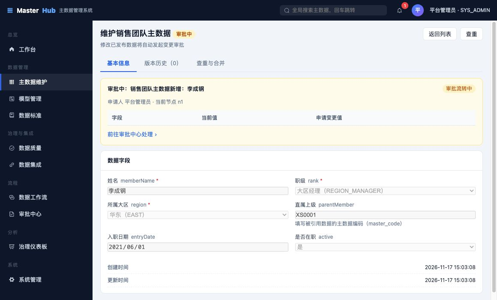

4. 按同样方法依次录入剩余成员（每人提交后由周主管、林治理审批通过）：

| 编码 | 姓名 | 岗位 | 所属大区 | 直属上级 |
| --- | --- | --- | --- | --- |
| XS0001 | 张万峰 | POST001 · 销售总监 | 华东 | — |
| XS0002 | 李成钢 | POST002 · 大区经理 | 华东 | XS0001 |
| XS0003 | 王丽华 | POST002 · 大区经理 | 华南 | XS0001 |
| XS0004 | 陈美琳 | POST003 · 二线经理 | 华东 | XS0002 |
| XS0005 | 刘志强 | POST003 · 二线经理 | 华南 | XS0003 |
| XS0006 | 孙晓东 | POST004 · 一线销售 | 华东 | XS0004 |
| XS0007 | 钱小雨 | POST004 · 一线销售 | 华东 | XS0004 |
| XS0008 | 何大勇 | POST004 · 一线销售 | 华南 | XS0005 |
| XS0009 | 宋佳 | POST004 · 一线销售 | 华南 | XS0005 |

全部发布后的平铺列表（岗位列即岗位编码）：


> **一线销售批量录入**：人数最多的一线销售不必逐个录入，见 [第 12 步](#第-12-步批量导入一线销售)。

## 第 11 步：树形视图核对汇报线

进入 **主数据维护 → 销售团队主数据**，点击 **切为树形视图**。列表按「直属上级」字段层级展开，张万峰在最顶层，逐级缩进显示到一线销售，四级汇报线一目了然。每层可点击 `▸/▾` 折叠展开。

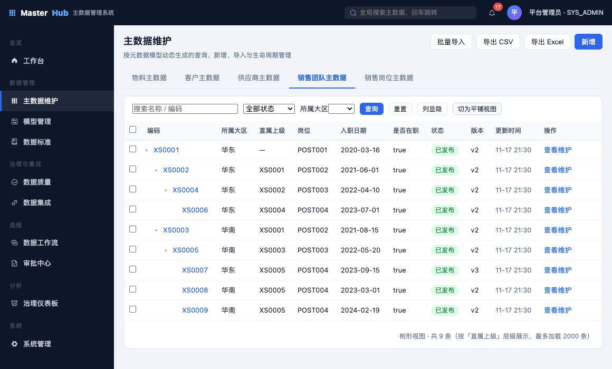

## 第 12 步：批量导入一线销售

新团队成批入职（尤其一线销售）时用批量导入：

1. 点击 **批量导入**，先点击 **下载 CSV 模板** 或 **下载 Excel 模板**。
2. 按模板填写：`memberName`（姓名）、`region`（大区，如 `EAST`）、`post`（岗位编码，如 `POST004`）、`parentMember`（直属上级编码，如 `XS0004`）、`entryDate`、`active`。
3. 上传文件 → 系统自动 **预校验**（必填、码表范围、岗位与上级编码是否存在都会检查）→ 确认无误后 **提交入库**。导入的记录同样走审批发布流程。

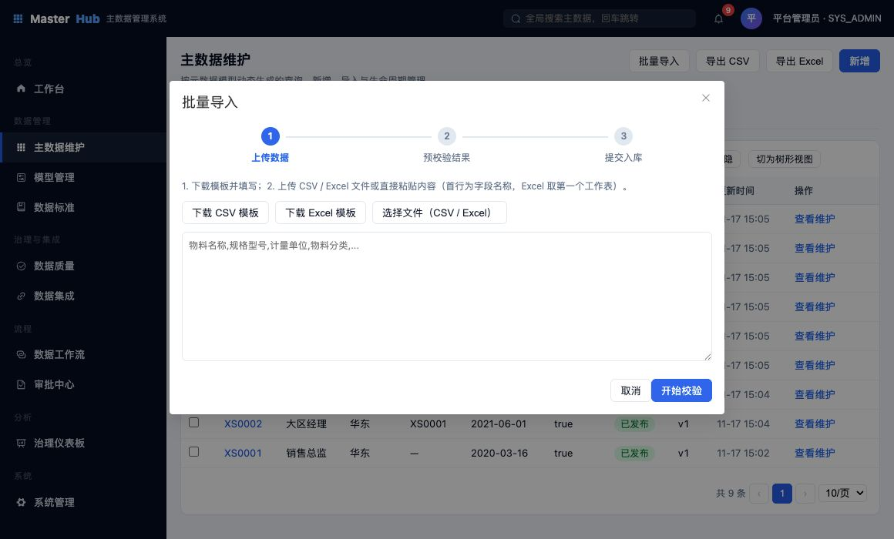

## 第 13 步：调整汇报线（修改直属上级）

组织调整、人员转岗时需要修改某位成员的直属上级。已发布的记录不能直接改库，系统会自动发起**变更审批**。以一线销售「孙晓东」从陈美琳团队（XS0004）调整到刘志强团队（XS0005）为例：

1. 找到孙晓东（XS0006），点击 **维护**，将 **直属上级** 从 `XS0004` 改为 `XS0005`：

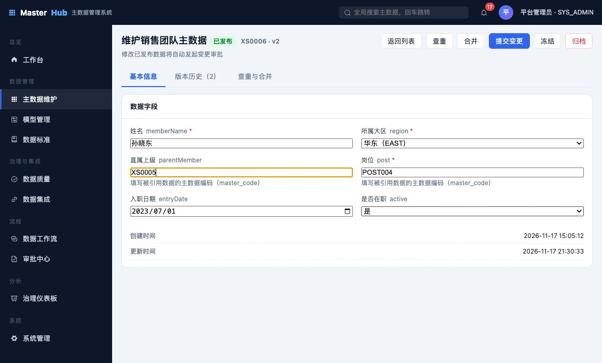

2. 点击 **提交变更**。记录状态变为 **变更中**，页面顶部出现黄色审批横幅，并附上本次变更的字段对照表（直属上级：XS0004 → XS0005）：

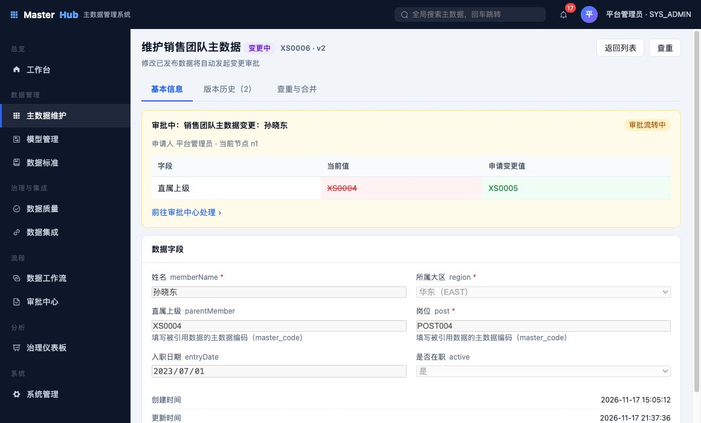

3. 变更走「主数据变更通用审批」，由 **林治理**（数据治理岗）在审批中心审核通过后自动生效，记录版本 +1、状态恢复为 **已发布**。

> 注意事项：
> - 变更审批期间记录不可再次编辑；如需撤销，可在审批中心驳回，记录回到原状态。
> - 修改直属上级同样受**环校验**保护：不能把自己或自己的下级设为上级。
> - 调整后建议到树形视图核对汇报线——孙晓东已挂到刘志强之下：


4. 如需追溯历史，打开该记录的 **版本历史** 页签，可以看到每个版本的变更内容与时间，并支持回滚（例如调错汇报线可一键回到旧版本）。孙晓东的版本历史完整记录了他的三次变化——创建发布、岗位字段调整回填、本次汇报线调整：

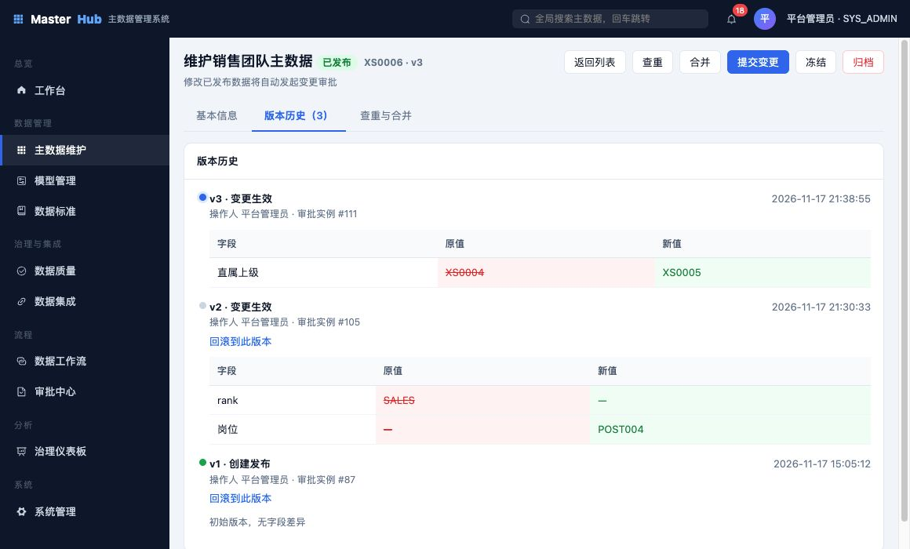

## 第 14 步：查看审批记录

进入 **审批中心**，可查看岗位与人员每条数据的审批实例：申请人、当前记录版本、以及「部门初审（周主管）→ 数据治理岗复审（林治理）」的完整流转与审批意见。审批中的主数据在详情页会显示变更对照表。

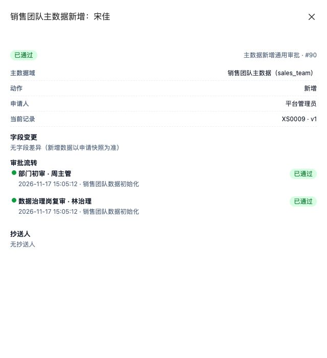

## 第 15 步：外部系统通过 API 读取岗位与销售人员数据

岗位和人员维护好之后，CRM、BI、订单系统等下游需要把它们读走。系统提供两条互补的通道：

| 方式 | 谁主动 | 适用场景 | 时效 | 鉴权方式 |
| --- | --- | --- | --- | --- |
| 开放 API 增量拉取 | 外部系统（拉） | 首次全量初始化、定时对账、批量装载 | 取决于调度频率 | 当前版本免登录（见 15.3） |
| 订阅事件推送 | 主数据系统（推） | 变更实时同步、下游缓存失效 | 发布后约 20 秒内 | 订阅方 secret 做 HMAC 签名 |

> 前置条件：只有**已发布（PUBLISHED）**的数据对外可见。草稿、审批中、已归档的记录都不会出现在接口结果里——这正是"先审批发布、下游才能消费"的原因。

### 15.1 方式一：开放 API 增量拉取

```
GET {host}/open/v1/master/{domain}?cursor={lastId}
```

| 参数 | 说明 |
| --- | --- |
| `{domain}` | 数据域编码：岗位 `sales_post`，销售人员 `sales_team` |
| `cursor` | 上一页返回的 `nextCursor`；首页传 `0` 或省略 |

响应遵循系统统一包装 `{code, msg, data, traceId}`，`code = 0` 表示成功，分页内容在 `data` 里。

岗位数据（`sales_post`，节选两条）：

```bash
curl "http://localhost:3000/open/v1/master/sales_post?cursor=0"
```

```json
{
  "code": 0,
  "msg": "ok",
  "data": {
    "domain": "sales_post",
    "list": [
      {
        "id": 108, "masterCode": "POST001", "name": "销售总监", "version": 1,
        "updatedAt": "2026-11-17T21:06:38",
        "data": {
          "postName": "销售总监", "postSeq": "DIRECTOR", "headcount": 1,
          "postDuty": "制定全国销售战略，统筹各大区业绩目标，直接管理大区经理"
        }
      },
      {
        "id": 109, "masterCode": "POST002", "name": "大区经理", "version": 1,
        "updatedAt": "2026-11-17T21:06:38",
        "data": {
          "postName": "大区经理", "postSeq": "REGION_MANAGER", "headcount": 2,
          "postDuty": "统筹大区销售运营与目标拆解，管理二线经理，向销售总监汇报"
        }
      }
    ],
    "nextCursor": "111"
  },
  "traceId": "c7fc37f8-1cf"
}
```

人员数据（`sales_team`，节选两条）：

```json
{
  "code": 0,
  "msg": "ok",
  "data": {
    "domain": "sales_team",
    "list": [
      {
        "id": 94, "masterCode": "XS0001", "name": "张万峰", "version": 2,
        "updatedAt": "2026-11-17T21:30:33",
        "data": {
          "memberName": "张万峰", "region": "EAST", "parentMember": null,
          "post": "POST001", "entryDate": "2020-03-16", "active": true
        }
      },
      {
        "id": 96, "masterCode": "XS0003", "name": "王丽华", "version": 3,
        "updatedAt": "2026-11-17T22:19:37",
        "data": {
          "memberName": "王丽华", "region": "SOUTH", "parentMember": "XS0001",
          "post": "POST002", "entryDate": "2021-08-16", "active": true
        }
      }
    ],
    "nextCursor": "102"
  },
  "traceId": "9a31c0f4-2ab"
}
```

拉取规则：

- 每页最多 **50 条**，按记录 id 升序返回，只含 `status = 'PUBLISHED'` 且未删除的记录。
- 首页 `cursor=0`，之后把响应里的 `nextCursor` 作为下一页的 `cursor`，循环直到结束。
- **终止条件**：当 `list` 为空时，`nextCursor` 会原样回传传入的 cursor（不再前进）。实测再拉一次 `cursor=102` 得到 `"list": [], "nextCursor": "102"`，据此结束循环。
- `cursor` 是记录 id 而非时间戳，可重复拉取，结果幂等。

外部系统怎么拼出职级与汇报线：人员记录里存的是**编码**，需要自己 join——`data.post`（如 `POST002`）去岗位结果里找 `masterCode` 相同的记录，其 `postSeq` 就是职级序列；`data.parentMember`（如 `XS0001`）指向另一条人员记录，逐级上溯即可还原四级汇报树。`region`、`postSeq` 也是码表编码，中文名请在下游维护码表映射（如 `EAST → 华东`），不要在代码里硬编码中文。

### 15.2 方式二：订阅事件推送

数据一旦发布、变更、冻结、解冻、归档，系统会把事件写入 Outbox 事件表，后台每约 20 秒扫描一次，按订阅关系把事件 POST 给订阅方。在 **数据集成 → 订阅方** 页签可以看到当前订阅关系：

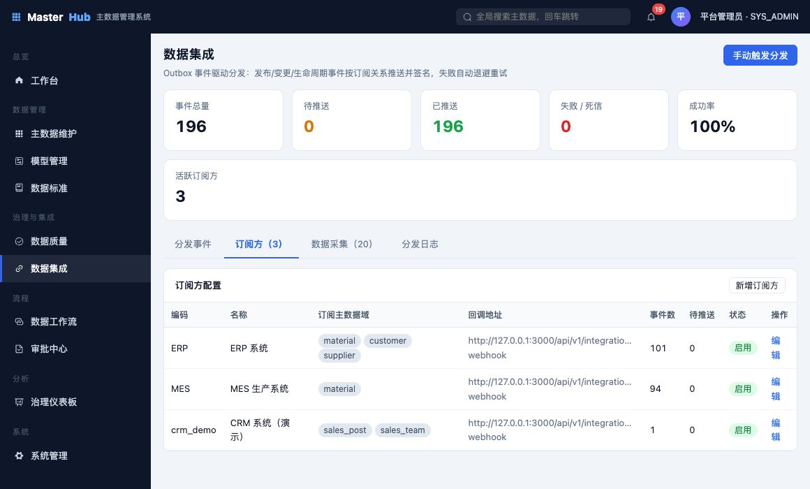

订阅方包含编码、名称、订阅的数据域（可多选）、回调地址、签名密钥和启停状态。界面上点「新增订阅方」即可，也可调用接口（需登录态与 `integration.manage` 权限）：

```bash
curl -X POST http://localhost:3000/api/v1/integration/subscribers \
  -H "Authorization: Bearer <token>" \
  -H "Content-Type: application/json" \
  -d '{
    "code": "crm_demo",
    "name": "CRM 系统（演示）",
    "domainCodes": ["sales_post", "sales_team"],
    "url": "https://crm.example.com/hooks/masterhub",
    "secret": "crm-secret-2026",
    "status": "ACTIVE"
  }'
```

推送请求约定：

- 方法 `POST`，`Content-Type: application/json`，请求体即事件 payload，超时 5 秒。
- 请求头 `X-MH-Event` 为事件号，`X-MH-Signature` 为 `HMAC-SHA256(secret, 原始请求体)` 的小写十六进制串。
- body 是**发布后的完整字段快照**，不是差量；下游按 `masterCode` 做 upsert 即可。

真实推送样例（王丽华入职日期变更后，版本 3）：

```json
{
  "eventNo": "EVT202611172219375223",
  "eventType": "UPDATE",
  "domain": "sales_team",
  "masterCode": "XS0003",
  "occurredAt": "2026-11-17T22:19:37",
  "data": {
    "memberName": "王丽华", "region": "SOUTH", "parentMember": "XS0001",
    "post": "POST002", "entryDate": "2021-08-16", "active": true,
    "status": "PUBLISHED", "version": 3
  }
}
```

对应的签名实算值为 `ab704a83404a4cfb18f5046e0dc3529a9c794af297a4fb00fc9395f6f40d04c8`（secret 为 `crm-secret-2026`）。下游验签示例：

```js
import { createHmac, timingSafeEqual } from 'node:crypto';

export function verify(req, rawBody, secret) {
  const expected = createHmac('sha256', secret).update(rawBody).digest('hex');
  const actual = String(req.headers['x-mh-signature'] || '');
  if (expected.length !== actual.length) return false;
  return timingSafeEqual(Buffer.from(expected), Buffer.from(actual));
}
```

在 **分发事件** 页签可按事件号或主数据编码检索，点「详情」可看到事件 payload、订阅方、推送次数与日志。本次推送耗时 14ms，状态为「已推送」：

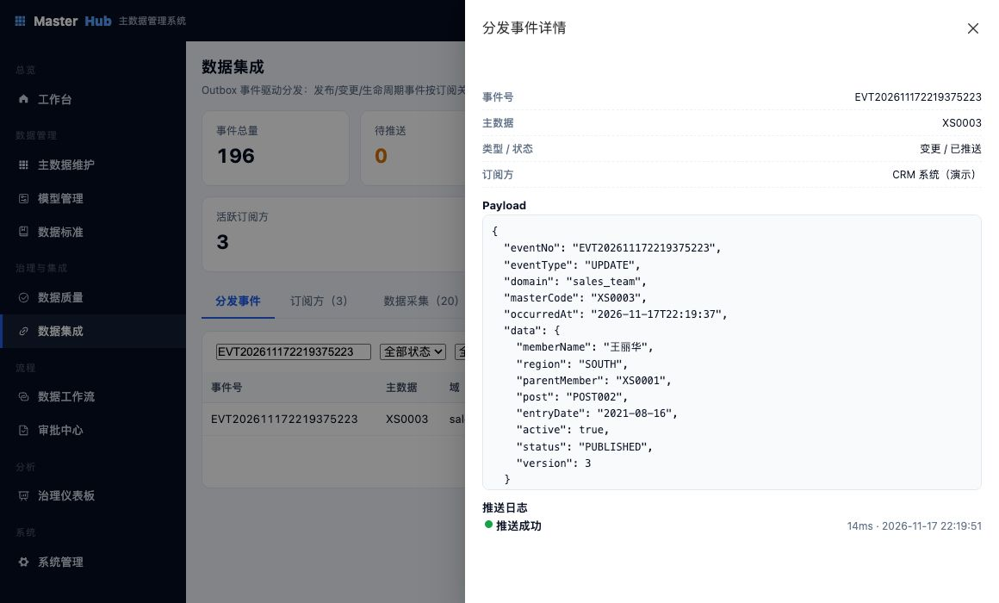

失败处理：下游不可达或验签失败时，事件标记为「失败」并按退避策略重试；重试耗尽进入「死信」，可在列表页手动「重试」。因此回调地址要保证幂等——同一事件可能被投递多次，请用 `eventNo` 或 `masterCode + version` 去重。

### 15.3 对接注意事项

1. **只有已发布数据可见**：审批中的岗位、人员不会出现在拉取结果与推送事件里；下游看到的永远是与系统当前发布版本一致的数据。
2. **归档必须靠推送感知**：员工离职、岗位撤销后，拉取接口不再返回该记录（是"消失"而不是"标记失效"）。只做拉取、不做订阅的下游会残留已删除数据，建议以 `ARCHIVE` 事件标记失效，或定期做全量对账兜底。
3. **编码永久不复用**：`XS0007`、`POST001` 这类编码归档后不会再分配给新记录，下游可以放心把编码当作长期主键。
4. **字段值都是编码**：`post` 存 `POST002`、`parentMember` 存 `XS0001`、`region` 存 `SOUTH`，请 join 主数据或码表得到中文名，不要在代码里硬编码中文。
5. **增量游标是 id 不是时间戳**：如需按时间窗口增量，请用每条记录的 `updatedAt` 自行筛选；`version` 可用于丢弃乱序到达的旧版本事件。
6. **当前为 M1 最小实现**：`/open/v1` 免鉴权、未限流，适合内网对接与本地验证。上生产前请在网关层加 IP 白名单或升级到带 API Key/OAuth 与限流的版本，订阅方 `secret` 也要换成足够长的随机串，并妥善保管。

## 日常维护速查

| 场景 | 操作 |
| --- | --- |
| 新设岗位 | 销售岗位主数据 → 新增 → 保存并提交 → 审批通过自动发布 |
| 撤销岗位 | 岗位记录「归档」（建议先为其在岗人员改挂其他岗位） |
| 新员工入职 | 主数据维护 → 新增 → 填岗位编码与直属上级编码 → 保存并提交 → 审批通过自动发布 |
| 汇报线调整 | 记录「维护」→ 修改直属上级 → 提交变更 → 审批通过后生效（版本 +1，版本历史可回滚），详见 [第 13 步](#第-13-步调整汇报线修改直属上级) |
| 转岗 | 记录「维护」→ 修改岗位编码 → 提交变更 → 审批通过后生效 |
| 临时封存（停职审查等） | 列表勾选记录 → 批量冻结（不可编辑）→ 解冻恢复 |
| 员工离职 | 记录「归档」（建议先将其下属改挂到其他上级） |
| 花名册导出 | 列表页 **导出 Excel/导出 CSV**（按当前筛选条件） |
| 列太多看不过来 | **列显隐** 可勾选隐藏暂不关心的字段，配置按域记忆 |
| 外部系统读取岗位/人员 | 全量初始化用 `GET /open/v1/master/{domain}` 分页拉取；实时变更在「数据集成 → 订阅方」配置回调地址走签名推送，详见 [第 15 步](#第-15-步外部系统通过-api-读取岗位与销售人员数据) |

列显隐面板（可隐藏暂不关注的字段）：

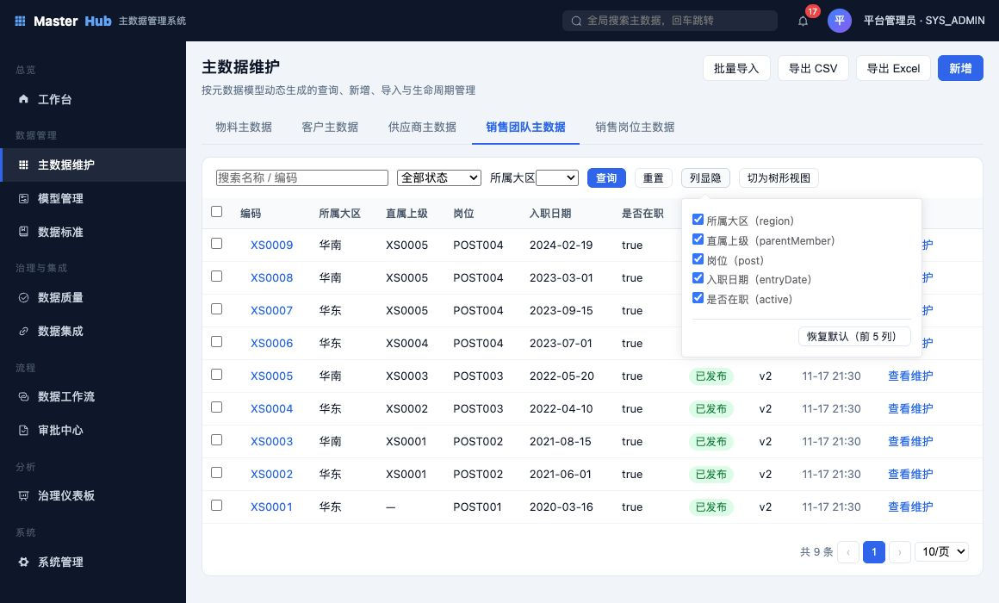

---

## 常见问题（FAQ）

**Q1：为什么必须先维护岗位、再录入人员？**
人员表单的「岗位」是必填引用字段，填的是岗位编码（如 POST001），而编码在岗位审批发布时才生成。岗位未发布前，任何人都无法引用它的编码——这与直属上级必须自顶向下录入是同一个道理。

**Q2：「岗位」字段到底填什么？**
填岗位的**主数据编码**（如 `POST001`），不是岗位名称。编码在岗位审批发布后自动生成，可在销售岗位主数据列表「编码」列复制。

**Q3：「直属上级」到底填什么？**
填上级成员的**主数据编码**（如 `XS0001`），不是姓名。编码在上级审批发布后自动生成，可在主数据列表「编码」列复制。

**Q4：保存时报错「层级校验失败：上级「XS0099」不存在」或「岗位」引用的 sales_post 数据不存在？**
直属上级/岗位填的编码不存在或尚未发布。先确认被引用对象已走完审批并发布、编码抄写无误，再保存。

**Q5：保存时报错「上级不能是自身或自己的下级（会形成循环）」？**
这是系统的环检测：如果把张万峰的上级设成他的某个下级，汇报线会成环。请改填正确的上级编码。

**Q6：岗位和职级是什么关系？**
岗位是**实体**（`sales_post` 域，携带岗位序列、编制人数、岗位职责），职级序列是岗位的**分类维度**（码表 `sales_rank`，树形）。人员不再直接存职级，而是引用岗位、经岗位间接获得职级——查一个人的职级，看他所挂岗位的「岗位序列」。

**Q7：为什么不把岗位做成人员模型里的一个枚举字段？**
一个岗位对应多名销售人员，合并会让岗位属性冗余到每条人员记录；岗位也无法携带编制、职责等自身属性，且撤岗（岗位生命周期）与离职（人员生命周期）无法分开表达。岗位有独立属性、独立生命周期、被多系统引用时，就值得独立建模——这也是本教程把岗位单独立域的原因。

**Q8：提交后为什么不是直接发布，而是「审批中」？**
本域未配置专属审批流程时，系统自动匹配「主数据新增通用审批」（部门初审 → 数据治理岗复审），岗位与人员域均如此。如需调整审批人或改为一审、免审，请由审批管理员在审批中心配置新流程并绑定对应域。

**Q9：录错了岗位/大区怎么改？**
已发布数据点击「维护」修改后提交，走**变更审批**，通过后新值生效且版本 +1；录错也可在详情页「版本历史」回滚到旧版本。

**Q10：离职员工或撤销岗位的编码会被回收复用吗？**
不会。编码永久累加不复用，归档记录仍在版本历史中可查。

**Q11：非管理员能维护这些数据吗？**
可以。由系统管理员在「系统管理 → 数据权限」为相应角色授权 `sales_post` / `sales_team` 域：业务专员可录入提交，部门主管/数据治理岗负责审批，管理员负责建模和码表。岗位域归口人力资源部，可单独为其配置维护角色。

---

*本教程在演示环境中实际操作并截图生成；配套脚本：岗位造数 `TEST/UAT/scripts/seed-sales-post.mjs`、人员造数 `TEST/UAT/scripts/seed-sales-team.mjs`、存量人员岗位回填 `TEST/UAT/scripts/backfill-member-post.mjs`。*
