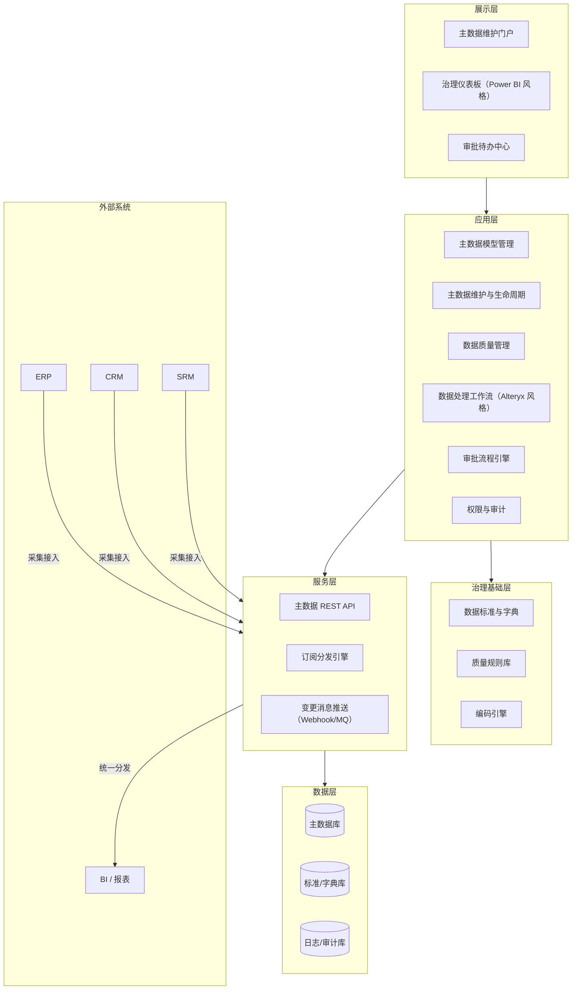
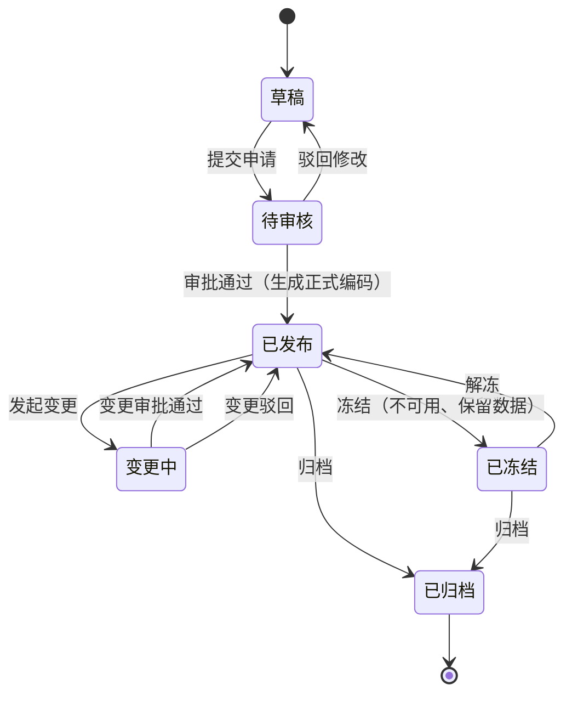

# 主数据管理系统（MasterHub）功能设计文档

| 项目 | 内容 |
| --- | --- |
| 文档版本 | V0.1（草案） |
| 编写日期 | 2026-11-16 |
| 文档状态 | **待确认** |
| 读者对象 | 业务负责人、产品、开发、测试 |

---

## 1. 项目概述

### 1.1 项目背景

随着企业内业务系统不断增多（ERP、CRM、SRM、MES、财务等），同一业务实体在各系统中重复维护、口径不一，带来以下问题：

- **编码不统一**：同一客户/物料在不同系统存在多套编码，无法关联；
- **数据冗余冲突**：名称、属性各系统维护不一致，报表统计口径混乱；
- **数据质量差**：重复、缺失、过期数据普遍，缺少统一校验与治理手段；
- **集成成本高**：系统间点对点对接，主数据一处变更、处处适配。

本项目拟建设**主数据管理系统（Master Data Management，MDM）**，作为企业级主数据的唯一权威来源（Single Source of Truth），实现"**一数一源、一处维护、多处使用**"。

### 1.2 建设目标

| 目标 | 说明 |
| --- | --- |
| 统一模型 | 按主数据域建立可配置的统一数据模型与编码规则，新域零编码上线 |
| 集中管理 | 主数据全生命周期集中管理：申请 → 审核 → 发布 → 变更 → 冻结 → 归档 |
| 保障质量 | 规则化校验 + 定期质量检查 + 量化评分，持续治理数据质量 |
| 标准分发 | 通过 API / 订阅机制向下游系统统一分发，变更自动同步 |
| 可视治理 | 治理仪表板全景呈现数据资产、质量、集成、流程效率 |

### 1.3 名词解释

| 术语 | 说明 |
| --- | --- |
| 主数据（Master Data） | 企业内跨系统、跨部门共享的核心业务实体数据（客户、供应商、物料等） |
| 主数据域 | 一类主数据的集合，如"物料主数据" |
| 数据标准 | 对主数据的命名、编码、码值、格式等作出的统一规定 |
| 数据字典 / 码表 | 枚举类标准值的集合（如国家、币种、计量单位） |
| 数据质量规则 | 对数据进行完整性、唯一性、合法性、一致性校验的规则 |
| CDC | Change Data Capture，变更数据捕获 |
| 金数据 | 多条疑似重复记录合并时最终保留的权威记录 |

### 1.4 设计原则

1. **配置优于编码**：新主数据域通过模型配置即可上线，无需开发介入；
2. **标准先行**：先定义标准（模型 / 字典 / 规则），再落主数据；
3. **流程管控**：主数据的新增、变更、冻结均须审批，全程留痕可追溯；
4. **开放集成**：标准 REST API + 消息订阅，与上下游松耦合；
5. **体验对标成熟产品**：数据处理工作流对标 **Alteryx**，分析仪表板对标 **Power BI**。

---

## 2. 总体设计

### 2.1 功能架构

### 2.2 首批主数据域（建议）

| 主数据域 | 典型字段（示例） | 是否层级结构 | 优先级 |
| --- | --- | --- | --- |
| 物料主数据 | 物料编码、名称、规格、型号、类别、计量单位 | 是（物料分类树） | P0 |
| 客户主数据 | 客户编码、名称、统一社会信用代码、行业、区域 | 否 | P0 |
| 供应商主数据 | 供应商编码、名称、法人、银行账号、资质 | 否 | P0 |
| 组织机构主数据 | 组织编码、名称、上级组织、负责人 | 是 | P1 |
| 员工主数据 | 工号、姓名、所属组织、岗位、状态 | 否 | P1 |
| 会计科目主数据 | 科目编码、名称、科目类别、余额方向 | 是 | P2 |

> 主数据域本身是可配置的，以上为首批建议范围，实际以业务确认为准。

---

## 3. 功能模块设计

### 3.1 主数据模型管理

**功能定位**：主数据域的元模型配置中心，新增主数据域无需编码。

#### 功能清单

| 功能点 | 说明 | 优先级 |
| --- | --- | --- |
| 模型设计器 | 可视化定义主数据实体、字段、字段分组 | P0 |
| 字段类型 | 文本、数值、日期、布尔、枚举（关联码表）、引用（关联其他主数据域）、附件 | P0 |
| 字段约束 | 必填、唯一、长度、默认值、正则校验、值域范围 | P0 |
| 引用关系 | 字段引用其他主数据域（如物料引用计量单位码表），保证参照完整性 | P0 |
| 层级模型 | 支持树形主数据（物料分类、组织机构），配置层级字段 | P1 |
| 编码规则 | 前缀 + 日期 + 流水号的组合规则，流水号位数与重置策略可配 | P0 |
| 模型版本管理 | 草稿 → 发布；版本对比；发布后的变更需评估存量数据兼容性 | P1 |
| 表单与列表配置 | 列表显示列、表单字段分组/Tab 页、字段联动显隐 | P1 |

#### 关键设计说明

- **编码规则示例**：`WL` + `yyyyMMdd` + 4 位流水号 → `WL20261116-0001`；
- **模型变更控制**：已发布模型允许新增字段；修改/删除字段须走变更审批，并提示存量数据处理方案；
- 每个主数据域的列表查询条件、导入模板均由模型自动生成。

---

### 3.2 主数据维护

**功能定位**：主数据的日常增删改查、导入导出、生命周期管理与查重合并。

#### 生命周期状态机

#### 功能清单

| 功能点 | 说明 | 优先级 |
| --- | --- | --- |
| 查询列表 | 关键字搜索、高级筛选（组合条件）、排序、分页、列显隐与冻结 | P0 |
| 新增 / 编辑 | 表单维护、字段联动、必填与格式即时校验 | P0 |
| Excel 导入 | 模板自动生成与下载、导入前预览、逐行校验、错误行导出重导 | P0 |
| 导出 | 按当前筛选条件导出 Excel | P0 |
| 批量操作 | 批量冻结 / 解冻 / 归档 | P1 |
| 变更历史 | 字段级修改记录，版本 diff 对比视图，支持回滚到历史版本 | P0 |
| 重复检测 | 新增/导入时按匹配规则查重（精确匹配 + 模糊匹配），命中则提示疑似重复 | P0 |
| 数据合并 | 疑似重复记录人工比对后合并：选定金数据、字段级取舍、被合并记录的引用关系自动迁移 | P1 |

#### 关键设计说明

- **查重规则可配置**：按域配置匹配字段与相似度阈值（如客户名称 + 信用代码精确匹配；名称模糊匹配 ≥ 85% 提示）；
- **合并操作不可逆**，合并前自动备份被合并记录，操作记入审计日志。

---

### 3.3 数据标准与字典管理

**功能定位**：维护企业级数据标准，为模型、质量、集成提供统一码值依据。

| 功能点 | 说明 | 优先级 |
| --- | --- | --- |
| 码表管理 | 国标/行业标准码表（国家、币种、计量单位、行业分类）的维护与版本管理 | P0 |
| 自定义码表 | 企业自定义码值集，支持树形码表 | P0 |
| 码值映射 | 源系统码值 ↔ 标准码值的映射配置（集成清洗时自动转换） | P1 |
| 命名规范检查 | 字段命名、编码命名的规范检查规则 | P2 |

---

### 3.4 数据质量管理

**功能定位**：对主数据持续开展规则化检查，量化质量水平并驱动整改闭环。

#### 质量维度

| 维度 | 规则示例 |
| --- | --- |
| 完整性 | 必填字段空值检查（如物料必须有计量单位） |
| 唯一性 | 编码重复、业务键重复检查 |
| 合法性 | 格式（信用代码 18 位）、值域（币种必须在码表内）、参照完整性（引用的码值存在） |
| 一致性 | 跨字段逻辑（有效期止 > 有效期起；状态为"已冻结"时冻结时间必填） |
| 及时性 | 数据超期未更新检查（如供应商资质证照已过期） |

#### 功能清单

| 功能点 | 说明 | 优先级 |
| --- | --- | --- |
| 质量规则库 | 按域配置五类维度规则，规则可视化配置 | P0 |
| 质量检查任务 | 手动执行 + 定时调度 | P0 |
| 质量评分 | 按域/规则加权计算质量分（0-100） | P1 |
| 质量报告 | 问题清单（可下钻到具体记录）、质量趋势、问题分布 | P1 |
| 问题整改闭环 | 问题生成整改任务，指派责任人，跟踪闭环 | P2 |

---

### 3.5 数据集成（采集与分发）

**功能定位**：承接源系统数据接入，并向下游消费系统统一分发主数据。

#### 采集（入方向）

| 功能点 | 说明 | 优先级 |
| --- | --- | --- |
| 源系统注册 | 登记源系统、连接信息、密钥管理 | P0 |
| 采集通道 | 数据库直连、REST API 拉取、文件（Excel/CSV）导入 | P1 |
| 字段映射 | 源字段 → 主数据字段映射 + 清洗规则（去空格、大小写、码值转换） | P0 |
| 增量识别 | 基于时间戳 / CDC 的增量采集 | P1 |

#### 分发（出方向）

| 功能点 | 说明 | 优先级 |
| --- | --- | --- |
| 订阅管理 | 下游系统订阅主数据域与字段范围 | P0 |
| REST API | 主数据查询/详情/全量拉取标准接口 | P0 |
| 变更推送 | 主数据发布/变更后通过 Webhook / MQ 推送变更事件 | P1 |
| 分发日志与对账 | 分发成功/失败记录、失败自动重试、周期对账 | P0 |

---

### 3.6 数据处理工作流（对标 Alteryx）

**功能定位**：面向存量数据清洗、批量处理的可视化数据流编排工具，**界面布局与节点行为完全对标 Alteryx Designer**。

#### 界面布局（照搬 Alteryx）

- **左侧节点工具箱**：按类别分组（输入 / 准备 / 转换 / 关联 / 输出 / 浏览）；
  - 工具箱**图标放大**，**功能说明文字位于图标下方**（与 Alteryx 一致）；
- **中间画布**：拖拽放置节点，节点间拖拽连线形成数据流；支持框选、对齐、放大缩小；
- **配置窗口**：选中节点后在画布上方/侧边展示该节点的参数配置；
- **数据流预览（核心）**：每个节点执行后可点击查看输出数据样本与元数据（字段名、类型、行数），与 Alteryx 的 Browse 体验一致；
- **顶部工具栏**：运行、停止、缩放、撤销/重做、校验。

#### 首批节点清单（对齐 Alteryx 常用节点）

| 分类 | 节点 | 对应 Alteryx 行为 |
| --- | --- | --- |
| 输入 | 数据库输入、Excel/CSV 输入、主数据输入（按域读取）、文本输入 | Input Data |
| 准备 | 过滤 Filter、字段选择 Select、公式 Formula、去重 Unique、排序 Sort、采样 Sample、多字段合并 | Preparation |
| 转换 | 汇总 Summarize（分组聚合）、交叉表 Crosstab、转置 Transpose、记录生成 | Transform |
| 关联 | Join（内/左/右/全连接）、并集 Union、模糊匹配 Fuzzy Match、追加行 | Join |
| 清洗 | 码值映射、标准化（去空格/大小写/替换）、空值填充 | Preparation 扩展 |
| 输出 | 写入主数据（走审批/直接发布可选）、数据库输出、Excel 输出 | Output Data |
| 浏览 | Browse 浏览器（查看任一节点数据） | Browse |

#### 运行与调度

| 功能点 | 说明 | 优先级 |
| --- | --- | --- |
| 手动运行 | 整体运行 / 逐节点运行 / 运行到指定节点 | P1 |
| 运行日志 | 每节点执行耗时、处理行数、错误明细 | P1 |
| 定时调度 | 工作流绑定定时任务（如每日凌晨清洗） | P1 |
| 版本管理 | 工作流保存、另存、版本历史 | P2 |

---

### 3.7 审批流程

**功能定位**：主数据全生命周期的流程管控引擎。

| 功能点 | 说明 | 优先级 |
| --- | --- | --- |
| 流程设计器 | 可视化拖拽配置审批流（节点、条件、表单） | P1 |
| 审批节点类型 | 人工审批、条件分支、会签（全部通过）、或签（任一通过）、抄送 | P0 |
| 流程绑定 | 新增 / 变更 / 冻结 / 归档 / 模型变更可绑定不同流程，未配置则默认直接生效 | P0 |
| 待办中心 | 我的申请（进度跟踪）、我的待办（审批处理）、我的已办 | P0 |
| 审批操作 | 通过、驳回（至发起人或上一节点）、转办、加签、审批意见 | P0 |
| 消息通知 | 待办站内信提醒；邮件通知（可选） | P1 |
| 流程监控 | 超时预警、流程效率统计 | P2 |

---

### 3.8 治理仪表板（对标 Power BI）

**功能定位**：主数据治理的可视化分析平台，**视图菜单、面板布局与交互完全照搬 Power BI**。

#### 界面与交互（照搬 Power BI）

- **视图切换**：阅读视图（查看、交叉筛选）/ 编辑视图（设计报表）；
- **右侧三面板**：可视化（图表类型 + 格式 + 分析）、筛选器（视觉对象/页面/报表三级）、字段列表（数据模型字段）；
- **画布与页面**：多页面标签、页面尺寸设置；
- **交互能力**：切片器（Slicer）、交叉突出显示与交叉筛选、层级钻取（下钻/上钻）、工具提示（自定义 Tooltip）、书签；
- **可视化组件**：卡片 / KPI / 瀑布 / 柱状 / 条形 / 折线 / 面积 / 饼 / 环形 / 散点 / 表格 / 矩阵 / 树状图 / 仪表盘。

#### 预置仪表板

| 仪表板 | 核心内容 | 优先级 |
| --- | --- | --- |
| 主数据资产总览 | 各域数据量、月度新增趋势、生命周期状态分布、活跃度 | P1 |
| 数据质量评分卡 | 质量分趋势、规则通过率、问题按域/规则分布、问题明细下钻 | P1 |
| 集成监控 | 分发成功率、推送延迟、接口调用趋势、失败明细 | P1 |
| 流程效率 | 平均审批时长、各环节耗时、待办积压、驳回率 | P2 |

#### 自定义报表

| 功能点 | 说明 | 优先级 |
| --- | --- | --- |
| 报表设计器 | 编辑视图下拖拽字段生成自定义图表，绑定主数据/日志数据 | P2 |
| 报表管理 | 保存、另存、分享、订阅（定时导出） | P2 |

---

### 3.9 权限与安全

| 功能点 | 说明 | 优先级 |
| --- | --- | --- |
| 用户管理 | 用户、组织、岗位维护 | P0 |
| 角色与功能权限 | 角色 → 菜单 / 按钮级授权 | P0 |
| 数据权限 | 按主数据域授权；行级（按组织/条件）；字段级（隐藏/脱敏，如银行账号） | P1 |
| 认证方式 | 账号密码；预留 SSO / LDAP 对接 | P2 |
| 审计日志 | 登录、增删改、审批、导入导出、接口调用全量留痕，可查询可导出 | P0 |

---

### 3.10 系统管理

| 功能点 | 说明 | 优先级 |
| --- | --- | --- |
| 参数配置 | 系统全局参数（分页大小、密码策略、会话超时等） | P0 |
| 任务调度中心 | 质量检查、采集、分发、工作流的统一定时调度与管理 | P1 |
| 日志管理 | 操作日志、登录日志、接口日志查询 | P0 |
| 消息模板 | 通知消息模板配置 | P2 |

---

## 4. 典型业务场景（端到端）

### 场景一：新增主数据（以物料为例）

### 场景二：存量数据清洗入库

1. 从源系统导出存量数据（Excel / 数据库输入）；
2. 在数据处理工作流中编排：读取 → 码值映射 → 标准化 → 去重 → 质量规则校验；
3. 问题数据导出线下整改，合格数据经审批批量发布；
4. 疑似重复走人工比对合并流程。

### 场景三：主数据变更分发

1. 已发布主数据发起变更，走变更审批；
2. 审批通过后系统生成新版本，记录字段级变更历史；
3. 订阅分发引擎向下游推送变更事件（Webhook/MQ）；
4. 下游拉取或接收推送失败时自动重试，支持人工触发对账补发。

---

## 5. 非功能性需求

| 类别 | 要求 |
| --- | --- |
| 性能 | 单域主数据支持千万级记录；列表查询 ≤ 2s；Excel 导入 10 万行 ≤ 5 分钟 |
| 可用性 | 核心功能可用性 ≥ 99.5%；操作有二次确认与防误删设计 |
| 兼容性 | Chrome / Edge 最新两个大版本；界面分辨率适配 1366×768 及以上 |
| 安全 | HTTPS、密码复杂度策略、防 SQL 注入 / XSS / CSRF、敏感字段脱敏 |
| 可扩展 | 模型/规则/流程均元数据驱动配置化，新增主数据域无需改代码 |

---

## 6. 分期实施建议

| 阶段 | 范围 | 目标 |
| --- | --- | --- |
| 一期（基础平台） | 模型管理、主数据维护（含导入导出/变更历史/查重）、审批流程、码表管理、基础 API 与分发日志、权限与审计、系统管理 | 平台可用，首批主数据域上线 |
| 二期（治理增强） | 数据质量、数据处理工作流（Alteryx 风格）、治理仪表板（Power BI 风格）、订阅推送（Webhook/MQ）、数据合并、任务调度 | 治理能力完整，存量数据可清洗 |
| 三期（深化扩展） | CDC 增量采集、自定义报表设计器、SSO/LDAP、多语言主数据、问题整改闭环 | 集成与体验深化 |

---

## 7. 待确认事项

| # | 事项 | 待确认内容 |
| --- | --- | --- |
| 1 | 主数据域范围 | 首批是否为物料 / 客户 / 供应商，组织与员工是否纳入一期？ |
| 2 | 数据量级 | 各域预估数据量、日增数量、并发用户数？ |
| 3 | 对接系统 | 上游源系统与下游消费系统清单，及各自支持的集成方式（API / 数据库 / MQ / 文件）？ |
| 4 | 部署环境 | 内网私有化部署还是云端？操作系统与中间件限制？ |
| 5 | 多语言 | 主数据是否需要中英文等多语言维护？ |
| 6 | 技术栈 | 前后端技术栈是否有既有标准或偏好？ |
| 7 | 分期边界 | 第 6 章分期建议是否符合预期？ |

---

> 请审阅以上设计内容。确认或调整后，将基于本文档开展原型设计与详细技术方案。
