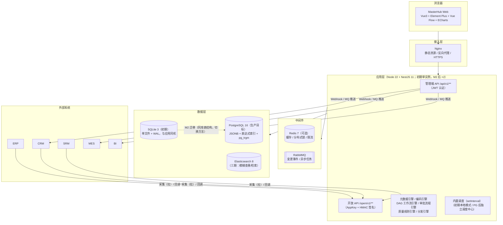
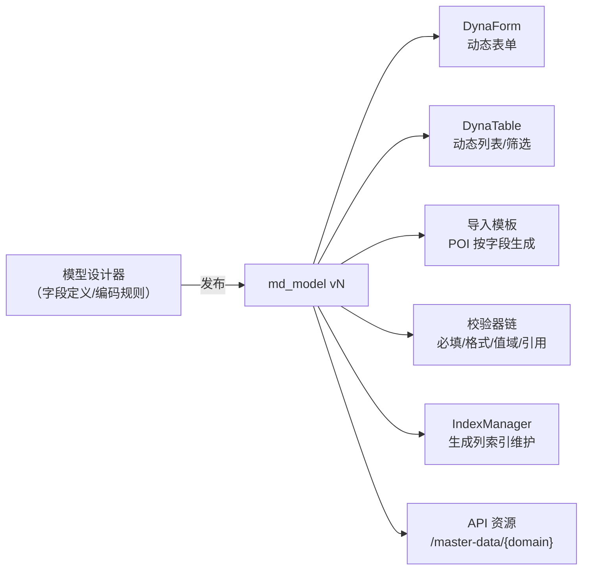
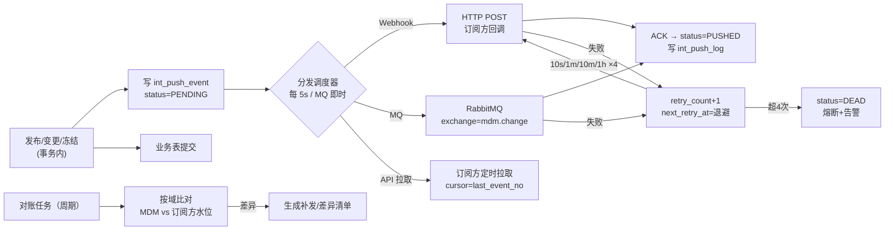
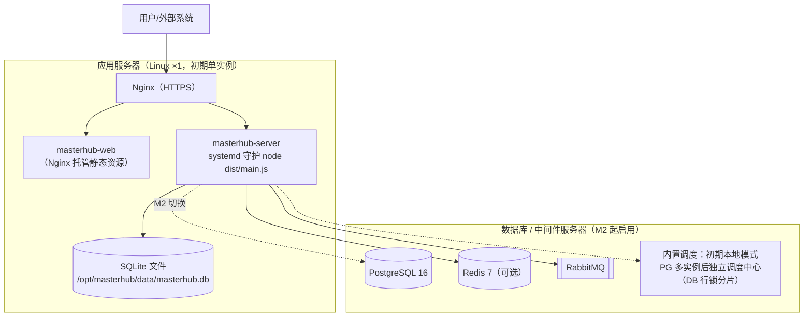

# 主数据管理系统（MasterHub）技术方案

| 项目 | 内容 |
| --- | --- |
| 文档版本 | V1.1（数据库：SQLite 初期 → PostgreSQL 生产） |
| 编写日期 | 2026-11-17 |
| 文档状态 | **待评审** |
| 依据文档 | 《主数据管理系统功能设计》V0.1 · 《MasterHub 交互原型》V0.1 |
| 读者对象 | 架构师、开发、测试、运维 |

---

## 1. 文档说明

本方案将功能设计中的 10 大模块落为可开发、可测试、可部署的工程设计，重点解决四个核心技术问题：

1. **元数据驱动**：新主数据域零编码上线（模型 → 表单/列表/导入模板/API 自动生成）；
2. **动态数据存储**：可变字段模型的存储、索引与查询性能；
3. **双引擎**：数据处理工作流（DAG）引擎 + 审批流程引擎的独立设计与协同；
4. **可靠分发**：变更事件不丢失（Outbox 模式）、失败重试与对账。

各章节与功能设计文档章节一一对应（如"对应功能设计 3.6"）。

---

## 2. 总体架构

### 2.1 技术架构



### 2.2 技术选型

| 层 | 选型 | 版本 | 选型理由 |
| --- | --- | --- | --- |
| 前端框架 | Vue 3 + TypeScript + Vite | 3.4 / 5.x / 5.x | 组合式 API 适合复杂画布与仪表板状态管理 |
| UI 组件库 | Element Plus | 2.x | 表单/表格/抽屉组件齐全，企业后台风格与原型一致 |
| 状态管理 | Pinia | 2.x | 仪表板筛选/钻取状态、工作流画布状态 |
| 工作流画布 | Vue Flow | 1.x | 节点式编辑器：自定义节点、Bezier 连线、小地图、对齐，对标 Alteryx 画布 |
| 图表 | ECharts | 5.x | 柱/线/环/矩阵全图表类型，原生支持联动、tooltip、下钻事件 |
| 大数据表格 | VxeTable | 4.x | 虚拟滚动支撑 10 万行预览与大数据列表 |
| 后端框架 | Node.js + NestJS | 22 / 11 | 本机无 JDK/Maven 环境，Node 原生可用；NestJS 模块化、依赖注入与守卫体系可等价承载原设计 |
| 数据访问 | better-sqlite3（自研轻量 DAO） | 11.x | SQLite 单文件 + WAL + 单写连接；`DbService` 统一提供 `raw/all/one/run/tx`，M2 仅替换方言层 |
| 安全 | NestJS Guard + JWT + bcryptjs | 11 / 9 / 2.5 | 全局 `APP_GUARD` 校验 `@Public/@Perm`，JWT 载荷携带角色、权限、数据域与字段脱敏策略 |
| 任务调度 | NestJS `setInterval`（初期） | — | 质量检查/分发重试/对账定时任务；M2 可升级独立调度中心，不引入额外中间件 |
| 数据库（初期） | SQLite | 3.4x | 零安装、单文件、随应用部署；JSON1 扩展 + 生成列（3.31+）满足动态字段需求；单写并发，适合开发与试运行 |
| 数据库（生产目标） | PostgreSQL | 16 | JSONB（可建索引）+ 表达式索引 + pg_trgm 模糊检索；并发与容量上限高，M2 完成替换 |
| 缓存 | Redis | 7.x | 模型/字典缓存、分布式锁；**初期单实例可省略**，编码流水走库内序列表（见 4.2），迁移 PostgreSQL 集群后再接入 |
| 消息队列 | RabbitMQ | 3.13 | 变更事件推送、导入/工作流异步任务 |
| 搜索（三期） | Elasticsearch | 8.x | 模糊查重（ngram 相似度）与全文检索 |
| 网关 | Nginx | 1.24 | HTTPS 终止、静态托管、负载均衡 |
| 监控（可选） | Prometheus + Grafana | — | JVM/接口/队列指标 |

> **数据库演进与可替换性**：初期 SQLite、生产 PostgreSQL，差异只落在数据访问层，业务代码不感知：
> - **方言隔离**：`DbService` 封装 SQL 执行与事务；JSON 取值统一由 `IndexManager/Dialect` 生成片段（SQLite `json_extract(data,'$.x')` / PG `data->>'x'`），业务 Service 中禁止写死方言函数；
> - **DDL 版本**：初期以 `server/src/db/schema.ts` 单一 DDL 初始化（含全部表/索引），M2 提供 PostgreSQL 方言脚本，表名/字段名/索引名完全一致，仅类型与索引语法不同；
> - **规避方言专有特性**：分页统一 `LIMIT/OFFSET`；时间统一 UTC ISO-8601 字符串入库（PG 侧映射 `timestamptz`）；不使用自增以外的序列语法；
> - **迁移方式**：`pgloader` 或自研导出导入（分批 + 序列重置 + 行数/指纹校验和比对），M2 双跑对账通过后切换。
>
> 当前实现采用 **Node 22 + NestJS 11**（本机无 JDK/Maven），表结构、接口契约、引擎设计均与语言无关；下文涉及框架处已标注 NestJS 等价实现。

### 2.3 工程结构

**后端（NestJS 单工程，按领域模块拆分）：**

```
masterhub/server/
├── src/
│   ├── main.ts                 # 启动：ValidationPipe、统一响应拦截、异常过滤、CORS
│   ├── app.module.ts           # 模块装配
│   ├── core.module.ts          # 数据库/审计/ProcessHooks/全局守卫
│   ├── db/
│   │   ├── schema.ts           # 全量 DDL（含生成列与复合索引）
│   │   ├── db.service.ts       # better-sqlite3 封装：raw/all/one/run/tx
│   │   └── seed.ts             # 角色/用户/主数据域/码表/模型/审批/订阅 初始数据
│   ├── common/                 # Result/异常/装饰器/守卫/审计/工具/钩子注册表
│   └── modules/
│       ├── auth/               # 登录、当前用户
│       ├── metadata/           # 域/模型/字段/字典/编码引擎/IndexManager
│       ├── master/             # 主数据 CRUD、生命周期、导入预校验、查重、合并、版本
│       ├── import/             # CSV 模板/校验/提交
│       ├── approval/           # 审批流程引擎（JSON 定义、会签/或签、AUTO 回调）
│       ├── integration/        # 订阅方、Outbox 分发、日志、开放 API
│       ├── system/             # 用户/角色权限矩阵/审计
│       └── stats/              # 工作台与治理概览
└── package.json                # build=tsc，start=node dist/main.js
```

**前端：**

```
masterhub/web/src/
├── views/              # 与侧边栏一一对应：Login/Workbench/DataList/DataDetail/
│                       # ModelList/DictList/ApprovalCenter/Integration/System/Placeholder
├── api/                # axios 实例 + 全部接口封装（统一 code/msg/data/traceId 解包）
├── stores/             # Pinia：auth（token/用户/权限/数据域）
├── router.ts           # 路由 + 登录态与权限守卫
├── App.vue             # 顶栏 + 分组侧边导航 + 待办角标
└── styles.css           # 复刻原型设计变量与通用组件样式
```

---

## 3. 数据存储设计

### 3.1 动态字段存储策略（核心决策）

| 方案 | 说明 | 优点 | 缺点 | 结论 |
| --- | --- | --- | --- | --- |
| A. 纯 EAV | 属性表（记录-字段-值）行存储 | 灵活 | 列表查询需行转列，千万级性能崩溃 | 否决 |
| B. 每域动态建表 | 新域时 DDL 建独立表 | 查询性能最优 | DDL 变更风险高、跨域统一治理复杂、备份迁移困难 | 否决 |
| **C. 宽表 + JSON** | 单表公共列 + `data` 动态属性列 + 生成列索引 | 一张表统一治理；高频字段可索引；查询性能可控 | JSON 写入有解析开销（可接受） | **采用**（SQLite 用 TEXT + JSON1，PostgreSQL 用 JSONB） |

### 3.2 核心库表设计

**主数据表（核心 DDL，以初期 SQLite 版本为准）：**

```sql
-- SQLite 3.4x：索引名为库级全局唯一，统一以「表名_列名」命名
CREATE TABLE md_master_data (
  id            INTEGER PRIMARY KEY AUTOINCREMENT,
  domain_code   TEXT    NOT NULL,          -- 主数据域编码
  master_code   TEXT    NULL,              -- 主数据编码，发布后由编码引擎生成
  name          TEXT    NOT NULL,          -- 名称冗余列（模型 name 字段，查重/检索用）
  status        TEXT    NOT NULL,          -- DRAFT/PENDING/CHANGING/PUBLISHED/FROZEN/ARCHIVED
  version       INTEGER NOT NULL DEFAULT 1,
  data          TEXT    NOT NULL,          -- 动态业务属性（JSON 文本，JSON1 函数解析）
  fingerprint   TEXT    NULL,              -- data 规范化 JSON 的 SHA-256，变更对比加速
  created_by    INTEGER, created_at TEXT,
  updated_by    INTEGER, updated_at TEXT,
  deleted       INTEGER NOT NULL DEFAULT 0
);
CREATE UNIQUE INDEX uk_md_master_data_dom_code   ON md_master_data(domain_code, master_code);
CREATE INDEX        idx_md_master_data_dom_status ON md_master_data(domain_code, status);
CREATE INDEX        idx_md_master_data_dom_upd    ON md_master_data(domain_code, updated_at);
```

**同一表在 PostgreSQL 侧的差异（M2 另一套方言 DDL，表/字段/索引名不变）：**

| 项目 | SQLite（初期） | PostgreSQL（生产） |
| --- | --- | --- |
| 主键自增 | `INTEGER PRIMARY KEY AUTOINCREMENT` | `BIGINT GENERATED BY DEFAULT AS IDENTITY` |
| JSON 列 | `TEXT` + JSON1（`json_extract`） | `JSONB`（`data->>'x'`，可加 GIN 索引） |
| 布尔/删除标记 | `INTEGER` 0/1 | `BOOLEAN` |
| 时间 | `TEXT`（UTC ISO-8601） | `TIMESTAMPTZ` |
| 模糊检索 | FTS5（trigram）或 `LIKE` | `pg_trgm` + GIN 索引 |
| 索引命名 | 库级全局唯一（前缀表名） | 库级全局唯一（前缀表名） |

**动态字段索引（生成列机制）**：模型中字段勾选「作为查询条件」时，`IndexManager` 按方言生成对应 DDL。

```sql
-- SQLite：ALTER TABLE 仅支持新增 VIRTUAL 生成列（不支持 STORED）；VIRTUAL 列可建索引
ALTER TABLE md_master_data ADD COLUMN g_unit TEXT
  GENERATED ALWAYS AS (json_extract(data,'$.unit')) VIRTUAL;
CREATE INDEX idx_md_master_data_dom_g_unit ON md_master_data(domain_code, g_unit);

-- PostgreSQL：生成列只能 STORED，语法如下
-- ALTER TABLE md_master_data ADD COLUMN g_unit TEXT
--   GENERATED ALWAYS AS (data->>'unit') STORED;
-- CREATE INDEX idx_md_master_data_dom_g_unit ON md_master_data(domain_code, g_unit);
```

- 生成列为 **VIRTUAL / STORED** 差异由方言屏蔽，不占业务逻辑差异；
- 模型发布时由 `IndexManager` 统一维护（建/删生成列均记录模型变更日志），SQLite 侧新增生成列后需执行 `CREATE INDEX`，PG 侧可平滑 `CREATE INDEX CONCURRENTLY`（避免锁表）。

**其余核心表（清单）：**

| 分组 | 表 | 说明 |
| --- | --- | --- |
| 元数据 | md_domain / md_model / md_field | 域、模型版本、字段定义（类型/必填/唯一/引用/码表/查询开关） |
| 元数据 | md_code_rule | 编码规则段（有序 JSON：`[{type:'FIX',value:'WL'},{type:'DATE',fmt:'yyyyMMdd'},{type:'SEQ',len:4,reset:'DAY'}]`） |
| 元数据 | md_sequence | 编码流水号（`rule_hash + period` 唯一键，初期作为唯一发号源，见 4.2） |
| 元数据 | md_dict / md_dict_item | 码表与码值（支持树形 parent_id） |
| 主数据 | md_data_version | 变更历史：`data JSON` 全量快照 + `diff JSON` 字段级差异 + 操作单号 |
| 主数据 | md_dup_rule / md_merge_log | 查重规则（精确字段+模糊字段+阈值）、合并记录（金数据、被合并数据、字段取舍、引用迁移结果） |
| 质量 | dq_rule / dq_task / dq_task_run / dq_issue | 规则（维度/表达式/级别）、任务、执行结果（评分快照）、问题清单（状态闭环） |
| 集成 | int_source / int_mapping / int_subscriber / int_push_event / int_push_log / int_reconcile | 源系统、字段映射、订阅关系、**Outbox 事件表**、推送日志、对账结果 |
| 工作流 | wf_definition / wf_run / wf_node_run | DAG 定义（JSON）、运行实例、节点运行（状态/行数/耗时/**preview 采样 JSON**） |
| 审批 | ap_process_def / ap_instance / ap_task | 流程定义（JSON）、实例、审批任务（含意见、转办、会签状态） |
| 权限 | sys_user / sys_role / sys_user_role / sys_menu_perm / sys_data_perm | 菜单按钮权限（矩阵原型对应）、数据权限（域/行级条件/字段级脱敏） |
| 系统 | sys_config / sys_audit_log | 参数、审计全量表 |

**关键 DDL——Outbox 事件表（分发不丢的核心）：**

```sql
CREATE TABLE int_push_event (
  id            INTEGER PRIMARY KEY AUTOINCREMENT,
  event_no      TEXT NOT NULL,              -- 事件号（幂等键）
  domain_code   TEXT NOT NULL,
  master_code   TEXT NOT NULL,
  event_type    TEXT NOT NULL,              -- CREATE/UPDATE/FREEZE/UNFREEZE/ARCHIVE
  payload       TEXT NOT NULL,              -- 推送报文（订阅方字段裁剪前的全量 JSON）
  status        TEXT NOT NULL DEFAULT 'PENDING',  -- PENDING/PUSHED/FAILED/DEAD
  retry_count   INTEGER NOT NULL DEFAULT 0,
  next_retry_at TEXT,
  created_at    TEXT NOT NULL
);
CREATE UNIQUE INDEX uk_int_push_event_event_no ON int_push_event(event_no);
CREATE INDEX        idx_int_push_event_status_retry ON int_push_event(status, next_retry_at);
```

> PostgreSQL 侧仅类型不同（`INTEGER`→`BIGINT IDENTITY`、`TEXT`→`TEXT/JSONB`、时间 `TEXT`→`TIMESTAMPTZ`），字段与索引名完全一致。

### 3.3 缓存设计

| 缓存 | Key | 失效策略 |
| --- | --- | --- |
| 模型/字段定义 | `meta:model:{domain}:v{ver}` | 模型发布时版本号递增（旧 key 自然淘汰） |
| 码表 | `meta:dict:{dictCode}` | 码值变更时删除 + MQ 广播集群各节点 |
| 编码流水 | `meta:seq:{ruleHash}:{period}` | **初期不依赖 Redis**：由 `md_sequence` 表原子发号；迁移 PG 且多实例后切 Redis INCR，按重置周期滚动（AOF 持久化） |
| 用户权限 | `auth:perm:{userId}` | 权限变更时删除 |

> 初期单实例部署时，以上缓存可用进程内缓存（Map/LRU）承载（Key 结构不变）；跨实例共享时通过 `CacheService` 抽象切换为 Redis，业务代码无改动。

---

## 4. 核心机制设计

### 4.1 元数据驱动引擎（对应功能设计 3.1）



- **字段类型 → 组件/校验器映射表**：TEXT→Input+length/regex；ENUM→Select(码表)；REF→数据选择器（引用域接口）；DATE/NUMBER/BOOL/FILE 同理。新增字段类型只需注册映射（SPI）。
- **模型变更兼容性检查**：发布时对比前后版本——新增字段（放行）、改类型/删字段（必须选择存量处理策略：置空/默认值/阻断），检查结果随审批单一并提交（功能设计 3.1 关键设计）。

### 4.2 编码引擎

- **规则段模型**：`FIX | DATE(fmt) | JOIN(sep) | SEQ(len, reset)` 有序组合，存 md_code_rule；
- **流水号生成（`Sequencer` 接口，两套实现，切换只改配置）**：
  - **初期（SQLite 单实例）`DbSequencer`**：同一事务内执行 `UPDATE md_sequence SET cur = cur + 1 WHERE rule_hash = ? AND period = ?`；SQLite 3.35+ 用 `RETURNING cur` 直接取值，否则回读；行不存在则 `INSERT (…, cur=1)`，唯一键冲突时重试。SQLite 单写者 + 事务保证不重号、不跳号；
  - **迁移后（PG 多实例）`RedisSequencer`**：`INCR meta:seq:{ruleHash}:{period}`；首次发放用 `SET NX` 从 `md_sequence` 读取当前值初始化（防 Redis 故障回退重复），`md_sequence` 仍作为兜底与审计；
  - `period` 由重置策略计算（DAY → `20261117`，MONTH → `202611`，FOREVER → `ALL`）；
  - 号段不足（超过 len 位数）直接抛业务异常并告警。
- 生成时机：审批终审通过 → 事务内生成 master_code → 状态置 PUBLISHED（与功能设计"审批通过自动编码发布"一致）。

### 4.3 生命周期状态机（对应功能设计 3.2）

| 当前状态 | 事件 | 目标状态 | 触发方 |
| --- | --- | --- | --- |
| DRAFT | 提交申请 | PENDING | 申请人（前置：查重） |
| PENDING | 审批通过（新增） | PUBLISHED | 流程引擎回调（编码引擎介入） |
| PENDING | 驳回 | DRAFT | 流程引擎回调 |
| PUBLISHED | 发起变更 | CHANGING | 申请人 |
| CHANGING | 变更通过 | PUBLISHED（version+1） | 流程引擎回调 → 写 md_data_version → 写 Outbox |
| PUBLISHED / CHANGING | 冻结/解冻 | FROZEN / PUBLISHED | 治理岗（可配审批） |
| PUBLISHED / FROZEN | 归档 | ARCHIVED | 治理岗 |

实现：引入通用状态机框架过重，采用 **枚举 + 事件驱动**（`MasterService.fire(record, event)`），非法迁移抛 `BizException`；所有迁移写审计。

### 4.4 变更历史与数据指纹

- 更新时计算新 data 的规范化 JSON（key 排序）SHA-256 与 fingerprint 比对，**未变化直接短路**（减少版本膨胀）；
- 变更落 `md_data_version`：全量快照 + 逐字段 diff（`{field:{old,new}}`），支撑前端红绿对比组件（原型 dw-his 抽屉）；
- 回滚 = 以历史版本 data 发起新的变更申请（不做物理回退，保持审计链完整）。

### 4.5 查重与合并

- **精确查重**：唯一字段组合查询（模型配置的业务唯一键，建议建生成列唯一索引）；
- **模糊查重**：名称相似召回——初期 SQLite 用 FTS5 虚表（`tokenize=trigram`，3.34+）或域内 `name LIKE '%kw%'`；迁移后 PG 用 `pg_trgm` + GIN（`name % :kw`、`similarity(name, :kw)`）。召回后由应用层对候选集计算相似度（编辑距离 + Jaccard，加权分）→ ≥ 阈值返回（原型 md-dup 弹窗）；日增量大时降级为异步预计算相似对（三期 ES 方案）；
- **合并事务**：`MergeService` 单事务完成——① 金数据字段写入（字段级取舍表）② 被合并记录置 ARCHIVED + merge 标记 ③ `int_*` 引用记录批量改指向金数据（引用迁移清单表驱动）④ 写 md_merge_log + 审计。合并不可逆，事务前置备份。

---

## 5. 审批流程引擎（对应功能设计 3.7）

**选型决策：自研轻量引擎**。理由：MDM 审批链路短（≤5 级）、需与生命周期状态机/编码引擎深度回调，引入 Flowable 成本高于收益；流程设计器交互按原型（拖拽节点）自研 JSON 定义。

**流程定义（ap_process_def.definition JSON）：**

```json
{
  "code": "MATERIAL_ADD",
  "bind": {"domain": "material", "action": "CREATE"},
  "nodes": [
    {"id": "start", "type": "START"},
    {"id": "n1", "type": "APPROVAL", "name": "部门初审",
     "assigneeType": "DEPT_LEADER", "multi": "OR", "timeoutHours": 24},
    {"id": "n2", "type": "APPROVAL", "name": "数据治理岗复审",
     "assigneeType": "ROLE", "role": "DATA_STEWARD", "multi": "AND"},
    {"id": "n3", "type": "AUTO", "handler": "publishWithCode"},
    {"id": "end", "type": "END"}
  ],
  "flows": [
    {"from": "start", "to": "n1"},
    {"from": "n1", "to": "n2", "when": "approved"},
    {"from": "n1", "to": "start", "when": "rejected"},
    {"from": "n2", "to": "n3", "when": "approved"},
    {"from": "n2", "to": "start", "when": "rejected"}
  ]
}
```

- **节点类型**：START / APPROVAL（会签 AND、或签 OR）/ AUTO（`ProcessHooks` 处理器注册表，如 `publishWithCode`）/ CONDITION / END；
- **回调协议**：AUTO 节点与流程终态事件（通过/驳回/撤回）通过 `ProcessHooks` 调用主数据状态机，保证流程与数据状态最终一致；
- **超时**：内置调度扫描 `ap_task` 超时任务 → 站内信 + 升级（转上级/标红，原型 overtime 展示）；
- 每个域 × 动作（新增/变更/冻结/归档/模型变更/导入批次）可绑定不同流程；未配置则直接生效（功能设计 3.7）。

---

## 6. 数据工作流引擎（对应功能设计 3.6，对标 Alteryx）

### 6.1 DAG 定义（wf_definition.definition JSON）

```json
{
  "name": "WF-003 物料存量数据清洗",
  "nodes": [
    {"id": "n1", "type": "MD_INPUT", "cfg": {"domain": "material", "scope": "ALL"}},
    {"id": "n2", "type": "CODE_MAP", "cfg": {"dict": "unit", "field": "unit"}},
    {"id": "n3", "type": "FILTER", "cfg": {"expr": "[status] in ('PUBLISHED','CHANGING')"}},
    {"id": "n4", "type": "DEDUP", "cfg": {"keys": ["name", "spec"], "threshold": 0.9, "policy": "KEEP_EARLIEST"}},
    {"id": "n6", "type": "BROWSE"},
    {"id": "n5", "type": "MD_OUTPUT", "cfg": {"domain": "material", "mode": "WITH_APPROVAL", "conflict": "UPDATE_BY_CODE"}}
  ],
  "edges": [
    {"from": "n1", "to": "n2"}, {"from": "n2", "to": "n3"},
    {"from": "n3", "to": "n4"}, {"from": "n4", "to": "n5"}, {"from": "n4", "to": "n6"}
  ]
}
```

### 6.2 节点算子体系（策略模式 + SPI）

```ts
export interface NodeOperator {
  type(): string;                                  // FILTER / FORMULA / JOIN ...
  execute(input: DataFrame, cfg: NodeConfig, ctx: RunContext): NodeResult;
}
```

| 分组 | 算子 | 首批实现要点 |
| --- | --- | --- |
| 输入 | DB_INPUT / FILE_INPUT / MD_INPUT / TEXT_INPUT | 流式分批读取（batch=1000） |
| 准备 | FILTER / SELECT / FORMULA / DEDUP / SORT / SAMPLE / MULTI_FIELD | FORMULA 内置白名单表达式函数集 |
| 转换 | SUMMARIZE / CROSSTAB / TRANSPOSE / GENERATE_ROWS | 分组聚合内存 + 超限落临时表 |
| 关联 | JOIN / UNION / FUZZY_MATCH / APPEND | JOIN 支持 内/左/右/全 |
| 清洗 | CODE_MAP / STANDARDIZE / FILLNA | CODE_MAP 走字典缓存 |
| 输出 | MD_OUTPUT / DB_OUTPUT / FILE_OUTPUT | MD_OUTPUT 与审批引擎/状态机对接 |
| 浏览 | BROWSE | 仅注册采样，不落盘全量 |

新算子 = 新增 `NodeOperator` 实现（NestJS Provider 注册），前端工具箱由算子元数据接口（分组/图标/名称/配置 Schema）**自动生成**，保证工具箱与后端能力永远一致。

### 6.3 执行器

- **执行模型**：拓扑排序逐节点执行；`DataFrame` 为轻量列式游标（分批拉取，避免全量进内存）；
- **节点级预览（对标 Alteryx Browse）**：每节点执行后采样前 100 行 + 元数据（字段/类型/行数）写入 `wf_node_run.preview`；失败节点记录错误行样本；
- **断点续跑**：wf_node_run 记录各节点完成状态，重跑从未完成节点开始（上游结果已持久化于临时结果集）；
- **调度**：手动运行 / 定时（内置调度）/ 事件触发（如导入完成后自动清洗）；
- **MD_OUTPUT 写入**：`WITH_APPROVAL` 模式生成批量审批单（一行一明细，汇总单），审批通过后批量走编码发布；`DIRECT` 模式仅限治理岗权限并强制审计。

### 6.4 前端画布（对标 Alteryx 布局，原型已验证）

- 左侧工具箱：算子元数据驱动渲染，**图标放大 + 文字在下**；
- 画布：Vue Flow（拖入节点、端口连线、框选、对齐、缩放、小地图）；
- 配置窗口：选中节点右侧渲染配置 Schema → 动态表单（与 DynaForm 复用）；
- 结果窗口：底部 Dock，数据/元数据/消息三页签，数据走 VxeTable 虚拟滚动，请求节点 preview 分页接口。

---

## 7. 数据质量引擎（对应功能设计 3.4）

- **规则模型**：维度（完整/唯一/合法/一致/及时）→ 内置算子（NOT_NULL / UNIQUE / REGEX / IN_DICT / REF_EXISTS / FIELD_LOGIC / EXPIRY…）+ 参数化配置；复杂规则支持 SQL 片段（白名单校验，仅治理岗可写）；
- **执行**：规则按域编排为检查任务（内置调度/手动/实时触发），逐规则分批扫描（只扫增量或全量按配置），命中写入 dq_issue（关联记录 ID，支持下钻，原型 dw-issue）；
- **评分公式**：`域评分 = Σ(维度得分 × 维度权重)`，`维度得分 = (1 - 问题记录数 / 域总量) × 100`，权重默认 0.25×4+…可配；执行快照入 dq_task_run 支撑趋势图；
- **闭环**：dq_issue 状态机 待整改 → 整改中 → 已闭环；生成整改任务（指派/截止），闭环需复检通过。

---

## 8. 数据集成设计（对应功能设计 3.5）

### 8.1 采集（入）

- **通道**：DB_INPUT（数据库驱动直连 + 时间戳增量）、API 拉取（调度执行）、文件导入（复用导入向导）、MQ 监听（源系统主动推）；
- **映射与清洗**：int_mapping 定义 源字段→模型字段 + 清洗规则链（trim/大小写/码值转换/正则替换），采集数据一律先进**暂存表**（staging，按批次），预览校验通过后走与人工导入完全相同的发布链路（查重→审批→编码）。

### 8.2 分发（出）—— Outbox 模式



- **不丢失保证**：事件与业务数据同事务写入（Outbox），调度器至少一次投递 + 订阅方按 `event_no` 幂等去重；
- **字段裁剪**：订阅方配置字段范围（如 SRM 不含银行账号），payload 推送前裁剪 + 脱敏规则二次应用；
- **对账**：按订阅方维护 `last_event_no` 水位，周期任务拉取订阅方水位比对，差异生成补发任务（原型「对账」按钮）。

### 8.3 开放 API 网关（供下游与源系统）

- 认证：AppKey + HMAC-SHA256 签名（timestamp + nonce 防重放）；
- 限流：令牌桶（初期进程内按 AppKey，默认 100 QPS，可配；M2 后切 Redis 令牌桶以支持多实例）；
- 幂等：写接口要求 `Idempotency-Key` 头（初期用幂等键表去重，M2 后切 Redis 24h 去重）。

---

## 9. 治理仪表板（对应功能设计 3.8，对标 Power BI）

### 9.1 语义层

| 对象 | 存储 | 说明 |
| --- | --- | --- |
| 数据集 ds_dataset | SQL 模板 + 参数定义 | 预置：资产总览 / 质量评分 / 集成监控 / 流程效率 |
| 指标 ds_metric | 字段 + 聚合（SUM/COUNT/AVG/RATIO）+ 筛选维度 | 如"主数据总量 = COUNT(md_master_data)"，可下钻维度链（域→分类） |
| 报表 ds_report | 页面 × 视觉对象（类型/字段绑定/格式）JSON | 预置 4 张（原型三页 + 流程效率），自定义报表设计器写同结构 |

- 查询执行：报表请求 → 数据集模板 + 当前筛选（域/年度/状态）渲染 SQL → 生成列索引命中 → 返回聚合结果（**不暴露明细大表**）；结果按筛选指纹缓存 5 分钟。

### 9.2 前端交互实现（照搬 Power BI 行为）

- **交叉筛选**：Pinia `filterBus` 保存 {domain, year, status…}；任一图表点击 → 更新 bus → 订阅 bus 的卡片/环形图/表格自动重新请求（原型已验证此交互模型）；
- **下钻**：指标定义层级链（域→物料分类），双击触发钻取，面包屑栈管理返回；
- **视图菜单**：阅读视图隐藏右侧三面板与视觉对象标头（编辑态 token 校验，普通用户仅阅读）；
- 视觉对象组件：`<BizVisual :schema>` 封装 ECharts，统一 tooltip/联动事件。

---

## 10. 权限与安全（对应功能设计 3.9）

### 10.1 权限模型

```
用户 → 角色 → ①功能权限（菜单/按钮，sys_menu_perm，原型权限矩阵）
              ②数据权限（sys_data_perm）：
                 - 域级：可访问的 domain 列表
                 - 行级：条件表达式（如 dept = :userDept），SQL 解析层自动注入
                 - 字段级：hidden / masked（如银行账号 → **** 6222），序列化层处理
```

- 行级权限在 Service 层统一拼接数据域条件（`assertDomain` + 域级过滤）；字段级在 `presentRecord` 序列化阶段按权限改写（对缓存同样生效）；
- 越权访问默认拒绝（白名单式装饰器 `@Perm` + 全局 `APP_GUARD`）。

### 10.2 安全清单

| 项 | 措施 |
| --- | --- |
| 认证 | JWT（2h）+ Refresh Token；密码 BCrypt；预留 OIDC/LDAP（三期 SSO） |
| 传输 | 全站 HTTPS（Nginx 终止） |
| 注入 | 参数化 SQL（better-sqlite3 绑定参数）；动态 JSON 路径白名单（仅模型已发布字段可查询）；表达式白名单函数集 |
| XSS | 前端输出转义；富文本字段白名单过滤 |
| CSRF | 纯 JWT Header 认证（无 Cookie 会话）天然免疫 |
| 越权 | 接口层 `@Perm` 守卫 + 数据层域级校验双重校验 |
| 审计 | `AuditService` 显式调用 → 写 sys_audit_log（登录/增删改/审批/导出/接口调用） |
| 敏感数据 | 字段级脱敏；导出二次审批（可配） |

---

## 11. 接口设计规范

### 11.1 REST 规范

- 路径：管理端 `/api/v1/{module}/{resource}`；开放端 `/open/v1/{resource}`；
- 版本：URL 主版本 + Header `X-Minor-Version`；
- 分页：`?page=1&size=20` → `{list, total, page, size}`；
- 统一响应：`{code:0, msg:"ok", data:{...}, traceId}`；错误码分段（1xxx 参数 / 2xxx 认证 / 3xxx 业务 / 5xxx 系统）；
- 幂等：写接口支持 `Idempotency-Key`（初期幂等键表去重，M2 后 Redis 24h 去重）。

### 11.2 核心接口清单（节选）

| 模块 | Method & Path | 说明 |
| --- | --- | --- |
| 模型 | GET/POST/PUT `/api/v1/models`、POST `/api/v1/models/{id}/publish` | 模型 CRUD 与发布（含兼容性检查结果） |
| 字典 | GET/POST `/api/v1/dicts/{code}/items` | 码值维护 |
| 主数据 | GET `/api/v1/master-data/{domain}?filters&page…` | 动态列表（筛选走生成列） |
| 主数据 | POST `/api/v1/master-data/{domain}` | 新增申请（自动查重，返回疑似重复列表） |
| 主数据 | GET `/api/v1/master-data/{domain}/{code}/versions` | 变更历史（含 diff） |
| 主数据 | POST `/api/v1/master-data/{domain}/merge` | 合并 |
| 导入 | POST `/api/v1/imports/{domain}/template` / `/batch` / `/{batchId}/result` | 模板/上传校验/结果 |
| 审批 | GET `/api/v1/approvals/todo`、POST `/api/v1/approvals/{id}/pass|reject|transfer` | 待办与处理 |
| 质量 | POST `/api/v1/quality/tasks/{id}/run`、GET `/api/v1/quality/issues?drill` | 检查与问题下钻 |
| 集成 | POST `/api/v1/subscriptions`、POST `/api/v1/push-events/{id}/retry`、POST `/api/v1/reconcile` | 订阅/重试/对账 |
| 工作流 | POST `/api/v1/workflows`、POST `/api/v1/workflows/{id}/run`、GET `/api/v1/workflow-runs/{runId}/nodes/{nodeId}/preview` | 定义/运行/**节点数据预览** |
| 仪表板 | GET `/api/v1/datasets/{code}/query`、GET/PUT `/api/v1/reports/{id}` | 数据集查询/报表定义 |
| 开放 | GET `/open/v1/master/{domain}?cursor=`、POST `/open/v1/master/{domain}`（源系统回推） | 拉取（增量游标）/回推 |
| 开放 | POST `/open/v1/subscribe/callback`（Webhook 注册） | 订阅回调 |

### 11.3 示例：变更推送报文（Webhook POST）

```json
{
  "eventNo": "EVT202611170930120001",
  "eventType": "UPDATE",
  "domain": "material",
  "masterCode": "WL20260102-0001",
  "occurredAt": "2026-11-17T09:30:12+08:00",
  "data": {
    "materialName": "六角螺栓",
    "spec": "M8×30 · GB/T 5783",
    "unit": "EA",
    "status": "PUBLISHED",
    "version": 3
  },
  "signature": "hmac-sha256(...)"
}
```

---

## 12. 性能设计

| 场景 | 目标（功能设计 §5） | 技术措施 |
| --- | --- | --- |
| 列表查询 | 生产千万级单域，≤2s；SQLite 期单域 ≤100 万 | 公共列/生成列覆盖 95% 筛选；深分页改 cursor（`id > lastId`）；排序字段均建复合索引；SQLite 期数据量超阈值即按计划迁移 PG |
| JSON 查询 | — | 禁止全表 `json_extract` 过滤，只走生成列；模型保存时校验"查询条件字段必须开索引" |
| Excel 导入 | 10 万行 ≤5min | 流式 CSV 解析 + 1000 行/批校验 + 校验流水表断点续传 + 发布走异步任务；SQLite 下 1000 行/事务批量提交（WAL 模式） |
| 变更分发 | P99 ≤3s | Outbox 批量扫描 + Webhook 连接池 + 超时 10s 快速失败 |
| 仪表板 | 打开 ≤2s | 聚合查询 + 筛选指纹缓存 5min；数据集 SQL 均为索引覆盖的聚合（无明细扫描） |
| 编码生成 | 无瓶颈 | 初期 `md_sequence` 单行原子更新（单写串行，数百 TPS 足够）；迁移 PG 后 Redis INCR（10 万+ QPS） |
| 容量 | — | md_master_data 按年归档 ARCHIVED 至历史表；工作流临时结果集 TTL 自动清理；SQLite 单库建议 ≤100GB |
| 连接 | — | SQLite：better-sqlite3 同步单写连接 + `busy_timeout=5000`；PG：`pg` 连接池；慢 SQL 阈值 1s 记录并告警 |

**SQLite 期调优基线（应用启动时执行）：**

```sql
PRAGMA journal_mode = WAL;          -- 读写并发（单写多读）
PRAGMA synchronous = NORMAL;        -- WAL 下兼顾安全与吞吐
PRAGMA busy_timeout = 5000;         -- 写锁等待 5s，避免瞬时 SQLITE_BUSY
PRAGMA foreign_keys = ON;
PRAGMA temp_store = MEMORY;
```

- 写入集中：导入/采集/批量发布统一走批量事务 + 单写通道（`WriteQueue`），避免长事务与写放大；
- 期间应用限定**单实例**部署（内置调度本地模式），横向扩展与高并发写入随 PG 迁移一并开启。

---

## 13. 部署架构（物理机 / 虚拟机直装，不使用容器）



**服务器规划（初期 1 台，M2 起扩至 2~3 台）：**

| 阶段 | 服务器 | 安装内容 | 规格（起步） | 说明 |
| --- | --- | --- | --- | --- |
| 初期（M0~M1） | 应用服务器 ×1 | Node 22（LTS）、masterhub-server（dist + systemd）、Nginx + 前端 dist、SQLite 数据文件 | 4C8G + SSD | **单实例部署**（SQLite 单写）；库文件置于独立数据盘，便于快照备份与迁移 |
| M2 起 | 应用服务器 ×1~2 | Node 22、masterhub-server（dist + systemd）、Nginx + 前端 dist | 4C8G | 应用无状态；横向扩展 = 新增实例挂入 Nginx upstream |
| M2 起 | 数据库/中间件服务器 ×1 | PostgreSQL 16、Redis 7（可选）、RabbitMQ | 8C16G + SSD | 中间件与应用分机部署，数据目录独立磁盘 |
| 三期（可选） | 只读库 / 检索服务器 | PG 只读副本、Elasticsearch | 4C8G | 对账/报表读分流；模糊查重检索 |

**部署方式：**

- **应用**：`/opt/masterhub/server/dist/main.js`，systemd unit 托管（`Restart=always`，开机自启、崩溃自动拉起）；外置配置 `/opt/masterhub/config/prod.env`（`PORT`、`DB_PATH`、`JWT_SECRET` 等）；
- **前端**：构建产物 `dist/` 发布至 `/opt/masterhub/web`；Nginx 托管静态资源 + `/api`、`/open` 反向代理 + HTTPS 证书；
- **数据库（初期）**：SQLite 库文件 `/opt/masterhub/data/masterhub.db`（WAL 伴生 `.db-wal/.db-shm`）随应用同机，挂载独立数据盘；应用 systemd 启动前执行 §12 的 PRAGMA 基线；**M2 起**切换至独立 PostgreSQL 16 实例（官方安装包，版本锁定）；
- **中间件（M2 起）**：Redis 7（可选）/ RabbitMQ 采用官方二进制或操作系统包管理器安装，版本锁定（与 §2.2 一致），禁止自动升级；初期不安装；
- **发布流程**：上传新 `dist/` → 启动时由 `schema.ts` 幂等执行 DDL 初始化/升级（M2 提供 PostgreSQL 方言 DDL）→ `systemctl restart masterhub`（M2 双实例时逐台轮切，免停机）→ 端口探活（TCP 3000 或 Nginx upstream 检测）通过后接入流量；
- **迁移切换（M2）**：停机窗口内 `pgloader` / 自研导出导入全量搬数 → 序列重置 → 行数 + fingerprint 校验和比对 → 切换数据源配置 → 原 SQLite 文件归档只读，保留 30 天可回滚；
- **配置与密钥**：外置 `prod.env` + 敏感项独立 `secrets.env`（文件权限 600，不入代码库）；
- **备份**：SQLite 期每日 `VACUUM INTO` 在线快照（`/backup/masterhub-YYYY-MM-DD.db`）+ 每周全库归档；PG 期每日全量 + WAL 归档；均保留 30 天，恢复演练每季度一次。

---

## 14. 里程碑计划（映射功能设计 §6 分期）

| 阶段 | 内容 | 关键交付物 | 验收标准 |
| --- | --- | --- | --- |
| M0 基础框架 | 工程脚手架、认证/权限/审计、CI、环境 | 前后端框架、登录、用户角色、审计切面 | 权限矩阵生效；审计可查 |
| M1 一期·数据平台 | 模型管理/字典/编码引擎、主数据维护（导入/版本/查重）、审批引擎、基础 API + 分发日志（**SQLite 单实例**） | 物料/客户/供应商三域上线 | **新增域零编码 ≤1 小时上线**；端到端场景一跑通；导入 10 万行 ≤5min |
| M2 二期·治理增强 | 质量引擎、DAG 工作流（画布+算子）、订阅推送（Webhook/MQ）、合并、治理仪表板 4 报表、调度中心、**SQLite → PostgreSQL 迁移** | 存量清洗场景二跑通；PG 双跑对账报告 | 工作流断点续跑；Outbox 零丢失（故障演练）；仪表板打开 ≤2s；**迁移后行数/fingerprint 校验一致、无功能回归** |
| M3 三期·深化 | CDC 采集、ES 模糊查重、自定义报表设计器、SSO/LDAP、多语言、整改闭环 | 高级治理能力 | 10 万级模糊查重秒级；自定义报表可保存分享 |

> 每阶段结束做一次回归演示（以交互原型为验收对照）。

---

## 15. 风险与对策

| # | 风险 | 影响 | 对策 |
| --- | --- | --- | --- |
| 1 | JSON 查询性能不达预期 | 列表慢 | 生成列索引硬约束 + 慢 SQL 门禁；兜底方案 B（热点域拆物理表）预留 |
| 2 | 模糊查重准确率不足 | 误报/漏报 | 阈值可调 + 人工确认环节兜底；三期 ES + 同义词库提升召回 |
| 3 | 自研流程/工作流引擎复杂度失控 | 进度延期 | 引擎范围严格限定（MDM 场景）；算子 SPI 边界清晰；M2 前完成引擎单测覆盖 80% |
| 4 | Webhook 订阅方故障拖垮分发 | 队列堆积 | 超时快速失败 + 独立重试通道 + 熔断（DEAD 隔离）+ 告警 |
| 5 | 存量数据质量差导致清洗周期长 | 上线延期 | 清洗走工作流批处理 + 问题分级（高severity优先），不阻塞新数据录入 |
| 6 | 编码规则变更引发混乱 | 编码重复/断层 | 规则版本化，仅对新数据生效（功能设计已定）；序列兜底表审计 |
| 7 | SQLite 单写并发与后续迁移风险 | 高峰期写入等待、迁移期停机/数据不一致 | 写操作走批量事务 + 单写通道 + `busy_timeout`；初期限定单实例与数据量阈值（单域百万级）；M1 末即用真实数据做一次 PG 迁移预演，M2 正式切换前双跑对账、保留 SQLite 只读回滚 |

---

## 16. 待确认事项

| # | 事项 | 影响 |
| --- | --- | --- |
| 1 | 技术栈确认（本文推荐 Vue3 + NestJS 11 + SQLite（初期）→ PostgreSQL 16（生产）） | 全部工程结构 |
| 2 | 服务器规划：直装方案下服务器数量与 OS 版本（本文按初期 1 台 / M2 起 2~3 台 Linux 规划） | 部署清单与容量细化 |
| 3 | 源系统接入清单与网络策略（能否直连数据库 / 仅 API） | 采集通道优先级 |
| 4 | 订阅方回调地址与安全要求（是否已有企业级 MQ 可复用） | 分发实现 |
| 5 | 数据基线：各域存量数据量与清洗责任人 | M1/M2 计划排期 |
| 6 | SSO 选型（三期）：OIDC 平台 or LDAP | 认证模块预留接口确认 |
| 7 | SQLite → PostgreSQL 迁移时点与停机窗口（本文按 M2 正式切换、M1 末预演规划；若希望提前切换请明确） | 里程碑排期与迁移演练安排 |

---

> 评审通过后：M0 即刻启动；M1 详细排期以本方案 §14 为基线细化至周。
